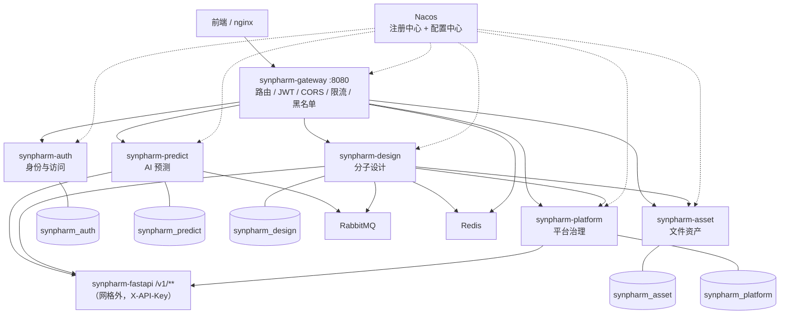
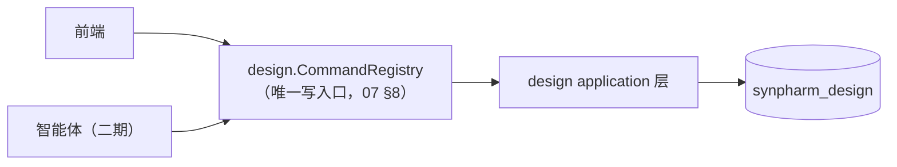

# SynPharm SpringCloud 微服务重构方案（后端服务拆分）

> 文档版本：v1.2.1
> 创建日期：2026-10-14
> 文档状态：**阶段 0 / 1 / 2A 已实施**（阶段 2A = design 域 schema 与服务骨架，尚未接网关流量），2B 及其余阶段待做
> 适用范围：`synpharm-backend` / `synpharm-fastapi` / `synpharm-frontend` / `synpharm-deploy` / `synpharm-cloud`
> 上游依据：[`../design/detailed/README.md`](../design/detailed/README.md)、`../modules/design/00-总览与架构分工.md`、[`./架构设计文档.md`](./架构设计文档.md)

---

## 目录

1. [背景与现状盘点](#1-背景与现状盘点)
2. [拆分铁律](#2-拆分铁律)
3. [服务清单](#3-服务清单)
4. [现有代码归属映射](#4-现有代码归属映射)
5. [横切能力和二期服务](#5-横切能力和二期服务)
6. [明确不做的（反模式）](#6-明确不做的反模式)
7. [数据库拆分策略](#7-数据库拆分策略)
8. [SQL 脚本重新编组](#8-sql-脚本重新编组)
9. [服务间接口边界](#9-服务间接口边界)
10. [端口与配置骨架](#10-端口与配置骨架)
11. [分阶段切换检查表](#11-分阶段切换检查表)
12. [拆分前置改造项](#12-拆分前置改造项)
13. [技术栈与版本](#13-技术栈与版本)
14. [决策记录与待决策项](#14-决策记录与待决策项)
15. [修订记录](#15-修订记录)

---

## 1. 背景与现状盘点

### 1.1 资产现状

| 资产 | 实际内容 | 规模 |
|---|---|---|
| [`synpharm-backend`](../../../synpharm-backend) | Spring Boot 3.3.5 **单体**，仅实现「平台复用」8 张表（auth + predict + batch） | 128 个类 / ~8.3k 行 |
| [`synpharm-fastapi`](../../../synpharm-fastapi) | 算法引擎（KAN-MoDTI / FlashPPI / DDI-LLM），对外 `/v1/**` | ~3k 行 |
| [`synpharm-frontend`](../../../synpharm-frontend) | Vue3 前端，含 `Design.vue` 工作台（当前走 mock 数据） | ~18k 行 |
| [`synpharm-deploy/sql`](../../../synpharm-deploy/sql) | `01_`~`10_` 平台表已建；`11_`~`38_` 设计域 33 张表**已定稿、未实现** | 38 个脚本 |
| [`docs/design/detailed`](../design/detailed) | 79 个端点契约、分层/事务/MQ/能力探测规范 | 已定稿 |

### 1.2 关键判断

1. **当前的"微服务分离"只是「SpringBoot 业务 + FastAPI 计算」的两段式**，业务侧仍是一个单体（见 [`./架构设计文档.md`](./架构设计文档.md) §1、§10）。
2. **设计域（`11_`~`25_`）后端一行代码都没有** —— 这是本次重构最大的有利条件：它是**一张白纸**，可以直接按目标形态生长，不需要"拆"。因此本文档的迁移策略是「**新域新建 + 旧域绞杀**」，而不是"把单体切开"。
3. 现有单体的三块业务（auth / predict / batch）**耦合度低、边界清晰**，属于可安全抽取的对象。

### 1.3 现状单体的问题

| 问题 | 证据 | 影响 |
|---|---|---|
| 本地文件卷不可水平扩展 | `file.upload-dir: ./uploads`、`file.result-dir: ./results` | 任一服务多副本即丢文件 |
| JWT 只验签不验人 | [问题总账 B-04](../development/SynPharm问题总账与整改方案（整合版）.md) | 无法在边缘统一拦截 |
| 归属校验 fail-open | 问题总账 B-12 | 拆开后每个服务都要独立守边界 |
| CORS 任意源 + 携带凭证 | 问题总账 B-07 | 安全面 |
| Redis 全部挤在 `database: 0` | `application.yml` | 拆分后 key 冲突 |
| 无链路追踪 | `docker-compose.yml` 无 tracing 组件 | 拆开后无法排障 |
| 手写熔断器 | [`SimpleCircuitBreaker.java`](../../../synpharm-backend/src/main/java/com/synpharm/client/SimpleCircuitBreaker.java) | 应交给框架组件 |

---

## 2. 拆分铁律

| # | 铁律 | 说明 |
|---|---|---|
| **R1** | **按限界上下文拆**，不按技术层拆、不按文档章节拆 | `docs/modules/design/01`~`07` 是**管线环节**，不是服务边界。按 01~07 拆成 7 个服务会把 `design_project` 聚合内的事务变成跨服务事务 —— 把本地事务换成分布式事务是纯粹的负收益 |
| **R2** | **数据所有权单一** | 每张表只有一个服务能写；禁止跨服务 JOIN 与外键 |
| **R3** | **计算层不并入网格** | FastAPI 保持 `/v1/**` + `X-API-Key`，只做计算、不碰数据库（见 [`设计域组件图`](../uml/设计域.md#2-设计域组件与依赖) 架构铁律） |
| **R4** | **不做分布式事务** | 优先 Saga + 事务性 Outbox + 幂等键；跨服务一致性靠事件最终一致 |

---

## 3. 服务清单

### 3.1 目标架构



> **网关占 8080**：与现有 `BACKEND_PORT=8080` 及前端 dev 回退地址一致。
> **更正（v1.1.0）**：原文说「前端与 nginx 零改动」不准确。前端**源码**确实零改动（基址仍是
> `http://localhost:8080`），但要把流量引到网关，上下游主机名必须改：
> ① `nginx.conf` 的 `proxy_pass` 上游 `backend` → `gateway`；② dev 的 `VITE_PROXY_TARGET`
> `http://backend:8080` → `http://gateway:8080`。见 §10.1。

### 3.2 服务职责与数据所有权

| # | 服务 | 限界上下文 | 拥有的表 | 对外接口前缀 | 关键依赖 |
|---|---|---|---|---|---|
| 0 | **synpharm-gateway** | 边缘网关 | — | `/api/**` 唯一入口 | Nacos、Redis（限流/Token 黑名单） |
| 1 | **synpharm-auth** | 身份与访问 | `sys_user`、`sys_login_log` | `/api/auth/**`、`/api/users/**` | Redis（验证码/锁定）、Mail |
| 2 | **synpharm-predict** | AI 预测 | `predict_task`、`predict_result`、`user_favorite`、`ddi_supported_drug`、`batch_task`、`batch_task_item` | `/api/predict/**`、`/api/results/**`、`/api/favorites/**`、`/api/tasks/**`、`/api/batch/**` | fastapi、RabbitMQ、Redis |
| 3 | **synpharm-design** | 分子设计 | `design_project`、`project_target`、`design_round`、`target`、`target_structure`、`binding_pocket`、`constraint_set`、`constraint_rule`、`generation_run`、`candidate_molecule`、`molecule_edit_log`、`metric_definition`、`evaluation_run`、`evaluation_result`、`workspace_state`、`design_library_item`、`design_job`、`design_report`、`wet_experiment` | `/api/design/**` | fastapi、RabbitMQ、Redis、asset、platform |
| 4 | **synpharm-asset** | 文件资产 | `file_asset` | `/api/files/**`（内网） | S3 / MinIO |
| 5 | **synpharm-platform** | 平台治理 | `design_tool` | `/api/system/**`、`/admin/tools/**` | fastapi `/v1/evaluate/capabilities`、Redis |

### 3.3 各服务边界要点

| 服务 | 要点 |
|---|---|
| **auth** | 最该先抽：身份被 predict / design / agent 全部引用，且自身最独立。抽走后 **JWT 校验上移到网关**，网关透传 `X-User-Id` / `X-Role`，各服务只做归属校验（fail-closed → 404） |
| **predict** | 搬迁自洽度最高：`pipeline/`（解析器 / 执行器 / 格式化器三段策略）+ `FastApiClient` + 批量 MQ 消费整体随迁 |
| **design** | 一期**一个服务**。内部必须按 [`实现分层图`](../uml/设计域.md#9-实现分层与依赖方向) 的 `api → application → domain ← infrastructure` 组织，并保留两条**接缝**：<br/>① **评估**（`evaluation_result` 规划到千万行，写入量最大）<br/>② **靶点与口袋**（外部 IO + 口袋检测独立）<br/>任一条压力上来即可整体切成服务，无需重构代码 |
| **asset** | 现有 `./uploads` 本地卷**一扩副本即失效**，抽成内容寻址（SHA256 去重 + `ref_count` + S3/MinIO）是拆分带来的直接收益 |
| **platform** | 把 `SystemController` 的算法健康检查 + `design_tool` 能力探测 + `metric_definition` 字典统一为"能力权威"服务，供 design 的命令注册表做能力过滤 |

---

## 4. 现有代码归属映射

> 一对一映射，避免拆分时漏文件。

| 服务 | 承接的现有类 | 说明 |
|---|---|---|
| **auth** | `AuthController`、`UserController`、`AuthService(+Impl)`、`UserService(+Impl)`、`CaptchaService`、`LoginStrategy` + `service/strategy/*`、`NotifyService`、`JwtUtils`、`PasswordUtils`、`IpUtils`、`SysUser` / `SysLoginLog`（含 Mapper 与 xml）、`UserRepository` | JWT **签发**留这里，**校验**上移网关 |
| **predict** | `PredictController`、`ResultController`、`FavoriteController`、`TaskController`、`BatchUploadController`、`PredictService` / `ResultService` / `FavoriteService` / `TaskService` / `BatchProcessService`（含 Impl）、`pipeline/**`（含 `impl/`、`resolve/`）、`client/FastApiClient`、`mq/**`、`PredictUtils`、`CsvUtils`、`PredictTask` / `PredictResult` / `UserFavorite` / `BatchTask` / `BatchTaskItem` / `DdiSupportedDrug`（含 Mapper 与 xml）、`ResultRepository`、`TaskRepository` | 整体搬迁 |
| **design** | 全新增（`11_`~`25_` + `30_` + `33_`~`35_` 表、79 端点） | 白纸新建 |
| **asset** | 新增 + 接管 `file.upload-dir` / `file.result-dir` | 内容寻址 |
| **platform** | `SystemController` + 新增 `ToolRegistryService`（`@Scheduled` 10min 探测 `/v1/evaluate/capabilities`） | `design_tool.available` 唯一权威 |
| **gateway** | `SecurityConfig`、`JwtAuthenticationFilter`、`CorsConfig`、`nginx.conf` 的 `/api` 反代 | |
| **common（库）** | `Result`、`GlobalExceptionHandler`、`MyBatisPlusMetaObjectHandler`、`validation/**`、`WebClientConfig`、`Knife4jConfig` | |

---

## 5. 横切能力和二期服务

### 5.1 任务与异步：先做成库，不自成服务

`design_job` 归 **design**、`batch_task` 归 **predict**（**聚合不跨服务**）。统一的任务编号、幂等键、进度（`design:progress:{id}`）、SSE 推送、重试与死信治理，先做成共享库 **`synpharm-job-core`**。

**升级为独立 `synpharm-job` 服务的触发条件**（满足其一再拆）：

1. 需要独立伸缩 SSE 与进度推送；
2. 需要跨服务统一任务视图。

### 5.2 二期再拆的服务（一期不要建）

| 服务 | 上下文 | 表 | 理由 |
|---|---|---|---|
| `synpharm-report` | 报告审批与湿实验闭环 | `design_report`、`wet_experiment` | 参与者不同（审批人 / 湿实验员）、生命周期不同（含校准回灌）。一期先放 design |
| `synpharm-agent` | 智能体编排 | `agent_session`、`agent_step`、`agent_report`、`tool_invocation_log` | LLM 长任务、独立演进。**必须经 design 的 CommandRegistry 写数据，不得直连 design 库** |
| `synpharm-notify` | 通知 | — | 仅当出现邮件/短信/站内信多通道需求时 |

### 5.3 计算层

`synpharm-fastapi` 仍在网格外，通过 Nacos 解析地址 + WebClient / Feign 调用。未来若 GPU 调度与 CPU 计算需分开，再拆 `compute-rdkit` / `compute-inference` / `compute-docking`。

---

## 6. 明确不做的（反模式）

| # | 反模式 | 后果 |
|---|---|---|
| 1 | 按 `01`~`07` 拆成 7 个服务 | 破坏事务边界 → 分布式事务 |
| 2 | 按 `controller` / `service` / `dao` 拆 | 技术分层不是服务边界 |
| 3 | 把 `sys_user` 复制到多个 schema | 身份只属于 auth |
| 4 | 把 FastAPI 纳入 Spring Cloud 业务网格 | 违反 R3 |
| 5 | 引入 Seata 做分布式事务 | 违反 R4，优先 Saga + Outbox + 幂等 |
| 6 | 一期就建 `report` / `agent` / `notify` | 表都还没有数据 |

---

## 7. 数据库拆分策略

**已决策（决策 A）**：**单 MySQL 实例 + 每服务独立 schema + 独立账号 + 禁止跨服务外键 / JOIN**。

理由：成本可控、边界严格，后续可无痛换成独立实例。

### 7.1 schema 划分

| schema | 归属服务 | 表 | 账号权限 |
|---|---|---|---|
| `synpharm_auth` | auth | `sys_user`、`sys_login_log` | 仅本 schema |
| `synpharm_predict` | predict | `predict_task`、`predict_result`、`user_favorite`、`batch_task`、`batch_task_item`、`ddi_supported_drug` | 仅本 schema |
| `synpharm_design` | design | 见 §8.2 | 仅本 schema |
| `synpharm_asset` | asset | `file_asset` | 仅本 schema |
| `synpharm_platform` | platform | `design_tool` | 仅本 schema |
| `synpharm_agent` | agent（二期） | `agent_session`、`agent_step`、`agent_report`、`tool_invocation_log` | 仅本 schema |

### 7.2 必须为普通列（禁止物理外键）的跨域引用

| 列 | 源表 → 目标表 |
|---|---|
| `user_id` | `design_project` / `constraint_set` / `design_tool` / `agent_session` → `sys_user` |
| `file_asset_id` | `target_structure` → `file_asset` |
| `structure_asset_id` | `candidate_molecule` → `file_asset` |
| `data_asset_id` | `wet_experiment` → `file_asset` |
| `source_tool_id` | `evaluation_result` → `design_tool` |
| `agent_session_id` | `design_report` → `agent_session` |

> 需要写入规范并禁止后人补外键。

---

## 8. SQL 脚本重新编组

### 8.1 38 个脚本的去向

| 原脚本 | 去向 |
|---|---|
| `00_create_database.sql` | **重写**：建 5 个 schema + 5 个账号 + 最小授权 |
| `01_`~`02_` | `synpharm_auth` |
| `03_`~`10_` | `synpharm_predict` |
| `11_`~`25_`、`30_`、`33_`~`35_` | `synpharm_design` |
| `31_` | `synpharm_asset` |
| `32_` | `synpharm_platform` |
| `26_`~`29_` | `synpharm_agent`（二期启用） |
| `36_design_domain_revision.sql` | **重写**：外键按归属裁决（见 §8.3） |
| `37_design_seed_data.sql`、`38_design_index_tuning.sql` | 按上述归属**拆分** |

### 8.2 设计域表清单（`synpharm_design`）

`design_project`、`project_target`、`design_round`、`target`、`target_structure`、`binding_pocket`、`constraint_set`、`constraint_rule`、`generation_run`、`candidate_molecule`、`molecule_edit_log`、`metric_definition`、`evaluation_run`、`evaluation_result`、`workspace_state`、`design_library_item`、`design_job`、`design_report`、`wet_experiment`

### 8.3 `36_` 延迟外键的逐条裁决（本次拆分最容易被忽略的破坏点）

| 外键 | 源 → 目标 | 跨 schema？ | 裁决 |
|---|---|---|---|
| `fk_dp_constraint_set` | `design_project` → `constraint_set` | 否 | ✅ 保留 |
| `fk_pt_target` | `project_target` → `target` | 否 | ✅ 保留 |
| `fk_gen_job` | `generation_run` → `design_job` | 否 | ✅ 保留 |
| `fk_ev_job` | `evaluation_run` → `design_job` | 否 | ✅ 保留 |
| `fk_struct_asset` | `target_structure` → `file_asset` | **是（design→asset）** | ❌ 删外键，改普通列 + 应用层校验 |
| `fk_cand_structure` | `candidate_molecule` → `file_asset` | **是** | ❌ 同上 |
| `fk_er_tool` | `evaluation_result` → `design_tool` | **是（design→platform）** | ❌ 同上 |

> 该裁决与上游勘误 R-05 方向一致，但语义发生变化：原「延迟补建外键」在拆分后应改为「**永久不建跨 schema 外键**」。

#### 8.3.1 实测勘误：跨 schema 外键实际是 **6 条**，不是 3 条

上表只覆盖了 `36_` 存储过程里的延迟外键。**阶段 2A 实测**旧库在这 19 张表上一共 39 条外键，
其中跨 schema 的是 **6 条** —— 另外 3 条是**内联在外键子句里**的，不在 `36_` 中：

| 外键 | 源 → 目标 | 归属服务 | 出现位置 |
|---|---|---|---|
| `fk_struct_asset` | `target_structure` → `file_asset` | asset（阶段 3） | `36_`（延迟） |
| `fk_cand_structure` | `candidate_molecule` → `file_asset` | asset（阶段 3） | `36_`（延迟） |
| `fk_er_tool` | `evaluation_result` → `design_tool` | platform（阶段 5） | `36_`（延迟） |
| `fk_job_tool` | `design_job` → `design_tool` | platform（阶段 5） | `33_design_job.sql`（内联） |
| `fk_rpt_session` | `design_report` → `agent_session` | agent（二期） | `34_design_report.sql`（内联） |
| `fk_we_asset` | `wet_experiment` → `file_asset` | asset（阶段 3） | `35_wet_experiment.sql`（内联） |

核对结果：新库 `synpharm_design` 保留 **33** 条同库外键，`39 − 6 = 33`，逐条比对一致。

> 教训：只审「延迟外键」会漏掉内联外键。**审计外键必须查 `information_schema` 实测，不要读源码**。

---

## 9. 服务间接口边界

**铁律：跨服务只允许"读"走同步，"写"只走事件或 owner 服务的命令接口。**

### 9.1 内部同步接口（Feign，统一 `/internal/**`，网关不暴露）

| 提供方 | 接口 | 消费方 | 用途 |
|---|---|---|---|
| auth | `GET /internal/users/{id}`、`POST /internal/users/batch` | 全部 | 昵称 / 头像补全（**id 与 role 优先从网关透传的 JWT claims 取，减少调用**） |
| auth | `POST /internal/auth/introspect` | gateway | 黑名单 / 失效校验 |
| platform | `GET /internal/tools/capabilities` | design | 命令注册表能力过滤（未部署引擎点击前置灰） |
| asset | `POST /internal/files:presign`、`GET /internal/files/{id}`、`POST /internal/files/{id}:ref`、`POST /internal/files/{id}:unref` | design、predict | 内容寻址文件读写与引用计数 |
| job-core | **库形式**（无进程） | predict、design | 任务号 / 幂等键 / 进度 / SSE |

### 9.2 异步队列与事件

| 类型 | 名称 | Owner |
|---|---|---|
| 队列 | `batch.task.queue` + `.dlq` | predict |
| 队列 | `design.generation.queue`、`design.evaluation.queue`、`design.report.queue` + `.dlq` | design |
| 事件 | `auth.user.deleted` | auth 发布 → 各服务消费（清理孤儿数据） |
| 事件 | `design.report.approved` | design 发布 → report / agent 消费 |
| 事件 | `asset.file.created` | asset 发布 |
| 事件 | `report.calibration.written` | 二期 |

**约定**：

- 投递一律 `afterCommit`（红线 R5）。
- 消费端每批结果一个独立事务。
- 队列隔离，避免互相挤占线程池。
- **「保存即编译」不走 MQ**（需即时反馈，同步直调）。

### 9.3 写路径的所有权



二期 `synpharm-agent` **绝不直连 `synpharm_design`**，只能调 CommandRegistry —— 自动继承权限、审计、幂等与能力过滤。

---

## 10. 端口与配置骨架

### 10.1 端口规划（前端与 nginx 零改动）

**关键点**：`gateway` 占 **8080**。因为 [`.env`](../../../.env) 注明前端 `src/utils/request.ts` 在 dev 下把 API 基址硬编码回退到 `http://localhost:8080`，且 `nginx.conf` 反代 `/api`。

**更正（v1.1.0）**：原文「前端与 nginx 一行都不用改」不准确 —— 前端**源码**确实一行都不用改，但**上下游主机名必须改**，否则流量到不了网关：

| 位置 | 改动 |
|---|---|
| `synpharm-frontend/nginx.conf` | `proxy_pass http://backend:8080/api/` → `http://gateway:8080/api/` |
| `docker-compose.dev.yml` | `frontend.VITE_PROXY_TARGET`：`http://backend:8080` → `http://gateway:8080` |
| `docker-compose*.yml` | `backend` 不再占宿主 8080，改用 `BACKEND_DIRECT_PORT`（默认 18081）仅作直连排查 |

> 之所以只动主机名不动端口，是因为网关刻意顶下了原先后端的 8080。

| 组件 | 宿主端口 | 容器内 |
|---|---|---|
| gateway | **8080**（沿用） | 8080 |
| auth / predict / design / asset / platform | **不映射** | 8081 / 8082 / 8083 / 8084 / 8085 |
| fastapi | 18050（沿用） | 8000 |
| frontend | 80（沿用） | 8080 |

### 10.2 Gateway 路由表

```yaml
spring:
  cloud:
    gateway:
      routes:
        - id: auth
          uri: lb://synpharm-auth
          predicates:
            - Path=/api/auth/**,/api/users/**
        - id: predict
          uri: lb://synpharm-predict
          predicates:
            - Path=/api/predict/**,/api/results/**,/api/favorites/**,/api/tasks/**,/api/batch/**
        - id: platform
          uri: lb://synpharm-platform
          predicates:
            - Path=/api/system/**
        - id: design-sse            # SSE 必须单独路由并关闭响应缓冲
          uri: lb://synpharm-design
          predicates:
            - Path=/api/design/stream/**
          filters:
            - RemoveResponseHeader=Transfer-Encoding
        - id: design
          uri: lb://synpharm-design
          predicates:
            - Path=/api/design/**
```

### 10.3 Nacos 配置组织

| 项 | 约定 |
|---|---|
| namespace | `synpharm-{dev\|test\|prod}` |
| group | `DEFAULT_GROUP` |
| 共享配置 | `synpharm-common.yaml`（MyBatis-Plus、Jackson、Knife4j、Redis 公共段、审计字段填充） |
| 各自配置 | `synpharm-{gateway\|auth\|predict\|design\|asset\|platform}.yaml` |
| 敏感项 | `JWT_SECRET`、`DB_PASSWORD`、`FASTAPI_API_KEY` 继续走**环境变量**，**不进 Nacos** |

### 10.4 Redis 命名空间

| 项 | 约定 |
|---|---|
| DB index | auth=1、predict=2、design=3、asset=4、platform=5（现全部挤在 `0`） |
| key 前缀 | `{service}:{domain}:{id}` |
| 特例 | `token:blacklist:*` 需网关可读，**全局统一命名** |

---

## 11. 分阶段切换检查表

> 采用**绞杀式（Strangler Fig）**迁移，不停机。

| 阶段 | 内容 | 验证点 | 回滚方式 | 状态 |
|---|---|---|---|---|
| **0** | Nacos + Gateway + `common` 三件套；单体注册 Nacos；网关全量 `/api/**` → `lb://synpharm-backend` | 前端全部页面 + 登录 / 预测 / 批量 / 结果 / 收藏全绿（**零行为变更**） | nginx 改回直连 `backend:8080` | ✅ **已实施**（见 [`synpharm-cloud/README.md`](../../../synpharm-cloud/README.md)） |
| **1** | 抽 auth（独立 schema，迁 `sys_user` / `sys_login_log`）；JWT 校验上移网关并透传 `X-User-Id` / `X-Role`；单体改读 header | 登录 / 注册 / 验证码 / 改密 / 邮箱 / 登录日志 / 注销 + 所有鉴权接口 | 网关路由回退单体；数据双写期可回灌 | ✅ **已实施**（见 §11.2） |
| **2** | design-service 直接新落地（建 `synpharm_design`，跑 `11_`~`38_`，去掉 6 条跨 schema 外键） | **2A**：服务启动 + 注册 Nacos + health + DB 边界；**2B**：79 端点契约 + `../modules/design/` 验收项 + 前端 `VITE_DESIGN_MOCK=false` | 前端切回 mock；2A 阶段单体仍持有全部设计域表，无回滚需求 | 🚧 **2A 已实施**（见 §11.3）；**2B 实现中：39/99 端点**（见 §11.4） |
| **3** | asset 落地；design / predict 文件读写改走 asset | 上传 / 下载 / 批量结果 / 结构文件；历史本地卷数据登记 | 保留本地卷并回退配置 | 🚧 **骨架 + 数据层已落地**（schema/账号/实体/3 个内网端点；引用方尚未改走 asset，`presign` 待定存储后端） |
| **4** | 抽 predict（独立 schema）；批量消费者随迁 | 三算法单条 / 批量 / 历史 / 结果 / 收藏 / 算法健康 | 网关路由回退单体 | ✅ **已实施**（v1.5.0）。网关切流到 `synpharm-predict`（5 个前缀）；单体侧预测域代码（86 个类）与 `synpharm` 侧 10 张旧表已删除。剩余：`agent_*` 三张表属二期 |
| **5** | 抽 platform；Sentinel 替换 `SimpleCircuitBreaker`；上 Micrometer Tracing + Zipkin | 能力探测回写、未部署引擎置灰与权重重分配、跨服务链路可见 | 保留手写熔断器 | ✅ **服务已实施**（v1.6.0）：骨架 + 数据层 + **工具与能力 6 端点** + **`ToolRegistryService`**（`@Scheduled` 10min 拉 `/v1/evaluate/capabilities` 回写 `available/probe_msg`，含内网 `/internal/tools/capabilities`）+ `/api/system/algorithm-health`。**剩余属基础设施升级（非服务抽取）**：Sentinel 替换手写熔断、Micrometer Tracing + Zipkin |
| **6** | 二期：report / agent / notify | — | — | ⏳ 待做 |

> **阶段 0 是唯一一个"完全无风险"的窗口** —— 先把路修好、验证网关链路，再动业务。

### 11.1 阶段 0 实现说明（v1.1.0 补充）

新增工程 [`synpharm-cloud`](../../../synpharm-cloud)（Maven 多模块），阶段 0 只含两个模块：

| 模块 | 内容 |
|---|---|
| `synpharm-common` | 响应信封 `Result` / `Warning`、`ErrorCode`、`BizException`、内部透传头、服务名、Redis 键约定。**栈中立**（不依赖 web / webflux），网关与业务服务都能用 |
| `synpharm-gateway` | 路由、无条件下剥离伪造身份头、JWT 验签与身份头注入、Token 黑名单、追踪 ID、CORS（默认关） |

阶段 0 用两个开关把「改配置」与「改行为」彻底分开，保证零行为变更：

| 开关 | 阶段 0 | 阶段 1 | 作用 |
|---|---|---|---|
| `synpharm.gateway.auth.enforce` | `false` | `true` | 为 `false` 时鉴权未通过的请求**原样转发**，由下游自行判定 |
| `synpharm.gateway.auth.forward-authorization` | `true` | `false` | 单体仍自行验签，必须继续透传 `Authorization` |

> 单体侧新增的 `spring.cloud.nacos.discovery.enabled` **默认为 `false`**，
> 因此 `mvn spring-boot:run` 单跑本模块的行为与拆分前完全一致；由编排文件显式打开。

### 11.2 阶段 1 实现说明

新增模块 `synpharm-auth`（`synpharm-cloud` 的第 3 个模块），并从单体**删除**全部 auth 代码（33 个文件）。

**边界与所有权**

| 项 | 结果 |
|---|---|
| schema | `synpharm_auth`（`sys_user`、`sys_login_log`），数据从过渡库迁移后**删除旧表** |
| 账号 | 独立账号，仅本 schema 权限；实测 auth 账号看不到 `synpharm` 任何表，跨库查询被 MySQL 拒绝 |
| 外键 | 断开 5 条指向 `sys_user` 的跨 schema 外键（`predict_task` / `predict_result` / `user_favorite` / `batch_task` / `agent_session`） |
| 迁移脚本 | [`synpharm-deploy/sql/migrations/2026-10-14-phase1-split-auth-schema.sql`](../../sql/migrations/2026-10-14-phase1-split-auth-schema.sql) |

**鉴权链路改写**

| 位置 | 之前 | 现在 |
|---|---|---|
| Token 校验 | 每个服务各自 `JwtUtils.validateToken` | **仅网关**；`synpharm-auth` 只签发不校验 |
| 服务识别用户 | 解析 `Authorization` 里的 Token | 读网关注入的 `X-User-Id` / `X-User-Role`，经 `CurrentUser` 取用 |
| 防伪造 | 无（服务只信自己的 Token 校验） | `X-Internal-Token` + `InternalRequestFilter`：令牌不匹配则**忽略全部身份头**（fail-closed） |
| 登出 | 服务解析 Token 取 jti | 网关透传 `X-Token-Id`；Redis 不可用时返回 503 而非静默成功（红线 R7） |

**成功码统一（勘误 C-01）**：单体 `Result`、`synpharm-common` 的 `Result`、前端 `request.ts` 三处一起从 `200` 改为 `0`。

**遗留偏离**（有意为之，需后续收敛）
1. Redis 未按 §10.4 分库：`token:blacklist:*` 是跨服务共享键，网关读 DB 0；若 auth 独占 DB 1 会让登出静默失效。
2. 服务内类名未改为 `{UseCase}AppService`（仍是 `AuthService` / `UserServiceImpl`），属机械搬迁后的命名债。
3. `domain/` 层目前只放持久化实体，尚无纯领域逻辑。
4. 单体的**预测域**错误码仍是旧整数码（`ErrorCode` 的 1001/3001/6001…），随阶段 4 抽出 predict 时再迁移；错误响应也仍是「HTTP 200 + body 里带错误码」的旧风格。

### 11.3 阶段 2A 实现说明

阶段 2 是最大的一块（19 张表 / 79 个端点），因此拆成 **2A（基础设施就绪）** 与 **2B（端点实现与切流）**。
本小节记录 2A。

**新增模块**：`synpharm-design`（`synpharm-cloud` 第 4 个模块），包结构按规范 §2：
`api/` `application/` `domain/model` `infrastructure/persistence` `support/` + `SynpharmDesignApplication`。
`support/` 下先落 4 个边界类：`SynpharmInternalProperties`、`CurrentUser`、`InternalRequestFilter`、`GlobalExceptionHandler`。

**数据库**

| 项 | 结果 |
|---|---|
| schema | 新建 `synpharm_design`（19 张表），数据从 `synpharm` 迁入 |
| 账号 | 独立账号 `synpharm_design`，仅本 schema 权限；实测看不到其他 4 个 schema，跨库查询被 MySQL 拒绝（`ERROR 1142`） |
| 数据 | `metric_definition` 24 行、`design_library_item` 22 行，逐表核对「旧 = 新」一致；其余 17 张表为空 |
| 外键 | 删 6 条跨 schema 外键（见 §8.3.1），保留 33 条同库外键；实测 `39 − 6 = 33` 逐条比对一致 |
| 迁移脚本 | [`synpharm-deploy/sql/migrations/2026-10-14-phase2-split-design-schema.sql`](../../sql/migrations/2026-10-14-phase2-split-design-schema.sql) |

**SQL 源文件改造**

| 改动 | 文件 |
|---|---|
| `USE synpharm;` → `USE synpharm_design;` | `11_`~`25_`、`30_`、`33_`~`38_`，共 22 个 |
| 删内联跨 schema 外键（连带修正前一行的尾逗号） | `33_`(fk_job_tool)、`34_`(fk_rpt_session)、`35_`(fk_we_asset) |
| 删除 3 处延迟外键的 `ADD CONSTRAINT` 分支，改为注释说明 | `36_design_domain_revision.sql` |
| 新增过渡期镜像钩子（把设计域 DDL 原地改 `USE` 回放一份到 `synpharm`，供单体在 2B 前使用） | `39_legacy_monolith_design_mirror.sh`（新文件）→ **已于 v1.9.0 删除** |

**错误码**：`ErrorCode` 补齐 design 段（40~59）共 **49** 个，与
[`conventions/01`](../conventions/01-接口与错误码规范.md) §4.4 登记表逐条对齐。

**两个「不做」的决策（都是为保住既有行为）**

1. **旧库 `synpharm` 里的 19 张设计表本阶段不删。** 单体仍在对外提供设计域 79 个接口，
   提前删表会让现有功能直接 500。删除时点是 2B 收尾（端点实现 + 网关切流 + 单体删码三者齐备），
   脚本已写好放在迁移文件的 §5，附前置校验查询。**已部署库**靠「不删」保留；**全新部署**（空数据卷）
   靠新增的 `sql/39_legacy_monolith_design_mirror.sh` 把设计域 DDL 原地改 `USE` 回放一份到 `synpharm`
   （零 DDL 重复，两边结构同源），2B 收尾时与旧表一起删除。
   > ✅ **已于 2026-10-16（v1.9.0）执行完毕**：19 张表 DROP（`synpharm` 剩余 **0** 张），
   > 镜像钩子 `39_legacy_monolith_design_mirror.sh` **已删除**，迁移文件 §5/§6 已更新为执行记录。
   > 详见 §11.4 之后的「单体退役」小节。
2. **不改网关路由。** 网关保持「auth 前缀 + 单体兜底」，`/api/design/**` 仍打到单体。
   给一个还没有端点的服务挂前缀路由，会把前端设计域整片打成 503。
   路由随 2B 的端点分组逐步插入。

> 代价：2A 期间 `synpharm` 与 `synpharm_design` 各有一份设计域表。当前两边数据一致且设计域几乎为空
> （仅种子数据），风险可忽略；**2B 期间不得通过单体创建设计域数据**，否则会产生分叉。

**实测验证**

| 项 | 结果 |
|---|---|
| 编译 + 单测 | ✅ `synpharm-cloud` 25/25（网关 13 + design 12） |
| 服务启动 | ✅ `SynpharmDesignApplication` 11.2s 启动，Tomcat 8083 |
| Nacos 注册 | ✅ `nacos registry, DEFAULT_GROUP synpharm-design 172.18.0.5:8083 register finished` |
| `/actuator/health` | ✅ `UP`，且 `db.status=UP`（证明以 `synpharm_design` 账号连通 `synpharm_design`） |
| DB 边界 | ✅ 账号可见表数：`synpharm_design` 19 / `synpharm` 0；越权查询 `ERROR 1142` |
| 实际连接 | ✅ `information_schema.PROCESSLIST` 显示 `synpharm_design@… DB=synpharm_design` |
| 网关链路回归 | ✅ 游客登录 `code:0`、单体预测历史 `code:0`、auth 个人中心 `code:0`、登录记录 `code:0` |
| 伪造身份头（经网关） | ✅ `X-User-Id: 999` + `X-User-Role: admin` 被剥离，实际仍是登录用户自己的 ID 与 `guest` 角色 |
| 未知路径语义 | ✅ 设计服务未知路径返回 `404 code:40400`（而非兜底 500） |
| **全新部署** | ✅ 空数据卷跑完整初始化零错误：`synpharm_design` 与 `synpharm` 各 19 张表、各 33 条同库外键、种子数据一致；6 个 schema 与独立账号齐备 |

**全新部署路径顺带修掉的 3 个既有缺陷**（都是「只在空数据卷才暴露」，实测确认）
1. `sql/00_create_accounts.sh` 是 CRLF 行尾 → Linux 下 shebang 变 `/bin/bash^M`，报 `bad interpreter`，
   **账号脚本从未真正执行过**；阶段 1 的独立账号其实只在开发库上手工建过。已统一改 LF。
2. `sql/07_test_data.sql` 仍向 `synpharm.sys_user` 写测试数据（阶段 1 已迁到 `synpharm_auth`）→
   报 1146 并使**整个初始化中断**。已改为切库 `synpharm_auth` 并显式指定 `id = 1`
   （下方 `predict_*` 测试数据引用 `user_id = 1`），同时做成幂等。
3. `sql/37_design_seed_data.sql` 在 `USE synpharm_design` 之后仍写 `design_tool`，而该表阶段 5 才迁出
   （`32_` 仍指向 `synpharm`）→ 全新部署必然失败。已改为全限定名 `synpharm.design_tool`。

**过渡期镜像**（**已于 2026-10-16 / v1.9.0 退役**）：单体在 2B 之前仍要 `synpharm` 里的设计域表，
因此曾有一份 `sql/39_legacy_monolith_design_mirror.sh`，初始化时把设计域脚本的
`USE synpharm_design;` 原地 sed 成 `USE synpharm;` 重放一遍（**零 DDL 重复**，两边结构同源不会漂移；
唯一差异是那 6 条跨 schema 外键，源脚本里已删且都是默认 NO ACTION）。

三个删除条件（单体设计域代码已删 ✅ / 网关已切流 ✅ / `synpharm` 里 19 张旧表已 DROP ✅）齐备后，
已执行：**DROP 19 张镜像表 + 删除该脚本**。实测 `synpharm` 剩余 **0 张表**
（2026-10-16，备份 `_synpharm-db-backup-legacy-design-mirror-20261016.sql`）。

---

### 11.4 阶段 2B 实现进展（99 个端点）

契约实测为 **83 路径 / 99 操作 / 13 组**（设计书正文写 79 端点，以 `openapi.yaml` 为准）。

**一个关键事实**：单体**从未实现过设计域** —— 它的 Controller 只有
`PredictController` / `ResultController` / `FavoriteController` / `BatchUploadController` /
`TaskController` / `SystemController`，前端设计域也一直 `VITE_DESIGN_MOCK=true` 走 mock。
所以设计域是**纯白纸新建**，不存在「旧行为并存」的问题，`/api/design/**` 整段前缀可以直接
指向 design 服务；尚未实现的端点得到干净的 404，而不是单体兜底处理器的 500。

**已落地的基础设施**

| 项 | 内容 |
|---|---|
| 实体层 | 19 张表 → 19 个实体 + 19 个 Mapper，**由 information_schema 机械生成**（323 列，列注释原样同步）；3 个生成列用 `@TableField(NEVER)` 只读；18 张表的 `deleted` 用 `@TableLogic` |
| 分页 | `PageResult<T>` 信封（`list/total/page/pageSize/hasNext`，与契约一致）；`PaginationInnerInterceptor` + `maxLimit=200`；无插件时 `selectPage` 会退化成全表拉取 |
| JSON 列 | `JsonCodec`（21 个 json 列统一出入，解码失败明确抛错而不是静默写 null） |
| 归属校验 | `OwnershipGuard`（红线 R4）：失败一律 404，且 `ownerId == null` 必须抛错（fail-closed，**不沿用**单体 B-12 的「userId 为空就放行」） |
| 错误语义 | 补齐 `ConstraintViolationException` / `MethodArgumentTypeMismatchException` / `MissingServletRequestParameterException` → 400，避免查询参数问题落进兜底 500 |
| 编号 | `SerialNumbers`（`CS`/`J` + yyMMddHHmmss + 4 位随机十六进制） |

**分组进度**

| # | 分组 | 端点数 | 状态 | 验证 |
|---|---|---|---|---|
| 1 | 知识库 library | 6 | ✅ 已实现 | 单测 17 + 端到端 38 项全通过 |
| 2 | 约束集 constraint | 8 | ✅ 已实现 | 单测 15 + 端到端 29 项全通过 |
| 3 | 项目 project（含靶点绑定、约束集绑定） | 8 | ✅ 已实现 | 单测 18 + 端到端 35 项全通过 |
| 4 | 轮次 round（open / close / next-round）+ 项目结项/归档 | 5 | ✅ 已实现 | 单测 13 + 端到端 26 项全通过 |
| 5 | 靶点 / 结构 / 口袋 target+structure+pocket | 8 | 🟡 **只读 3 个已实现（3/8）**；创建路径仍**阻塞在计算层**（`POST /targets` 是 UniProt 导入，`target.name` NOT NULL，需外部抓取；`bindStructure` 要拉 PDB 并落对象存储；`detect-pockets` 需引擎） | design 单测 21 + 端到端 52 项全通过（含中文检索、批量加载、登录守卫）；⚠️ `target` 三张表**当前 0 行**，见下 |
| 6 | 生成 generation | 5 | ⏳ 待做（需 MQ + 计算层） | — |
| 7 | 候选 candidate | 10 | ⏳ 待做（需 RDKit 与计算层） | — |
| 8 | 分子编辑 molecule/edit | 8 | ⏳ 待做（需 RDKit） | — |
| 9 | 评估 / 指标 evaluation+metric | 8 | ⏳ 待做（需计算层 + 权重重分配） | — |
| 10 | 任务 / SSE job+stream | 4 | 🟡 **任务查询与取消已实现（3/4）**；SSE 流需 Redis 进度快照 + 网关长连接路由 | 单测 43 + 端到端 38 项全通过（含真实 MQ 往返） |
| 11 | 报告与审批 report | 5 | ✅ 已实现（并已接入任务与投递） | 单测 33 + 端到端 77 项全通过 |
| 12 | 湿实验与回灌 experiment | 7 | 🟡 **同步部分已实现（4/7）**；`import`(CSV,202) 与 `feedback`×2 需 MQ + 校准管线（04 §4） | 单测 46 + 端到端 48 项全通过 |
| 13 | 工具与能力 tools+capabilities | 6 | ✅ 已实现（**由 `synpharm-platform` 提供**，阶段 5） | platform 单测 20 + 端到端 20 项全通过（含假引擎混合矩阵下 12 个工具的判定分支）；⚠️ 网关路由 `platform-design-tools` **必须排在 `design` 之前**，否则 `/api/design/tools/**` 会被 `/api/design/**` 静默吃掉成 404 |
| 14 | 工作台 / 命令 / 对比 / 排行榜 / 文件 workspace+command+compare+leaderboard+file | 11 | 🟡 **workspace(2) + commands(1) + leaderboard(1) 已实现（4/11）**；剩余 `compare/candidates`（需 RDKit 算 MCS）、`compare/runs`、`files`×3（归 asset，存储后端未定） | workspace/commands：design 单测 14 + 端到端 18 项（含**第一个服务间同步调用** design→platform `/internal/tools/registry`）；leaderboard：design 单测 12 + 端到端 12 项（偏移/键集双分页、`USE_CURSOR` 409、`sortBy` 白名单、R1 权重快照与缺失指标说明） |

**累计 52 / 99 端点已实现并端到端验证**（阶段 5 完成后，第 13 组 6 个端点由 platform 承接，本表的 39 是阶段 5 之前的旧口径）。主流程「立项 → 绑靶点 → 绑约束 → 开轮次 → 关轮次 → 下一轮 → 结项 → 归档」已可端到端跑通。

**第 5 组（靶点库只读）落地时的三个取舍**

1. **子项批量加载，列表与详情返回同一形状**。靶点 → 结构 → 口袋是两级嵌套，两个路径都展开，且无论页大小固定 3 条 SQL（`IN` 批量取本页的结构、再取这些结构的口袋）。不做「列表只给壳、详情才给全」的裁剪 —— 同一个 schema 若在列表与详情下语义不同，前端的类型与实际数据就对不上（字段永远是空数组）。代价是列表多两次查询，与页大小无关。
2. **`status` 非法值返回 400 而不是忽略**。它是契约声明的封闭枚举（`supported/beta/planned`），被用作过滤条件；静默吞掉非法值会返回**没筛过的全量列表**，用户以为筛过了 —— 比直接报错危险得多。`keyword` 只搜「标识 + 名称」四列（`uniprot_id`/`name`/`chinese_name`/`gene_name`），不搜 `description`：那是 TEXT 列，LIKE 会全表扫（规范 §4.4）。
3. **`STRUCTURE_NOT_FOUND` 是补登记的错误码**。「结构不存在」与「结构存在但没有口袋」必须可区分：都用 200 + 空数组等于告诉前端「这个结构一个口袋都没有」，而事实是它根本不存在。契约该端点原本只登记了 200，已同步补上 404（见规范 §4.4 补登记说明）。

> ⚠️ **靶点库当前是空的**：`target` / `target_structure` / `binding_pocket` 三张表 **0 行**，`37_design_seed_data.sql` 只 seed 了知识库、指标定义与平台工具 —— **没有任何靶点种子**。也就是说这 3 个端点的代码已可用，但**没有数据可返回**。
> 靶点数据是 `测试数据准备清单.md` §2.A 里**唯一被标为「需要外部获取」的一项**（UniProt REST + 人工补充 `targetType`/`diseaseArea` 等分类字段，建议先做 20~50 条）。它同时会卡住别的路径：`POST /projects/{id}/targets`（绑靶点）需要 `targetId`，而 DTI 预测需要 `target.sequence`。
> 本次端到端验证用的是**临时构造并已删除**的数据，未进入任何种子脚本。

**第 14 组（工作台）落地时的三个设计取舍**

1. **`PUT /workspace` 是「不传 = 不变」**（与 design 域其它 PATCH 的「不传 = 清空」相反）。契约写作 PUT，但前端发的是 `Partial<WorkspaceState>`；视图状态是"UI 自己的记忆"，若按省略即清空处理，一次只改 `activeTab` 的保存会把已打开的分子页签与面板布局一起抹掉。代价是无法用省略来清空某字段，对视图状态可接受。
2. **`project_id IS NULL` 的槽位必须先读最近一行再写**。`uk_user_project(user_id, project_id)` 在 MySQL 下**不约束 NULL**，`INSERT ... ON DUPLICATE KEY UPDATE` 对"用户级最近项目"这一行不会命中；直接插会攒出一堆同义行，而"最近项目"从此取哪一行都说不清。已用「同一用户连做 5 次 PUT 后仍只有 1 行」的库内断言锁死。
3. **`writes` 与项目状态过滤都无权威数据源**。`design_tool` 没有"是否写操作"这一列，`writes` 按 `category != RETRIEVAL` 推导并写进 javadoc；项目状态过滤只实现了**唯一没有争议**的一条（`ARCHIVED` 项目的写命令不可用），其余状态待确认设计意图后再补。

**轮次组落地时的两个设计取舍**

1. **`next-round` 的重放保护靠状态而非幂等键**：`design_round` 没有幂等键列（`uk_idempotent_key` 在
   `design_job` 上），但「同一项目只允许一个未关闭轮次」这条约束天然挡住了重放 —— 重复提交会命中
   `DESIGN_ROUND_ALREADY_OPEN`(40942)，不会开出两个轮次。代价是客户端拿到 409 而不是同一个 202，
   已记录在案。
2. **`autoStartGeneration=true` 显式拒绝而非忽略**：生成任务管线（MQ 消费者 + 计算层）尚未落地，
   若只默默开轮次，用户会以为任务已经投出去了。故返回 `DEPENDENCY_UNAVAILABLE`(50300)

**报告组落地时的三个设计取舍**

1. **`status` 与 `decision` 是两条正交的线，不能互相代替**。`design_report` 上同时有
   `status`（正文生成到哪一步：PENDING/GENERATING/SUCCEEDED/PARTIAL/FAILED）与
   `decision`（人怎么批：PENDING/APPROVED/REVISE/REJECTED）。正文没生成完就审批没有意义，
   因此决策前先校验 `status`，未就绪返回 `REPORT_NOT_READY`(40954) —— 该错误码原本就是为此登记的。
   校验顺序：**先判「是否已决策」（40955），再判「正文是否就绪」（40954），最后判「REVISE/REJECTED
   是否写了意见」（40048）**，保证诊断信息最精确。
2. **`REVISE` 在同一事务内插入修订版占位**：修订版 `revision_of` 指向原报告、`version_no` = 原 + 1，
   自身 `decision`/`status` 均回到 `PENDING`（正文同样待生成）。这样「被打回」在数据上就是一条可追踪的
   新版本链，而不是只改一个字段。
3. **`Idempotency-Key` 已闭环**（原为缺口，B 阶段接上）。该头落在 `design_job.uk_idempotent_key`
   唯一索引上：同键且原任务未终态 → 409 `BUSINESS_CONFLICT` + `details.existingId`（拒绝重复提交）；
   已终态 → **复用同一任务与同一份报告**，重放不产生第二份业务数据。
   实现上有一处次序要求：**幂等判定必须先于写业务行** —— 否则重放会先插一条重复报告，
   再发现任务已存在，报告已经重了。另有一种状态被显式拒绝而不是将就：复用到的已终态任务若找不到
   关联报告，直接报 409，**不**把新报告挂到这个终态任务上（消费端约定终态不再执行，
   那样新报告会永远 PENDING，而同一 jobId 却显示 SUCCEEDED，状态自相矛盾）。
   另有一条**有意接受**的取舍：同键重放不比对请求体入参（同键即视为同一请求），
   若要严格比对则需额外存请求指纹，当前不做。

**湿实验组：命中判定口径（补齐规格缺口）**

契约只写了「服务端按 `is_hit` 阈值判定 `isHit`」，**没有定义阈值从哪来**；数据模型里也没有落点
（`metric_definition` 只有 `better`/`min_value`/`max_value` 取值范围，`design_library_item` 甚至没有 `meta` 列）。
经确认，口径固定为：**`predicted_metric` → `metric_definition.dimension` → 项目 `goal_metric_json` 中同维度的
`{operator, threshold}`**（维度键大小写不敏感）。判定器抽成 `HitJudge` 单一来源，并遵循两条纪律：

1. **判不出来就是 `null`，不猜**。缺数值结果、未记录预测指标、指标未注册、项目未设该维度目标、目标缺阈值 —— 
   一律返回 `null`（`is_hit` 本来就可空）。把「未知」写成 `false` 会直接污染下游命中率统计。
2. **有界实测只认「可证伪」方向**。实测是 `>10000 nM` 这类有界值时真值只落在区间内：要求 `<=100` 且实测 `>10000`
   能**证明**不命中（→ `false`）；要求 `<=100` 而实测 `>50` 则不可证明（→ `null`）。
3. **严格界与非严格界不能混用**（评审中发现并修掉的实现缺陷）。真值区间必须区分 `GT`⇒开区间、`GTE`⇒闭区间：
   实测 `>=100`、目标是 `>100` 时真值可能恰为 100，只能 `null`；把 `GTE` 当 `GT` 处理会把「不可证明」判成
   `true`，**直接高估命中率**（`LTE`/`LT` 同理）。   现以「实测恰等于阈值」的边界用例逐条固化（`GTE`/`LTE` 在 `=阈值`、`>阈值`、`<阈值` 三档 × 五种目标算子，
   共 26 个 `HitJudge` 用例），并穷举真值表核对过无剩余误判。

**由此暴露的数据层缺口**：现网 `metric_definition` 24 行中只有 **7 行有 `dimension`**，其余 17 行是理化/ADMET
描述符（`MOL_WT`/`QED`/`SA_SCORE` 等）。这些指标永远映射不到优化目标，因此它们的实验 `is_hit` 恒为 `null`，
命中率只能对那 7 个指标计算。若要扩展，需要给这些指标补 `dimension`，或改口径（登记在此，避免后人以为是 bug）。

**MQ 与任务骨架（B 阶段起点）**

`design_job` 是唯一异步任务载体，同时兼作**幂等键存储**（`uk_idempotent_key` 唯一索引）——
这补上了报告组留下的 `Idempotency-Key` 缺口：重放不再产生第二份业务数据
（同键且原任务未终态 → 409 + `details.existingId`；已终态 → 复用同一任务）。

**网关启动窗口：服务在「就绪」前就开始接流量**（本轮实测发现，已登记待处理）

重启网关时，Netty 在 `10:01:52.117` 就绑定了 8080，但 `Started SynpharmGatewayApplication` 到 `10:01:55.810`
才打印 —— 中间约 **4 秒**的窗口里请求会被受理，而上下文尚未完成初始化。实测在这个窗口内发一个
`POST /api/auth/login`，拿到的是 **500** 而不是干净的 503：

```
WARN ... Exception encountered during context initialization - cancelling refresh attempt:
  java.lang.IllegalStateException: block()/blockFirst()/blockLast() are blocking,
  which is not supported in thread reactor-http-epoll-2
ERROR ... [aadbd04f-2] 500 Server Error for HTTP POST "/api/auth/login"
```

失败请求在 auth 服务日志里**毫无痕迹**（根本没到下游），11 秒后重试即成功 —— 属启动期竞态，不是稳定态缺陷。

两点结论必须记住：
1. **就绪判定不能用「端口应答」**。本次我自己的检查脚本就踩了：`enabled=true` 时只要过滤器链起来，
   无 Token 请求就会返回 401，而这可能早于应用真正 `Started`。**判就绪要看 `/actuator/health`**（或等价探针）。
2. **滚动发布必须配 readinessProbe 指向 `/actuator/health`**，否则流量会被打到尚未就绪的网关上，
   用户看到的是 500 而不是「稍后重试」。
3. **判 MySQL 初始化完成不能数「ready for connections」**：MySQL 每次启动会打印**两次**该行
   （socket 与 TCP 各一次），所以它会在初始化脚本还**没**跑完时就出现两次。本次验证就因此跑早了，
   误报「`file_asset`/`design_tool` 没建到新 schema」—— 实际是脚本还在执行。可靠信号是
   `[Entrypoint]: MySQL init process done. Ready for start up.`。

**正向投递已接通**：`POST /api/design/reports` 不再是占位式 PENDING —— 它现在会在同一事务里登记
`design_job` 与报告行、互相回填 `bizId`/`jobId`，并在提交后把消息投到 `design.report`
（计算层未部署时消息就排队等待，这正是期望行为：任务已经派出去了，不是"假装成功"）。

**本轮 e2e 暴露的两处**（都是脚本与其断言，不是产品代码，但值得记下）：
报告创建后 `jobId` 不再是 null（原先的断言写死了 null，属"断言编码了旧占位行为"）；
清理测试数据时漏删 `design_job`，而它对 `design_project` 有外键（`fk_job_project`），
删项目会直接被外键挡住 —— 有外键的表不能在清理顺序里被忽略。

| 项 | 落地方式 |
|---|---|
| 交换机/队列 | 沿用单体约定：统一 direct 交换机 `synpharm.exchange`（durable）；队列名**逐字取自**《03 §7》的 `design.generate/evaluate/pocket/report/feedback`，另建 `design.dlq` 承接死信 |
| 重试 | `listener.simple.retry` 3 次指数退避（1s→2s）+ `default-requeue-rejected: false` → 进 `design.dlq`。已用真实消息验证「未知 jobNo → 3 次重试 → 死信」 |
| 投递时机 | **一律 `afterCommit`**（红线 R5）。事务内投递会在回滚后留下「计算层已开工、库里没有任务行」的不一致 |
| 投递失败 | **不让请求失败**（事务已提交，抛错只会给调用方一个误导的 500），改为把「未派发」写进任务行 `errorCode=DEPENDENCY_UNAVAILABLE` + `errorMsg`，状态**保持 PENDING** —— 没投出去 ≠ 任务失败，置 FAILED 会丢掉「本该执行」的语义 |
| 消费端防重复 | 回报先判「job 未终态」，终态直接忽略。MQ 至少投递一次，重投是常态而非异常；已 e2e 验证终态任务不会被改回 RUNNING |

**补齐的规格缺口：计算层 → 设计服务的回报通道**。§7 的队列表只定义了「设计服务 → 计算层」的下发方向，
但计算层是独立服务、不能直连本服务的库，而规范又要求「DB 为权威」，因此回报只能走 MQ。
本次新增队列 `design.job.status`（同样配死信），消息体
`{jobNo, status, totalCount, doneCount, result, errorCode, errorMsg}`，已登记进《03 实现级详细设计》§7。

**容器配置缺口（已修）**：`synpharm-cloud` 此前完全没有 MQ，design 服务在 compose 里也没有 `RABBITMQ_*` 环境变量 ——
默认值 `localhost:5672` 在容器内指向自己，结果是**队列声明静默全失败而应用照样启动成功**（只有日志里有连接栈）。
已补 `RABBITMQ_HOST/PORT/USERNAME/PASSWORD` 与 `depends_on: rabbitmq(healthy)`，变量名与单体统一为 `RABBITMQ_USERNAME`。

**本轮暴露并修掉的五处**（4 处来自评审、1 处由端到端断言抓到）：

1. `GET /jobs/{超长数字}` 直接 `Long.valueOf` → `NumberFormatException` → **500**，把参数问题报成服务故障；
   已改为按「不可能存在这样的 id」返回 404 `JOB_NOT_FOUND`。
2. `report` 未落实规范 §7「PARTIAL 必须逐项写明原因」，会收下一条无法解释的部分失败；
   现在 PARTIAL 缺 `errorMsg`、FAILED 缺 `errorCode` 一律拒绝（消息重试 → 死信）。
3. **`updateById` 跳过 null 字段**导致「成功时清空历史错误标记」静默失效（表面上清了、库里还在）；
   已改用 `UpdateWrapper` 显式 `set`。这与早前 PATCH「不传 = 清空」同源，都是 MyBatis-Plus 的 null 更新策略。
4. 报告创建里**复用到的已终态任务**若找不到关联报告，原实现把新报告挂到该终态任务上并再次投递；
   但消费端约定终态任务不再执行（规范 §7），结果新报告永远 PENDING、同一 jobId 却显示 SUCCEEDED —— 
   状态自相矛盾。已改为如实报 409 冲突。
5. **契约入参被静默丢弃**：`includeLineage` / `includeExperimentAccuracy` 从未被读取。
   危害不在于"少个字段"——契约默认值是 `true`，而把 `null` 透给计算层，对方很可能按 `false` 处理，
   **恰好与契约相反**。现改为服务端定下默认值后再下发。同一轮还补了 `topN` 下界
   （`topN=-5` 原先会原样落库并进投递载荷）与 `params_json` 的入参保真
   （它按设计是"任务可重放入参快照"（红线 R5），原先缺 `evaluationRunId`）。
   并在消息里说清原因，与「不静默降级」的总则一致。

**顺带修掉的一处安全默认值问题**：`GatewayAuthProperties` 的字段默认值是**fail-open** 的
（`enforce=false` + `forwardAuthorization=true`，即阶段 0 的历史取值）。虽然 `application.yml`
每次都显式赋值、当前行为正确，但只要某个 profile 漏配，默认值就会倒向「不拦截 + 把凭据透传下游」。
已把两个字段的默认值改为安全侧（`true` / `false`），并把类注释从「阶段 0 是当前」更新为实际演进状态。

**镜像构建（顺带修掉的一处真实缺陷）**：`synpharm-cloud/Dockerfile` 原本把模块名写死成
`synpharm-gateway`，而阶段 1 给父 POM 加了 `synpharm-auth` 之后，Maven 读 `<modules>` 时会因为
构建上下文里缺少该目录而直接报 `Child module ... does not exist` —— **镜像构建从阶段 1 起就一直是坏的**。
现改为用 `--build-arg MODULE=` 选择服务（所有模块的 pom 都必须复制进来，否则同样的坑），
端口用 `SERVER_PORT` 对齐；prod 编排补上了 `auth` 与 `design` 两个服务（此前 prod 只有 gateway）。
另把运行阶段基础镜像从浮动的 `eclipse-temurin:17-jre` 钉到 `-jammy`：浮动标签会飘到最新
Ubuntu 发行版，而 `archive.ubuntu.com` 在国内网络下经常超时（实测索引直接 `Ign`，apt 以 100 退出）。

实测结果（`--build-arg MODULE=synpharm-design`）：

| 环节 | 结果 |
|---|---|
| Maven 阶段 | ✅ `BUILD SUCCESS`，reactor 只含 `[1/2] Common` + `[2/2] Design`，`-pl` 作用域正确 |
| 产出 jar | ✅ `COPY --from=build /build/synpharm-design/target/synpharm-design.jar` 成功 |
| 镜像启动 | ✅ `Started SynpharmDesignApplication in 2.718 seconds`，Tomcat 8083 |
| 镜像自带 HEALTHCHECK | ✅ 接真实 MySQL 跑成 `healthy`（说明镜像内 curl 可用且 `/actuator/health` 的 db 检查通过） |

> 注意：`apt-get` 拉 Ubuntu 归档源实测要 ~9.5 分钟（49 MB @ 86 kB/s）。这是网络环境问题，
> 已用「钉 jammy + `Acquire::Retries=5`」缓解；若仍不可用，可换用内网 apt 镜像或
> 改用自带 curl 的基础镜像。

**2B 期间修掉的两个真实缺陷**（都由端到端实测暴露，已补回归用例）

1. **子树平移会损坏路径**：`updateSubtreePath` 曾把「LIKE 转义后」的路径同时用于
   `LENGTH`/`SUBSTRING` 的算术。路径里每个 `_` 转义后多一个反斜杠，`LENGTH` 随之偏大，
   `SUBSTRING` 多切几个字符 —— 子节点路径被截成 `/DISEASE/E2E_D_5214/E2E_B_8413_C_1631`
   这类非法值。**只有测试数据里带下划线才会触发**，手工点几下永远发现不了。
   修法：转义值与原始值分成两个参数，转义只喂 `LIKE`。
2. **PATCH 省略可选字段被当成清空**：`metaJson` / `sortNo` / `enabled` 在契约里都非必填，
   原实现把「没传」写成 null（清空 meta），却又在内置项保护里按「未变更」放行 —— 两处判断
   自相矛盾。改为「新建取默认值、更新保持原值」。

**顺带登记的错误码缺口**：`GET/PATCH /constraints/{id}`、`activate`、`archive` 四个端点
需要一个「不存在或非本人」的 404 码，但三份登记表（`02-接口层` §2.2、`conventions/01` §4.4、
openapi）**都没有 `CONSTRAINT_SET_NOT_FOUND`**。按总则 G11（未登记的码不得凭空使用）
补登记为 `40449`，占 404 段空位，并同步了两份文档。

**遗留偏离**（有意为之，需后续收敛）
1. `CurrentUser` / `InternalRequestFilter` / `SynpharmInternalProperties` / `GlobalExceptionHandler`
   在 auth 与 design 各有一份（单体还有一份）。规范 §8.3 本就预期「每服务一份，继承 `common` 基类」，
   但 `common` 尚未提供基类。**建议在 predict 落地前先抽到 `synpharm-common`**，否则会变成 5 份复制。
2. `synpharm-auth` 的 `GlobalExceptionHandler` 未处理 `NoResourceFoundException` / `HttpRequestMethodNotSupportedException`，
   未知路径同样会落进兜底 500。design 已修，auth 待补齐（阶段 1 遗留）。
3. `synpharm-design` 暂未引入 Redis / 消息队列依赖，等 2B 出现限流（`DESIGN_RATE_LIMITED`）与异步任务需求时再加，避免无用依赖。

---

### 11.5 单体退役与遗留表清收（2026-10-16 / v1.9.0）

> **这一节是绞杀式迁移的收尾**：单体的最后一个 Controller 在阶段 4 迁走后，它已成空壳；
> 本次把「中间态」留下的三样东西一并清掉 —— 旧库镜像表、过渡期镜像脚本、编排里的服务本体。

**一、退役前的实测依据（不是"看代码觉得没用"）**

| 检查项 | 结果 |
|---|---|
| 单体主源码 | 仅 **11 个**文件，且**没有任何 Controller / Service / Mapper / Entity** —— 全是配置、过滤器、异常处理、`Result` |
| 单体端点 | **0**（最后一个 `SystemController` 于阶段 4 迁到 platform） |
| `synpharm` 库内容 | 19 张设计域镜像表 + **该库再无其它表**（平台表早已各自迁走）；19 张里 17 张 0 行，仅 `design_library_item` 22 行 / `metric_definition` 24 行，均为种子回放且 `synpharm_design` 里有同一份 |
| 删除前置校验 | `synpharm` 内**无**这 19 张表之外的表指向它们（查询返回空）→ 可安全 DROP |
| 前端是否依赖单体 | **不依赖**：`nginx.conf` 已 `proxy_pass http://gateway:8080`（注释明写"不再直连 SpringBoot"），`vite.config.ts` 的 proxy 指向网关端口 |

**二、做了六件事**

| # | 动作 | 说明 |
|---|---|---|
| 1 | **DROP** `synpharm` 里 19 张设计域镜像表 | 用迁移文件 §5 的语句（`SET FOREIGN_KEY_CHECKS=0` 包裹，因表间有 33 条自引用外键）。先做 dump 备份：`_synpharm-db-backup-legacy-design-mirror-20261016.sql` |
| 2 | **删除** `sql/39_legacy_monolith_design_mirror.sh` | 该脚本的头部自带了三个删除条件，现已全部满足。删除后**全新部署不再回放镜像表** |
| 3 | **搬迁** `synpharm-deploy/sql/` → `synpharm-deploy/sql/` | 编排以它作 `initdb` 来源，留在已退役的模块下语义混乱；两个 compose 的挂载改为 `./sql`，18 处文档/注释引用同步 |
| 4 | **移除** dev/prod 编排里的 `backend` 服务 | 连同 prod 的 `backend_uploads` / `backend_results` 两个数据卷与顶部构建提示。移除处留了注释说明怎么回滚 |
| 5 | **删除**网关的 `monolith` 兜底路由（`Path=/api/**` → `lb://synpharm-backend`） | 保留它只会把未匹配路径转到一个没有端点的服务并得到 500；删掉后由网关直接给 404，语义更准 |
| 6 | **新增** `GatewayErrorWebExceptionHandler` | 第 5 条的配套：未匹配路由原本会落成**无信封的空 body 404**，前端 axios 只会显示"未知错误"。该处理器把网关自身的错误包成统一信封（404→`RESOURCE_NOT_FOUND`、503/504/502→`DEPENDENCY_UNAVAILABLE`） |

**三、实测（经网关，14 项全通过）**

| 场景 | 期望 | 实测 |
|---|---|---|
| 已实现前缀仍正常 | 200 | `/api/design/library`、`/api/design/targets`、`/api/design/commands`、`/api/design/capabilities`、`/api/system/algorithm-health`、`/api/users/profile` 全部 200 |
| 未匹配路径 | 404 + 信封 | `404` + `{"code":40400,"errorCode":"RESOURCE_NOT_FOUND","message":"请求的资源不存在"}` |
| **下游服务停掉** | 503 + 信封 | 停 design 后带令牌请求 → `503` + `{"code":50300,"errorCode":"DEPENDENCY_UNAVAILABLE",...}` |
| 单体已消失 | Nacos 少一个服务 | 服务数 **7 → 6**，容器已移除 |
| 全新空卷部署 | `synpharm` 0 张表 | 独立空卷跑完整 initdb：`synpharm` **0 表**、`synpharm_design` 19、`synpharm_predict` 10、`synpharm_auth` 2、`synpharm_platform` 1、种子数据 22/24/12、5 个服务账号齐全、跨 schema 外键 **0** |
| 单测 | 全绿 | 全 reactor **349**（gateway 17 + design 253 + platform 20 + predict 59） |

**四、有意保留的东西（以及为什么）**

1. **`synpharm-backend/` 源码目录不删**。工作区**不是 git 仓库**，删除不可逆；且文档 §11.1 把它定位为"可用的对照基线"。回滚方式：恢复 compose 的 `backend` 块 + 网关 `monolith` 路由即可。
2. **`synpharm` 空 schema 保留**。compose 里 `MYSQL_DATABASE` 指向它，MySQL 官方镜像初始化时据此建库并授权给 `MYSQL_USER`；去掉它要牵动该变量及其下游引用，而空库代价接近 0。已在 `00_create_database.sql` 里写明"**不要再往里建表**"。
3. **`BACKEND_PORT` 变量名保留**。它现在指的是**网关**端口（宿主 8080），名字是历史遗留 —— 改名的收益低于它带来的 .env / 脚本文档连锁改动。已在 `.env` 与编排里确认语义。

**五、顺带记录的一个环境事实**

单体原用宿主 **5005** 做 IDE 远程调试，而该端口当前落在 **Windows 保留段（4910–5009）**内，本就绑不上（`netsh interface ipv4 show excludedportrange protocol=tcp` 可查）。单体退役后此端口自然不再需要。

---

## 12. 拆分前置改造项

> 这些不先做，拆完必然出问题；且它们本身就是[问题总账](../development/SynPharm问题总账与整改方案（整合版）.md)里的 P0/P1。

| # | 改造项 | 为什么挡着 | 对应问题 |
|---|---|---|---|
| 1 | 去掉跨域外键 | 不拆库可以留，一拆库就是硬阻塞 | §8.3 |
| 2 | 本地文件卷 → S3 / MinIO | `./uploads` 一扩副本就丢文件 | — |
| 3 | JWT 只验签不验人 → 网关统一校验 | 否则每个服务各自实现一套 | B-04 |
| 4 | 归属校验 fail-open → fail-closed | 拆开后每个服务都要独立守边界 | B-12 |
| 5 | CORS 任意源 + 携带凭证 → 收敛到网关 | 安全面 | B-07 |
| 6 | Redis key 命名空间化 | 网关读黑名单 + 各服务读自己的 key | — |

---

## 13. 技术栈与版本

| 用途 | 选型 | 说明 |
|---|---|---|
| 框架基线 | Spring Boot 3.3.5 → **Spring Cloud 2023.0.3** | 与现 Boot 版本对齐。**不能再往上**：gateway 4.1.6+（2023.0.4+）需要 Framework 6.2，而 Boot 3.3.5 带的是 6.1.14，运行期抛 `NoSuchMethodError` |
| 注册 / 配置 | **Nacos**（Spring Cloud Alibaba **2023.0.3.4**） | **已实测**：其父 POM 为 `spring-cloud-dependencies-parent:4.1.0`；内置 `nacos-client 2.4.3`，服务端配套 `nacos/nacos-server:v2.4.3` |
| 网关 | Spring Cloud Gateway **4.1.5** | 替代 nginx 的 `/api` 反代；**SSE 需关闭响应缓冲**。版本上界见 §13.1 |
| 服务调用 | OpenFeign + LoadBalancer | |
| 熔断限流 | Sentinel | 替换手写 [`SimpleCircuitBreaker`](../../../synpharm-backend/src/main/java/com/synpharm/client/SimpleCircuitBreaker.java) |
| 链路追踪 | Micrometer Tracing + Zipkin / Tempo | 现状**完全没有**可观测性，拆开后无链路追踪基本无法排障 |
| 共享库 | `synpharm-common`（✅ 已建）、`synpharm-api`（Feign 契约 + DTO）、`synpharm-job-core` | |

### 13.1 版本上界（实测踩坑，务必遵守）

Spring Cloud Gateway **4.1.6 起**调用 `HttpHeaders.headerSet()` —— **Spring Framework 6.2** 才有的方法，
而 Spring Boot 3.3.5 带的是 Framework **6.1.14**。症状不是启动失败，而是**运行期**：

```
java.lang.NoSuchMethodError: 'java.util.Set org.springframework.http.HttpHeaders.headerSet()'
    at ...RemoveHopByHopHeadersFilter.filter(RemoveHopByHopHeadersFilter.java:77)
```

表现为网关所有转发请求失败（连接被重置 / 500）。实测矩阵：

| Spring Cloud | Gateway | 与 Boot 3.3.5 |
|---|---|---|
| **2023.0.3** | 4.1.5 | ✅ 可用 |
| 2023.0.4 | 4.1.6 | ❌ 需要 Framework 6.2 |
| 2023.0.5 | 4.1.6 | ❌ 同上 |
| 2023.0.6 | 4.1.9 | ❌ 同上 |

> 要上 2023.0.4+，必须同时升 Spring Boot 到 3.4.x（Framework 6.2）—— 那是独立变更且牵动单体，需单独评估。
> 升级前先验：`javap -c -classpath spring-cloud-gateway-server-<ver>.jar org.springframework.cloud.gateway.filter.headers.RemoveHopByHopHeadersFilter | findstr headerSet`

---

## 14. 决策记录与待决策项

> **配套规范**：具体的接口/错误码/配置/数据/事务/安全/工程细则见 [`../conventions/README.md`](../conventions/README.md)（8 份规范文档），其中 C-01~C-07 记录了本方案与上游设计文档的差异。
>
> **配套业务图**：全平台业务流程 UML 见 [`uml/README.md`](../uml/README.md)（7 张图：用例/活动/时序/状态/组件）。

### 14.1 已决策

| # | 决策 | 结论 | 日期 |
|---|---|---|---|
| A | 服务拆分粒度 | **粗粒度 5 个业务服务 + 网关**（auth / predict / design / asset / platform） | 2026-10-14 |
| **A′** | **服务收敛（2026-10-22 修订 A）** | **基础套件独立 + 主业务合一**：`gateway` / `auth` / `predict` 保持独立；`design` + `asset` + `platform` **合并为 `synpharm-core`**（21 张表，schema `synpharm_core`）。<br>**理由**：主业务四段（需求分析→生成→编辑→决策）全在 design 域，asset 与 platform 本就是它的支撑件。合并消掉两处实质成本 —— ① design→platform 的唯一一次跨服务同步调用（`ToolRegistryClient`，含 503 降级分支）；② 网关必须把 `platform-design-tools` 排在 `design` 之前的隐式依赖（漏了会让 `/api/design/tools/**` 被静默吃掉成 404）。<br>**未合并 predict 的理由**：它有独立的算力链路（调 FastAPI 容器）与 MQ 拓扑，已完整且有 59 个单测，动它风险大于收益。<br>**代价**：模块内 `com.synpharm.design` 引用了 `com.synpharm.platform` 的 `ToolAppService`（跨包但同进程），后续可抽到 common 的接口层解耦 | 2026-10-22 |
| **B′** | **数据库拆分（2026-10-22 修订 B）** | 原 B 的「每服务独立 schema」在合并后**部分失效**：`design` / `asset` / `platform` 三库合成 `synpharm_core`（一个账号）。<br>**收益**：跨域外键**技术上已可建**（原先因跨 schema 被禁止）。但 `design_job.tool_id → design_tool`、`wet_experiment.data_asset_id → file_asset` **仍刻意不建**：前者工具下线要保留历史任务，后者资产 GC 是异步的，硬约束会让实验记录无法保留孤儿引用。<br>`auth` / `predict` 仍各自独立 schema + 独立账号 | 2026-10-22 |
| D | 微服务工程组织方式 | **新建独立多模块工程 `synpharm-cloud`**，单体 `synpharm-backend` 原地保留至被绞杀完。理由：不动 128 个类的路径（无 git、不可回滚），单体始终是可用的对照基线 | 2026-10-14 |
| E | 阶段 0 是否在网关拦截鉴权 | **不拦截**（`enforce=false`）。单体仍自行验签，两边同时拦截会出现公开接口清单/错误码/401 语义不一致。阶段 0 只做「剥离伪造身份头 + 注入身份头」，两者对现状均无行为影响 | 2026-10-14 |
| F | 网关与单体的 Token 黑名单 | 共用 **Redis DB 0** 与同一键前缀 `token:blacklist:{jti}`。抽 auth 后 auth 切到 DB 1，但黑名单键仍须放网关可读的公共 DB | 2026-10-14 |

### 14.2 待决策

| # | 事项 | 影响面 | 本文档建议 |
|---|---|---|---|
| C-1 | 是否引入 Nacos（vs Eureka + Spring Cloud Config） | 注册与配置基础设施 | 引入 Nacos，一步到位 |
| C-2 | `job-core` 何时升级为独立服务 | 任务与 SSE 伸缩 | 满足 §5.1 触发条件时再升 |
| C-3 | design 的评估接缝何时独立 | 千万行 `evaluation_result` | 参照上游 A-2 的归档阈值 |
| C-4 | 对象存储选型（MinIO 自建 vs 云 OSS/S3） | asset 服务落地 | 自建 MinIO 起步，接口按 S3 兼容 |
| C-5 | `design_report` / `wet_experiment` 一期是否就分服务 | 二期 report 服务范围 | 一期放 design，二期抽 |

---

## 15. 修订记录

| 版本 | 日期 | 说明 |
|---|---|---|
| v1.0.0 | 2026-10-14 | 首版：服务清单、代码归属映射、schema 划分、SQL 重新编组、接口边界、配置骨架、切换检查表、前置改造项 |
| v1.1.0 | 2026-10-14 | **阶段 0 实施**：新增 `synpharm-cloud`（父工程 + `synpharm-common` + `synpharm-gateway`）；Nacos v2.4.3 进两个编排文件；单体加可开关的 Nacos 注册；**更正「前端与 nginx 零改动」的不准确说法**（上游主机名必须改，见 §3.1 / §10.1）；**更正版本选型**：Spring Cloud 只能用 **2023.0.3**，2023.0.4+ 的 gateway 需要 Framework 6.2，与 Boot 3.3.5 运行期不兼容（见 §13.1） |
| v1.2.0 | 2026-10-14 | **阶段 1 实施**（§11.2）：新增 `synpharm-auth` 与 `synpharm_auth` schema + 独立账号；单体删除全部 auth 代码（128→96 个类）并改为消费内部身份头；`synpharm-common` 按规范 §8.1 重构为单一 `ErrorCode` 枚举；**成功码统一为 0（勘误 C-01 落地）** |
| v1.2.1 | 2026-10-14 | **阶段 2A 实施**（§11.3）：新增 `synpharm-design` 模块与 `synpharm_design` schema（19 张表 + 独立账号 + 数据迁移）；22 个设计域 SQL 脚本改 schema；**更正 §8.3 的跨 schema 外键数量：实测 6 条，不是 3 条**（原表漏了 3 条内联外键，新增 §8.3.1）；`ErrorCode` 补 design 段 49 个；**明确 2A 不删旧表、不切网关路由**并说明理由与 2B 收尾清单；新增过渡期镜像钩子 `39_legacy_monolith_design_mirror.sh`；**修掉 3 个只在空数据卷才暴露的既有缺陷**（`.sh` 用 CRLF 致账号脚本从未执行、`07_test_data.sql` 写已迁走的 `sys_user` 致初始化中断、`37_` 写未迁走的 `design_tool`） |
| v1.2.2 | 2026-10-14 | **阶段 2B 启动**（§11.4）：核实契约实为 **99 个操作 / 83 路径**（非 79 端点）；核实**单体从未实现设计域、前端全走 mock**，故 `/api/design/**` 整段可直接切给 design 服务；落地实体层（19 实体 + 19 Mapper，机械生成）、分页/JSON/归属校验/错误语义等基础设施；**知识库 6 端点 + 约束集 8 端点已实现并端到端验证**（38 + 29 项）；修掉子树平移路径损坏与 PATCH 可选字段语义两个真实缺陷；补登记 `CONSTRAINT_SET_NOT_FOUND`(40449) 缺口 |
| v1.2.3 | 2026-10-14 | **阶段 2B 续**：**项目组 8 端点已实现并端到端验证**（单测 18 + 端到端 35 项），`READY` 按推导态实现并把缺口写进 `readyBlockers`（红线 R2）；累计 **22/99**；核实**靶点创建路径阻塞在计算层**（UniProt 导入）并调整排期；**修掉 `synpharm-cloud/Dockerfile` 的模块写死缺陷**（阶段 1 加 `synpharm-auth` 后镜像构建一直是坏的）→ 改为 `MODULE` 参数化，prod 编排补 `auth`/`design` 两服务，运行阶段基础镜像钉 `-jammy`；补 prod Nacos 鉴权变量到 `.env` 以便 prod 编排可校验 |
| v1.2.4 | 2026-10-14 | **阶段 2B 续**：**轮次组 5 端点已实现并端到端验证**（单测 13 + 端到端 26 项），累计 **27/99**，主流程「立项 → 绑靶点 → 绑约束 → 开轮次 → 关轮次 → 下一轮 → 结项 → 归档」端到端跑通；把就绪度判定抽成 `ProjectReadinessChecker` 单一来源（避免「详情说就绪、开轮次说未就绪」）；补登记 `ROUND_NOT_FOUND`(40453)；**修掉 `GatewayAuthProperties` 的 fail-open 字段默认值**（漏配配置时会倒向「不拦截 + 透传凭据」） |
| v1.2.5 | 2026-10-14 | **阶段 2B 续**：**报告与审批组 5 端点已实现并端到端验证**（单测 26 + 端到端 66 项全通过），累计 **32/99**；落地 `status` 与 `decision` 双状态机（`REPORT_NOT_READY` 40954 拦住「正文未生成就审批」）、`REVISE` 同事务插入修订版占位（`revision_of` + `version_no`+1）、导出 markdown/json/PDF（PDF 无渲染器返回 `DEPENDENCY_UNAVAILABLE`）；**明示 `Idempotency-Key` 只记录不去重的缺口**（无幂等键存储，见 §11.4）；**收窄网关 actuator 暴露面**：`public-paths` 的 `/actuator/**` → 仅 `health`/`info`，`exposure.include` 去掉实际 404 且会泄漏内部路由表的 `gateway` 端点 |
| v1.2.6 | 2026-10-14 | **阶段 2B 续**：**湿实验台账 4 个同步端点已实现并端到端验证**（端到端 48 项全通过），累计 **36/99**；**补齐「命中判定」规格缺口**并抽成 `HitJudge` 单一来源（口径：`predicted_metric` → 指标维度 → 项目 `goal_metric_json` 同维度 `{operator,threshold}`；判不出即 `null`；有界实测只认可证伪方向，见 §11.4）；**暴露数据层缺口**：`metric_definition` 24 行仅 7 行有 `dimension`，其余 17 个理化/ADMET 指标的实验永远判不出命中；`PATCH` 采纳「不传 = 不变」语义；修正 `GatewayAuthProperties` 两处表述与事实不符（`internalToken` 未配置时是**不注入该头**而非注入空值；`enforce=false` 在阶段 1 之后**不再是**可用的回退手段，而是让受保护路径直接 401）；**修掉评审发现的 `HitJudge` 半开区间过度判定**（`GTE`/`LTE` 实测在阈值上被误判成确定结论 → 高估命中率）；该组单测 **46**（`ExperimentAppServiceImplTest` 20 + `HitJudgeTest` 26），模块累计 **162** 全绿 |
| v1.2.7 | 2026-10-14 | **阶段 2B：MQ 与任务骨架**：`synpharm-design` 接入 RabbitMQ（交换机/队列/死信逐字取自 03 §7），新增**任务查询与取消 3 端点**，累计 **39/99**，端到端 32 项全通过（含**真实 MQ 消息**驱动的状态推进与「3 次指数退避 → `design.dlq`」）；`design_job.uk_idempotent_key` 落地为真正的**幂等键存储**，补上报告组的 `Idempotency-Key` 缺口；**新增反向回报通道 `design.job.status`**（§7 未定义计算层→设计服务方向，已登记进 03 §7）；**修掉容器配置缺口**（design 服务缺 `RABBITMQ_*` → 队列声明静默全失败、应用仍启动成功）；明确投递失败的语义（状态保持 PENDING + `DEPENDENCY_UNAVAILABLE`，不置 FAILED）；该组单测 **43**，模块累计 **205** 全绿 |
| v1.2.8 | 2026-10-14 | **阶段 2B：报告组接上任务与投递**（端到端 77 项全通过）：`POST /reports` 在同一事务里登记 `design_job` 与报告行并互相回填，提交后把消息投到 `design.report`（计算层未部署时消息排队等待，不再返回 `jobId=null` 的占位）；**`Idempotency-Key` 缺口闭环**（落 `uk_idempotent_key`：未终态同键 → 409 + `details.existingId`，已终态 → 复用同一任务与报告；幂等判定必须先于写业务行）；**修掉 5 处**：复用终态任务导致「报告永远 PENDING 而 jobId 显示 SUCCEEDED」的自相矛盾、`topN` 无下界、`includeLineage`/`includeExperimentAccuracy` 被静默丢弃（透传 null 会被计算层按与契约相反的 false 处理）、`params_json` 缺 `evaluationRunId`、以及 `updateById` 跳过 null 导致「清空错误标记」静默失效；模块单测累计 **212** 全绿 |
| v1.2.9 | 2026-10-14 | **阶段 3 起步：asset 数据层骨架落地**。侦察结论：`file_asset` **0 行数据**（无需搬运，比 2A 简单）；指向它的跨 schema 外键只有 **3 条且全在 `synpharm`**（design 侧 2A 已清）；`synpharm_asset` 空 schema 早已存在；**单体源码里没有任何 `file_asset` 引用**（与 design 一样属"从未落地"的域）。改动：`31_file_asset.sql` 改 `USE synpharm_asset`、`00_create_accounts.sh` 放开 asset 账号、`.env` 补 `ASSET_DB_USER/PASSWORD`、新建并应用迁移 `migrations/2026-10-14-phase3-split-asset-schema.sql`（删 3 条外键 + 删旧表）。**核验：全库跨 schema 外键 0 条**、新表已在 `synpharm_asset`、引用方 6 个 `*asset*` 列全部保留。**另修掉一处配置陷阱**：`.env` 里长期写着 `GATEWAY_AUTH_ENFORCE=false`，而 dev compose 把该值硬编码为 `"true"` 且**从不读这个变量** —— 照它以为 dev 未开鉴权、或想靠它回退，都会静默落空；已删除并改为显式说明 |
| v1.3.0 | 2026-10-14 | **阶段 3：asset 模块骨架 + 共享基础设施抽取**。① 新建 `synpharm-asset`（端口 8084、数据源 `synpharm_asset`、dev 编排已接入），实体 `FileAsset` + Mapper；实测 `/actuator/health` = UP 且 `db/rabbit/discovery` 全 UP、Nacos 注册成功。② 把 auth 与 design 各一份的共享基础设施抽到 `synpharm-common`：`CurrentUser`/`InternalRequestFilter`/`SynpharmInternalProperties`/`OwnershipGuard`（`security`）、`GlobalExceptionHandler`/`PageResult`（`web`）、`JsonCodec`（`support`）、`MybatisPlusConfig`（`mybatis`）；两服务改 `scanBasePackages = "com.synpharm"` 以装配 common 的 bean。合并冲突时**保留更完备的那份**（design 的 `GlobalExceptionHandler` 比 auth 多 5 条映射）。**225 个单测零减少**（design 212 + gateway 13），两个服务 `package` 均成功，**163 项端到端复跑全绿**（证明抽取未改变行为）。③ 顺手修正：auth 原先缺 `MissingServletRequestParameterException` 映射，`UserController` 8 处 `@RequestParam` 缺参时会返回 **500**，合并后统一为 400 |
| v1.3.1 | 2026-10-14 | **阶段 3 收尾 + 阶段 5 数据层落地**。① 修掉 3 处会破坏部署的配置缺口：dev/prod 的 mysql 初始化都缺 `ASSET_DB_*`（空数据卷时 asset 账号会拿到空口令，属"只有全新部署才暴露"的缺陷，这次靠静态核对提前发现）；prod 的 design 缺 `depends_on: rabbitmq`。② **阶段 5 数据层**：`design_tool` 从 `synpharm` 迁到 `synpharm_platform`（12 行种子已搬、独立账号、迁移脚本留档）。**过程中发现一处方法论级问题**：asset 的 3 条外键是**跨 schema** 的（2A 已清），而 `design_tool` 的 2 条是**同 schema** 的（`fk_job_tool`/`fk_er_tool`，同库时完全合法所以从未被清理），一搬迁就变成跨 schema 违规 —— **拆分会把合法的同库约束变成违规的跨库约束**，必须按「引用方的列是否还和引用对象同库」逐表重审，而不是只看历史清理记录。③ 核验：全库跨 schema 外键 0 条、`*tool*`/`*asset*` 列全部保留、种子数据在 `synpharm_platform` |
| v1.3.2 | 2026-10-14 | **阶段 4：predict 框架接入；并修掉 3 处长期潜伏的缺陷**。① 新建 `synpharm-predict`（8082、`synpharm_predict`、独立账号），接入父 POM `<modules>`、dev 编排（`depends_on` mysql/rabbitmq/nacos/mvn-setup）、`.env`/`.env.example`，放开 `00_create_accounts.sh` 的 predict 行。② 实测：`/actuator/health` = UP 且 `db/rabbit/discovery` 全 UP；Nacos 服务数 **7**，predict 实例 `172.18.0.11:8082` healthy；predict 账号 `SHOW GRANTS` 只有 `synpharm_predict.*`，读 `synpharm.design_job` 被拒（`ERROR 1142`）；**空数据卷全新部署实测通过**（6 账号 / 6 schema / 跨 schema 外键 0 条 / `file_asset` 在 asset / `design_tool` 在 platform 且 12 行种子在）。③ **修掉 (a)**：`synpharm-cloud/Dockerfile` 的 COPY 列表漏了 `synpharm-asset`/`synpharm-platform`/`synpharm-predict` 三个 pom —— 父 POM 自阶段 3 起已含 asset/platform，**镜像构建自此一直处于坏状态**（Maven reactor 逐个校验 `<modules>` 目录，报 `Child module ... does not exist` 并整体失败；dev 走源码挂载所以掩盖了它，只有 prod 镜像制才会暴露）。**(b)**：prod `docker-compose.yml` 的 mysql 初始化 env 漏 `PLATFORM_DB_*`/`PREDICT_DB_*` —— v1.3.1 只补了 `ASSET_DB_*`，同一版落地的 platform 漏了；口令为空时 `00_create_accounts.sh` 会**静默跳过**该账号，未来启用该服务时才以"账号不存在"暴露。**(c)**：`.env.example` 与部署文档变量表缺 ASSET/PLATFORM/PREDICT 三项。④ 登记 predict 归属表：仍在 `synpharm` 的 **10 张**（`predict_result` / `predict_task` / `ddi_supported_drug` / `batch_task` / `batch_task_item` / `agent_session` / `agent_step` / `agent_report` / `user_favorite` / `tool_invocation_log`），其中 `ddi_supported_drug` 1323 行是唯一有实质数据量的表。⑤ 工具链登记：PowerShell 5.1 下 `-u$var` 会被**原样传递**（不展开），须写 `--user=$var` |
| v1.4.0 | 2026-10-15 | **阶段 4：预测域代码整体迁入 + 错误码迁移**。① **代码**：87 个类按 design 布局迁入 `synpharm-predict`（5 Controller / 20 pipeline / 10 service / 8 mapper+repository / 4 mq / 2 client / DTO 18 / 实体与枚举 12 / support 8 / 3 个 mapper XML），包名 `com.synpharm.*` → `com.synpharm.predict.*`；共享设施改复用 `synpharm-common`。② **错误码**（本阶段最实质的契约变更）：`ErrorCode` 的 predict 段 20~39 此前**只有注释、没有条目**，现按规范 §4.3 补齐 19 个码；`PredictionErrorCode` 那 10 个字符串码与 ErrorCode 常量名逐字相同，故直接删除该枚举、43 处调用点机械改名；`PredictionException` / `PipelineException` 改为继承 `BizException` 以获得统一处理。**对外表现变化**：原先一律「HTTP 200 + body 带旧整数码」，现为真实 HTTP 状态码（如 `TASK_NOT_FOUND` 200→404、`FASTAPI_UNAVAILABLE` →503），`errorCode` 字段取值不变。前端 `request.ts` 两种风格都兼容，已核实。③ **数据**：10 张表**非破坏性复制**到 `synpharm_predict`（含 1323 行 DDI 白名单）；`synpharm` 侧原表原数据一律保留 —— 因为单体此刻仍在对外服务，先删表会让它立刻读不到。新增 `40_legacy_monolith_predict_mirror.sh`，方向与设计域的 39_ **相反**（此刻权威仍在 synpharm，故源脚本不动、由镜像补出新 schema 那份）。④ **核验**：`/actuator/health` UP（db/rabbit/redis/discovery）、Nacos 7 服务；端到端 14 项（含一条只在 `synpharm_predict` 插入的探针行被 API 读到，证明数据源确实指向新 schema）；空数据卷全新部署通过；`mvn clean test` 全 reactor 7 模块 SUCCESS、225 单测全绿。⑤ **修掉 4 个既有缺陷**：`TaskController` 直读 `SecurityContextHolder` 未认证时静默返回 null（改为 fail-closed 401）；`10_ddi_supported_drug.sql` 缺 `USE` 靠连接默认库；`08_batch_task_alter.sql` 幂等检查硬编码 `TABLE_SCHEMA='synpharm'` 以致回放失效；predict 模块缺 webflux/redis 依赖。⑥ **登记两处环境级隐患**（见[问题总账](../development/SynPharm问题总账与整改方案（整合版）.md) H-21 / H-22）：共享 `~/.m2` 的 jar 会被并发 Maven 写坏（症状 `ClassFormatError: Invalid method Code length 0`，而 `javap` 解析正常，只有 JVM 真加载才暴露 → 这类重构必须 `mvn clean`）；宿主机 VS Code 的 Java 语言服务器会把 ECJ 产物写进共享 `target/`，与容器构建混用表现为 `Unresolved compilation problem` |
| v1.5.0 | 2026-10-15 | **阶段 4 收尾：predict 切流并下线单体预测域；`/api/system/**` 顺带迁到 platform**。① 网关新增 `predict`（5 前缀）与 `platform-system` 两条路由，排在单体兜底前。② 切流的验证方式是决定性的：**只在 `synpharm_predict` 插一条属于该登录用户的探针行**，经网关能读到 → 证明流量落在新服务且数据源指向新 schema。③ 单体删除 86 个 java + 3 个 XML + `SystemController`，从 98 降到 **11 个文件、零端点**；**单体的 9 个测试文件里 8 个随代码迁入 predict**（`PredictControllerTest` 改为装真实 `InternalRequestFilter` 并断言真 HTTP 状态码），**predict 单测 59 个全绿**。④ 单体最后一个 Controller 依赖已删的 `FastApiClient`，按 §4 把它连同能力探测迁到 platform（新增 `EngineHealthClient`，逐行保留原超时/重试/熔断）；实测经网关 200 且 `status=DOWN`，**无 token 也 200 与原行为一致**（该路径本就在 `permitAll()` 白名单）。⑤ SQL：12 个脚本改指向 `synpharm_predict`、删除过渡镜像 `40_`、新增破坏性迁移 `2026-10-15-phase4-cutover-drop-legacy-predict-tables.sql`（先删存量外键 `fk_rpt_session` 再删旧表）。⑥ 核验：经网关 10 项断言 9 通过（唯一"失败"是单体对未映射路径返回 500，属其 catch-all 的**既有行为**）；空数据卷全新部署全绿；`mvn clean test` 全 reactor **284 单测**全绿。⑦ 教训：**PowerShell 正则 `$` 锚点在 CRLF 文件上匹配不到行尾**，导致 4 个 CRLF 脚本的首轮替换静默失效。⑧ 收敛 `PredictionException`：它迁入后已是 `BizException` 的零行为别名（43 处调用点全为两参形式、带 cause 的三参形式从未使用），删除之，45 处改抛 `BizException`；`PipelineException` 因有真实 stage 映射而保留 |
| v1.6.0 | 2026-10-15 | **阶段 5 实施：工具注册表与能力矩阵（红线 R1/R2 的运行时）**。① **6 个公开端点**（契约 4.3.11）+ 内网 `GET /internal/tools/capabilities`（design 命令注册表用它把未部署引擎的命令置灰）。② **`ToolRegistryService`**：`@Scheduled` 10 分钟拉 `GET /v1/evaluate/capabilities` 回写 `available / probe_msg / last_probe_at`；契约 4 条判定规则逐条落地，并补齐规则表未覆盖的 2 种情形（`enabled=0`、键判不出），统一保持「不可用 + 说明原因」。③ **网关新增 `platform-design-tools` 路由**（`/api/design/tools/**`、`/api/design/capabilities`），**必须排在 design 之前** —— 路径属设计域但表归 platform（§1.1 / 勘误 C-05）；漏配会被 design 的 `/api/design/**` 静默吃掉成 404，且「路由看起来是通的」，极难定位（已用对照实验证明）。④ **修掉 3 处缺陷**：(a) `/internal/**` 无准入控制 → 口令不对直接 401；(b) `HttpMessageNotReadableException` 未映射 → 非法枚举值曾返回 500，现为 400 并回传允许取值；(c) `ToolResponse` 漏 `enabled` 字段。⑤ **数据侧发现**：`capability_key` 的 `pockets` / `generation` 与引擎键不符会导致假阴，已加 `requires_engine` 兜底 + WARN，并登记建议改种子（问题总账 H-25）。⑥ **实测**：假算法引擎（容器）+ 混合矩阵验证 12 个工具的全部解析分支；写接口 20 项 + 探测路径 12 项断言全通过；全 reactor **290 单测**全绿。⑦ **权限决定**：工具写接口限定管理员 —— `endpoint` 会被 design 直接调用，开放给任意登录用户等于开了内网地址入口。⑧ **单测 19 个**（能力解析 / 探测回写 / 写路径红线各 6~7 个），全 reactor **309 单测**全绿。残余：Sentinel / Tracing 未接（基础设施升级，非服务抽取） |
| v1.7.0 | 2026-10-16 | **design 2B 切片（第 14 组工作台）+ 把 H-21/H-22 从"人工规避"升级为"机制自愈"**。① **完成本项目第一个服务间同步调用**：`GET /api/design/commands` 需按「工具码 → 名称 / 分类 / 真实可用性」把未部署引擎的命令置灰（红线 R1/R2），而 `design_tool` 归 platform、拆分铁律 R2 又禁止跨库直连 —— 故在 platform 新增内网端点 `GET /internal/tools/registry`（公开契约缺少命令面板必须的 `name`/`category`，不为内部需求去改冻结的 schema），design 侧新增 `ToolRegistryClient`（`RestClient`，失败如实转 **503 `DEPENDENCY_UNAVAILABLE`**，**刻意不降级成空命令列表** —— 空面板让人分不清是能力服务挂了还是自己没权限）。② **第 14 组切片**：`GET/PUT /api/design/workspace` + `GET /api/design/commands`（3/11）。③ **三个必须写下来的取舍**：`PUT /workspace` 是「不传 = 不变」（与 design 域其它 PATCH 相反）；`project_id IS NULL` 槽位必须先读最近一行再写（`uk_user_project` 在 MySQL 下**不约束 NULL**，`ON DUPLICATE KEY UPDATE` 不会命中，直接插会攒出一堆同义行）；`writes` 与项目状态过滤无权威数据源，按最保守规则实现并写明。④ **H-22 复发且更严重**（Docker Desktop 重启后 6 个 Java 服务全部重启循环，gateway `RestartCount=24`）：取证见问题总账 —— 宿主 Java LS 在 `08:17:19` 一次性重写了 `platform/target/classes` 全部 31 个 class，其中 25 个字节码非法；异常却在 Spring `checkLookupMethods` 阶段爆出，极易误判成 Spring 配置问题。**根治**：`.vscode/settings.json` 设 `java.autobuild.enabled: false` 切断污染源；编排里 6 个 Java 服务启动命令改 `mvn -B clean spring-boot:run`、`mvn-setup` 改 `clean install`（自愈，代价是每次启动多一次全量编译）。⑤ **H-21 复发**（m2 的 common jar 又被写坏）—— 由此确认 `mvn install` **不带 clean** 会把 `target/classes` 里的坏 class 直接打进 jar，`mvn-setup` 的 `clean install` 是必须的。⑥ **实测**：端到端 18 项 + 路由归属/准入/归属校验 6 项全通过（经网关 `/api/design/tools` = 200、直连 design = **404**、直连 platform = 200；`/internal/**` 无令牌/错令牌均 **401**；他人项目 **404**）；库内断言「同一用户 5 次 PUT 后仍只有 1 行」；全 reactor **324 单测**全绿（gateway 13 + design 232 + platform 20 + predict 59）。⑦ 新增 `JarClassCheck`（JVM 真加载校验器）：因 `javap` **不校验 `Code_length`**，判断字节码好坏必须走 JVM 反射 |
| v1.8.0 | 2026-10-16 | **design 2B 第 5 组（靶点库只读 3 个端点）+ 补登记一个缺失的 404 码**。① **3 个端点**：`GET /api/design/targets`（列表）、`GET /api/design/targets/{id}`（详情）、`GET /api/design/structures/{id}/pockets`（口袋列表）。② **子项批量加载**：靶点 → 结构 → 口袋是两级嵌套，列表与详情**同一形状**都展开全；无论页大小固定 3 条 SQL（`IN` 批量取本页结构、再取这些结构的口袋）。不做「列表只给壳」的裁剪 —— 同一 schema 在两条路径语义不同会让前端类型对不上数据。③ **`status` 非法值 → 400 而不是忽略**：它是封闭枚举又被用作过滤条件，静默吞掉会返回**没筛过的全量列表**（用户以为筛过了），比报错危险。`keyword` 只搜「标识 + 名称」四列，不搜 `description`（TEXT 列 LIKE 会全表扫，规范 §4.4）。④ **补登记 `STRUCTURE_NOT_FOUND`(40454)**：契约给该端点只登记了 200，但「结构不存在」与「结构存在但没有口袋」必须可区分 —— 都用 200 + 空数组等于告诉前端「这个结构一个口袋都没有」。同步补上 openapi 的 404、规范 §4.4 表与**悬空的「见下」说明**（那三处「阶段 2B 补登记，见下」此前指向一处并不存在的说明）。⑤ **openapi 补 4 个字段**（`description`/`pathway`/`relatedDiseases`/`knownDrugs`）：契约漏登记，而 `14_target.sql` 建表时就按前端 `Target` 接口对齐、这几列都在，`测试数据准备清单.md` §2.A 还把它们列为接口字段（`description` 是必填）。加字段非破坏，已登记为勘误 E-01。⑥ **自查发现并修掉一个真问题**：实现里原本只声明「仍要求已登录」却**没有真的校验**，实测**直连 `http://design:8083/api/design/targets` 返回 200**（网关才拦）。已改为在实现层 `CurrentUser.requireUserId()`，fail-closed。⑦ **实测**：端到端 **52 项全通过**（中文检索与中文数据往返、`status` 大小写、分页与 `pageSize` 上限、两级嵌套与排序、`residues_json` 解成对象数组、0/1→布尔、`filePath` 不外泄、404 与 `VALIDATION_FAILED`、直连 401）；库里断言「同一 structure 的口袋按 `pocket_no` 升序且只查一次」；全 reactor **345 单测**全绿（gateway 13 + design 253 + platform 20 + predict 59）。⑧ **发现（未修，已登记 H-27）**：既有端点 **design `/api/design/library` 与 platform `/api/design/capabilities` 直连不带身份头仍返回 200**（同类共享只读数据，服务内同样没校验登录）；本次的 target 三个端点、`commands`、`workspace`、`projects` 均正确 401。⑨ **靶点库当前 0 行**：种子脚本只 seed 了知识库/指标/平台工具，**没有任何靶点数据**；数据获取是 `测试数据准备清单.md` §2.A 里唯一需要外部来源的一项，验证用的临时数据已删除、未进任何种子 |
| v1.9.0 | 2026-10-16 | **单体退役 + 遗留表清收（绞杀式迁移收尾）**。① **退役依据（实测，不是"看代码觉得没用"）**：单体主源码仅 **11 个文件**且**无任何 Controller/Service/Mapper/Entity**；端点 **0**（最后一个 `SystemController` 阶段 4 已迁 platform）；`synpharm` 库除 19 张设计域镜像表外**再无其它表**（17 张 0 行，仅两个种子表 22/24 行且 `synpharm_design` 有同一份）；前端**不依赖单体**（`nginx.conf` 已 `proxy_pass http://gateway:8080`，`vite.config.ts` 的 proxy 指向网关）。② **六件事**：(a) DROP `synpharm` 19 张镜像表（先 dump 备份 `_synpharm-db-backup-legacy-design-mirror-20261016.sql`，语句取自迁移文件 §5，`FOREIGN_KEY_CHECKS=0` 包裹以过 33 条自引用外键）；(b) **删除** `sql/39_legacy_monolith_design_mirror.sh`（其头部自带的三个删除条件已全部满足）；(c) **搬迁** `synpharm-deploy/sql/` → `synpharm-deploy/sql/` 并改两个 compose 的 `initdb` 挂载为 `./sql`（18 处引用同步）；(d) 移除 dev/prod 编排里的 `backend` 服务 + prod 的 `backend_uploads`/`backend_results` 卷 + 顶部构建提示；(e) **删除网关 `monolith` 兜底路由**（`Path=/api/**` → `lb://synpharm-backend`）—— 保留它只会把未匹配路径转到没有端点的服务并得到 500；(f) **新增 `GatewayErrorWebExceptionHandler`** 作为 (e) 的配套：未匹配路由原本会落成**无信封的空 body 404**，前端 axios 只会显示"未知错误"，现统一包成信封（404→`RESOURCE_NOT_FOUND`，503/504/502→`DEPENDENCY_UNAVAILABLE`）。③ **实测 14 项全通过**：6 个已实现前缀仍 200（未误伤）；未匹配路径 → 404 + `{"code":40400,...}`；**停掉 design 后带令牌请求 → 503 + `{"code":50300,"errorCode":"DEPENDENCY_UNAVAILABLE"}`**（真实下游不可达，不只是单测）；Nacos 服务数 **7→6**；**独立空卷跑完整 initdb：`synpharm` 0 表**、其余 schema 与种子数据齐全、跨 schema 外键 0。④ **有意保留**并列明理由：`synpharm-backend/` 源码目录（工作区**非 git 仓库**，删除不可逆；文档定位它是"对照基线"；回滚 = 恢复 compose 块 + 网关路由）、`synpharm` 空 schema（compose 的 `MYSQL_DATABASE` 指向它，去掉要牵动下游引用而空库代价≈0，已在 `00_create_database.sql` 写明"不要再往里建表"）、`BACKEND_PORT` 变量名（它现在指**网关**端口，改名收益低于连锁改动成本）。⑤ 全 reactor **349 单测**全绿（gateway 17 = 原 13 + 新增 4 + design 253 + platform 20 + predict 59）。⑥ 顺带记录：单体原用宿主 **5005** 做 IDE 调试，而该端口当前落在 **Windows 保留段 4910–5009** 内本就绑不上 —— 退役后自然不再需要 |
| v1.10.0 | 2026-10-17 | **技术债收口：H-25 / H-26 / H-27 三项**。① **H-27（安全面）**：`design /api/design/library` 与 `platform /api/design/capabilities`、`/tools`、`/tools/{id}` 在服务内**不校验登录**，只靠网关验签 —— 同网络内绕过网关直连（不带任何身份头）能直接读到知识库与工具注册表（修复前实测 200）。修法：AppService 读入口显式 `CurrentUser.requireUserId()`。**`capabilities()` 与 `registry()` 刻意不加** —— 它们被 `InternalToolController` 以服务间调用复用、那条路径没有用户身份，塞进去会直接打断 design 的命令面板；公开端点的校验因此放在 **controller 层**并注释说明。**实测 13 项全通过**：直连三端点均 401、经网关已登录的 7 个读端点仍 200（未误伤）、`/internal/tools/registry` 仍 200。② **H-25（数据）**：种子 `capability_key` 的 `pockets`/`generation` 改为引擎键 `p2rank`/`crem`（原本靠 v1.6.0 的 `requires_engine` 兜底 + WARN 才行为正确）。种子与线上库同步；`engines` 直命与「命中不回退」两条路径均有单测覆盖。③ **H-26（数据）**：种子管理员注释称口令为 `123456`，实测 BCrypt 校验为 **false**，且该口令本身也过不了强度校验 —— 该账号**无论如何登不进去**。修法：`password` 置 **NULL**，该行仅作 `predict_task`/`predict_result` 的 `user_id=1` 引用锚点；这也顺带消掉 **B-02「弱口令管理员随部署自动创建」**。种子头部写明创建管理员的正确路径（注册 + 提权）。④ 全 reactor **352 单测**全绿（gateway 17 + design **254** + platform **22** + predict 59），新增 3 个守卫用例 |
| v1.11.0 | 2026-10-17 | **design 2B 第 14 组续：排行榜（`GET /api/design/projects/{id}/leaderboard`）**。① **双分页模式**：默认偏移分页返回 `total/page/pageSize/hasNext`；带 `afterScore`+`afterId` 时切键集分页，返回 `nextAfterScore/nextAfterId` 且 **`total` 为 null** —— 规范 §4.2 明确要求键集模式无 `total`，因为「每次翻页 COUNT(*)」正是该规则要避免的事，所以刻意不回填而不是"填了但不准"。② **偏移 > 1000 硬拒绝**：409 `USE_CURSOR` 引导改用键集。性能悬崖最怕"能跑但慢"—— 悄悄退化比明确拒绝更难被发现。③ **`sortBy` 白名单**：`total_score`（默认）或**本轮实际启用过的 metricCode**；即使过了白名单，拼进 `ORDER BY` 前仍过 `^[A-Z][A-Z0-9_]{0,39}$` —— 名字最终进 SQL 文本，参数化救不了 ORDER BY。④ **红线 R1 两个字段**：`weightsSnapshot` 取自 `evaluation_run.metric_weights`（**不是**指标定义里的默认权重，两者刻意做得不同以证明快照优先）；`redistributed` 由「本页完全没出现的启用指标」推导，原因取失败样本的 `error_msg`、权重取快照值。⑤ **自查发现并修掉一个真 N+1**：`describeMetricFailure` 起初是「每个缺失指标查一次」，本轮启用 8 个指标全失败就是 8 次额外查询 —— 而这恰好只在"大量指标失败"时触发，正是最不该放大查询的时候；改为一次批量查。现在结果表查询次数固定为 2（填充 1 + 原因 1），与页大小、缺失指标数无关，有单测钉住。⑥ **`sortBy=metricCode` 的语义**：只排「算了该指标」的候选（无值无从排名），故走 `evaluation_result` 而非 `candidate_molecule`；实测 `total=4`（5 个候选里 1 个未评分被排除）。⑦ **实测 12 项全通过**（fixture：5 候选 / 12 结果，含同分与未评分）：排序与 NULL 排最后、权重快照、`redistributed` 原因「全部候选计算失败：vina 未安装」、409 `USE_CURSOR`、400 白名单、`sortBy=指标码` 的 asc 排序、键集模式无 `total` 且有游标、他人项目 404、缺 `roundId` 400。fixture 已彻底删除。⑧ 全 reactor **364 单测**全绿（gateway 17 + design **266** + platform 22 + predict 59），新增 12 |
| v1.12.0 | 2026-10-22 | **服务收敛：design + asset + platform → synpharm-core**（决策 A′/B′ 见 §14.1）。① **模块**：三模块合并，`com.synpharm.{design,asset,platform}` 原包名保留，新启动类合并 discovery + scheduling + 三包 MapperScan。② **跨服务调用消除**：删 `ToolRegistryClient`/`ToolRegistryEntry`/`InternalToolController`，改进程内 `ToolAppService.registry()`。③ **网关 4 条路由**（auth / core / predict / core-system），`platform-design-tools` 前置路由消失。④ **数据**：`synpharm_core` 21 表 + 单账号；24 个 SQL 的 `USE` 改写、`00_create_database.sql`/`00_create_accounts.sh` 同步；`26~29_` 的 `agent_*` 属 predict 域未动。⑤ **编排**：dev 13→11 服务、prod 单 core；Dockerfile COPY 列表同步。⑥ **验证**：6 模块编译 SUCCESS、**单测 364/364**、**E2E 247 项全绿**（2b 18 + target 52 + h27 14 + job 38 + experiment 48 + report 77）、Nacos 服务数 **6→4**、`algorithm-health` 23ms。⑦ **保留**：三个旧库 7 天、备份 zip + db dump。⑧ **已知环境问题（A 类，非本次引入）**：`docker pull eclipse-temurin:17-jre-jammy` 持续报 `failed size validation`，导致 prod 镜像构建无法在本机验证；Dockerfile 已通过静态核对（7 个 COPY 源全部存在、5 个模块全覆盖、finalName 与期望 jar 名一致） |

---

> **说明**：本文档为**方案 + 阶段 0 实施记录**。阶段 0 未改动任何业务代码（单体仅新增一个默认关闭的 Nacos 注册客户端）。
> 落地后续阶段时请配合上游 [`../design/detailed/README.md`](../design/detailed/README.md) 的验收流程执行。
