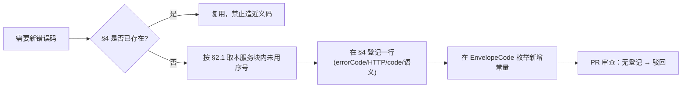

# 01 · 接口与错误码规范

> 本文由《01-响应与错误码规范》与《02-接口设计规范》合并而成（2026-10-14）。两者同属「对外 HTTP 接口」关注点。
> 上游：[`README.md`](./README.md)

## 第一部分 · 响应信封与错误码


> 文档版本：v1.0.0 ｜ 日期：2026-10-14 ｜ 状态：**待评审**
> 上游：[`README.md`](./README.md)、[`../architecture/SpringCloud微服务重构方案.md`](../architecture/SpringCloud微服务重构方案.md)
> 契约依据：[`../design/detailed/02-接口层详细设计.md`](../design/detailed/02-接口层详细设计.md) §1~§2、[`../design/detailed/openapi.yaml`](../design/detailed/openapi.yaml)
> 解决的问题：**问题总账 D-11「两套错误码体系并存」的收敛**（现状已扩大到三代）

---

### 1. 统一响应信封

#### 1.1 结构

```jsonc
{
  "code":      0,                  // Integer  聚合码，见 §2
  "errorCode": null,               // String?  业务错误标识，成功为 null；失败必填
  "message":   "ok",               // String   面向用户的可读文案（中文）
  "data":      { },                // T?       业务数据，可为 null
  "warnings":  []                  // Warning[]? 部分成功/能力降级提示，见 §5（可省略）
}
```

| 字段 | 类型 | 必填 | 说明 |
|---|---|---|---|
| `code` | Integer | ✅ | `0` = 成功；失败 = `HTTP 状态码 × 100 + 序号`。**不承载业务语义** |
| `errorCode` | String | ❌ | 大写下划线常量（如 `DESIGN_PROJECT_NOT_FOUND`）。**业务分支的唯一依据** |
| `message` | String | ✅ | 用户可读中文文案。**不得**包含堆栈、SQL、类名、内部路径 |
| `data` | Object/Array/null | ❌ | 业务数据；错误时用于承载 `details` |
| `warnings` | Array | ❌ | 有内容才出现；成功但存在能力降级/部分失败时必填 |

#### 1.2 三种典型响应

```jsonc
// ① 成功
{ "code": 0, "errorCode": null, "message": "ok", "data": { "id": 1024 } }

// ② 失败（details 承载可编程的补充信息）
{ "code": 40440, "errorCode": "DESIGN_PROJECT_NOT_FOUND",
  "message": "项目不存在或不属于当前用户",
  "data": { "details": { "projectId": 1024 } } }

// ③ 异步受理（HTTP 202）
{ "code": 0, "errorCode": null, "message": "accepted",
  "data": { "jobId": 8891, "jobNo": "J260101120001A7F3", "status": "PENDING" },
  "warnings": [] }

// ④ 部分成功（HTTP 200，红线 R1：必须让用户看见"哪些没算"）
{ "code": 0, "errorCode": null, "message": "ok",
  "data": { "runId": 331, "status": "PARTIAL", "doneCount": 180, "totalCount": 200 },
  "warnings": [
    { "code": "EVALUATION_METRIC_UNAVAILABLE", "message": "对接引擎未部署，DOCKING 指标未参与评分",
      "scope": "METRIC", "ref": "DOCKING", "details": { "redistributedTo": ["QED","SA"] } },
    { "code": "PARTIAL_BATCH_FAILED", "message": "20 个候选评估超时，其余成功",
      "scope": "ITEM", "ref": "18,19,20", "details": { "reason": "ALGO_TIMEOUT" } }
  ] }
```

#### 1.3 `data.details` 的固定子字段

| 子字段 | 用途 | 出现于 |
|---|---|---|
| `fieldErrors[]` | 字段级校验错误 `{field, message}` | `VALIDATION_FAILED` |
| `existingId` | 冲突对象的既有 ID | `*_DUPLICATED` |
| `readyBlockers[]` | 未就绪原因清单 | `DESIGN_PROJECT_NOT_READY` |
| `probeMsg` | 能力探测结论 | `COMMAND_UNAVAILABLE`、`TOOL_PROBE_FAILED` |
| `currentPocketId` | 当前已选定口袋 | `uk_structure_selected` 冲突 |

---

### 2. `code` 数值规则

```
成功： code = 0
失败： code = HTTP状态码 × 100 + 序号(00~99)
```

| 例 | 含义 |
|---|---|
| `0` | 成功 |
| `40000` | HTTP 400 + 序号 00 |
| `40440` | HTTP 404 + 序号 40（design 号段） |
| `50320` | HTTP 503 + 序号 20（predict 号段） |

> **勘误 C-01**：成功态取 `0`（对齐 [`02-接口层详细设计.md`](../design/detailed/02-接口层详细设计.md) §1.1），**不再使用 `200`**。现状影响面仅 2 处（前端 `request.ts` 2 行 + 后端 `Result.java` 2 个工厂方法），切换成本极低。

#### 2.1 序号块分配表（勘误 C-03）

> 六服务并行开发，**必须**按块分配，避免号段冲突。未分配的块（90~99）保留。

| 序号块 | 归属 | 备注 |
|---|---|---|
| `00` ~ `09` | 通用 / 框架 / 网关 | 全服务可用 |
| `10` ~ `19` | auth | |
| `20` ~ `39` | predict | 富余（预留算法扩展） |
| `40` ~ `59` | design | 号段最大，因端点数最多 |
| `60` ~ `69` | asset | |
| `70` ~ `79` | platform | 含全部 `TOOL_*` |
| `80` ~ `89` | agent（二期） | |
| `90` ~ `99` | 保留 | 新服务启用 |

---

### 3. HTTP 状态码使用规范

| 状态码 | 使用场景 | 禁止 |
|---|---|---|
| `200` | 查询成功；**部分成功**（`PARTIAL`，配合 `warnings[]`） | 禁止用 200 表达失败 |
| `201` | 同步创建成功（项目、编辑产物） | |
| `202` | **异步受理**（生成/评估/报告/口袋/回灌），返回 `jobId` | |
| `204` | 无内容（可选，本项目**不采用**，统一返回 200 + `data:null`） | |
| `400` | 参数语法/必填/格式错误 | 不用 400 表达"不存在" |
| `401` | 未认证、Token 失效/过期/黑名单 | |
| `403` | **仅**非归属类的权限不足（管理员接口） | **禁止**用 403 表达归属失败 |
| `404` | 资源不存在**或**不属于当前用户（红线 R4，防资源探测） | |
| `405` | 方法不允许 | |
| `409` | 状态冲突、唯一键冲突归一化、乐观锁冲突、幂等冲突 | |
| `413` | 上传文件/请求体超限 | |
| `415` | 媒体类型不支持 | |
| `422` | 业务规则拒绝（可预期，如 `BATCH_PARTIAL`） | |
| `423` | 账户锁定 | |
| `429` | 限流 | 必须带 `Retry-After` |
| `500` | 未预期异常 | 禁止泄露堆栈 |
| `502` | 下游返回非法/失败（口袋检测失败、邮件发送失败） | |
| `503` | 下游不可用（FastAPI / 对象存储 / LLM） | |
| `504` | 上游超时 | |

---

### 4. 错误码登记表

> **命名规范**：`SCREAMING_SNAKE_CASE`，`{领域}_{细节}`，全局唯一。
> **登记要求**：新增错误码必须先在本表登记（总则 G11）。

#### 4.1 通用 / 框架（块 00~09）

| errorCode | HTTP | code | 语义 |
|---|---|---|---|
| `VALIDATION_FAILED` | 400 | 40000 | 参数语法/必填校验失败（`details.fieldErrors`） |
| `MALFORMED_REQUEST` | 400 | 40001 | 请求体不可解析 / 类型不符 |
| `UNAUTHORIZED` | 401 | 40100 | 未登录 / 凭据缺失 |
| `TOKEN_EXPIRED` | 401 | 40101 | Token 过期 |
| `TOKEN_INVALID` | 401 | 40102 | Token 无效 |
| `SIGNATURE_INVALID` | 401 | 40103 | 签名无效 |
| `TOKEN_BLACKLISTED` | 401 | 40104 | Token 已注销（登出后复用） |
| `FORBIDDEN` | 403 | 40300 | 已登录但无权限（**仅非归属类**） |
| `RESOURCE_NOT_FOUND` | 404 | 40400 | 通用资源不存在 |
| `METHOD_NOT_ALLOWED` | 405 | 40500 | 方法不允许 |
| `STALE_OBJECT` | 409 | 40900 | 乐观锁冲突（`version`/`If-Match`） |
| `BUSINESS_CONFLICT` | 409 | 40901 | 通用状态冲突 |
| `PAYLOAD_TOO_LARGE` | 413 | 41300 | 请求体/文件超限 |
| `UNSUPPORTED_MEDIA_TYPE` | 415 | 41500 | 媒体类型不支持 |
| `UNPROCESSABLE` | 422 | 42200 | 业务规则拒绝（通用） |
| `RATE_LIMITED` | 429 | 42900 | 触发限流（带 `Retry-After`） |
| `INTERNAL_ERROR` | 500 | 50000 | 未预期异常（不泄露堆栈） |
| `DEPENDENCY_UNAVAILABLE` | 503 | 50300 | 下游不可用（通用） |
| `UPSTREAM_TIMEOUT` | 504 | 50400 | 上游超时（通用） |

#### 4.2 auth（块 10~19）

| errorCode | HTTP | code | 语义 | 迁移自 |
|---|---|---|---|---|
| `LOGIN_TYPE_UNSUPPORTED` | 400 | 40010 | 不支持的登录方式 | — |
| `CAPTCHA_ERROR` | 400 | 40011 | 验证码错误或已过期 | `3001` |
| `PASSWORD_TOO_WEAK` | 400 | 40012 | 密码强度不足（B-17） | — |
| `PASSWORD_ERROR` | 401 | 40110 | 密码错误 | `1003` |
| `USER_DISABLED` | 403 | 40310 | 用户已禁用 | `1005` |
| `USER_NOT_FOUND` | 404 | 40410 | 用户不存在 | `1001` |
| `USER_DELETED` | 404 | 40411 | 账户已注销 | — |
| `USER_EXISTS` | 409 | 40910 | 邮箱已注册 | `1002` |
| `EMAIL_NOT_VERIFIED` | 409 | 40911 | 邮箱未验证 | `1004` |
| `EMAIL_BOUND` | 409 | 40912 | 邮箱已被其他账户绑定 | — |
| `ACCOUNT_LOCKED` | 423 | 42310 | 账户锁定（B-08） | — |
| `CAPTCHA_SEND_LIMIT` | 429 | 42910 | 验证码发送过频（B-15） | `3002` |
| `EMAIL_SEND_FAILED` | 502 | 50210 | 邮件发送失败（B-18） | — |

#### 4.3 predict（块 20~39）

| errorCode | HTTP | code | 语义 | 迁移自 |
|---|---|---|---|---|
| `INPUT_RESOLVE_FAILED` | 400 | 40020 | 输入解析失败 | `PredictionErrorCode` |
| `INVALID_SEQUENCE` | 400 | 40021 | 蛋白质序列不合法 | 同上 |
| `SEQUENCE_TOO_SHORT` | 400 | 40022 | 序列长度不足（≥31 残基） | 同上 |
| `INVALID_SMILES` | 400 | 40023 | SMILES 不合法 | 同上 |
| `CHAIN_NOT_FOUND` | 400 | 40024 | PDB 结构中不存在指定链 | 同上 |
| `DRUG_NOT_SUPPORTED` | 400 | 40025 | 药物不在 DDI 支持范围内 | 同上 |
| `BATCH_FILE_INVALID` | 400 | 40026 | 批量文件格式/表头错误 | — |
| `ALGO_TYPE_UNSUPPORTED` | 400 | 40027 | 不支持的算法类型 | — |
| `TASK_NOT_FOUND` | 404 | 40420 | 预测任务不存在或非本人 | `4001` |
| `RESULT_NOT_FOUND` | 404 | 40421 | 结果不存在或非本人 | `5001` |
| `UNIPROT_NOT_FOUND` | 404 | 40422 | UniProt 条目不存在 | `PredictionErrorCode` |
| `PDB_NOT_FOUND` | 404 | 40423 | PDB 结构不存在 | 同上 |
| `TASK_RUNNING` | 409 | 40920 | 任务正在运行 | `4002` |
| `TASK_COMPLETED` | 409 | 40921 | 任务已完成 | `4003` |
| `BATCH_PARTIAL` | 422 | 42220 | 批量部分失败（配合 `warnings[]`） | — |
| `PREDICT_ERROR` | 500 | 50020 | 预测失败（兜底） | `6001` |
| `FASTAPI_UNAVAILABLE` | 503 | 50320 | 算法引擎不可用 | `PredictionErrorCode` |
| `MODEL_UNAVAILABLE` | 503 | 50321 | 模型服务不可用（引擎可达但推理失败） | 同上 |
| `ALGO_TIMEOUT` | 504 | 50420 | 算法执行超时 | — |

> **落地情况（阶段 4，v1.4.0）**：以上 19 个码已全部写入 [`ErrorCode`](../../../synpharm-cloud/synpharm-common/src/main/java/com/synpharm/common/error/ErrorCode.java) 的 predict 段；
> 原先那 10 个 `PredictionErrorCode` 字符串码常量名与之**逐字相同**，故该枚举已删除、调用点改为 `ErrorCode.*`。
> 迁移中**保持不新增码**：单体里 `new BusinessException("...")`（旧默认码 `BAD_REQUEST`，HTTP 200 + body 400）一律回退到 00~09 通用段，按下表选择 ——
>
> | 原场景 | 迁移为 | 说明 |
> |---|---|---|
> | 「XX 不存在」（批次任务、结果文件、收藏） | `RESOURCE_NOT_FOUND` / `RESULT_NOT_FOUND` | 404；比原来的 400 更贴合语义 |
> | 「无权访问…」 | `FORBIDDEN` | 403，与 00~09 一致 |
> | 「不支持的算法类型」 | `ALGO_TYPE_UNSUPPORTED` | 400/27，本段已登记 |
> | 「不支持的输入/输出类型」 | `VALIDATION_FAILED` | 400；该分支实际不可达（枚举反序列化失败会更早被 `MALFORMED_REQUEST` 拦下） |
> | 「文件上传失败」「读取批量 CSV 失败」 | `INTERNAL_ERROR` / `BATCH_FILE_INVALID` | 分别是未预期异常与文件格式问题 |
>
> 这些是**新增行为**（原先 HTTP 200 + body 400），前端 `request.ts` 两种风格都兼容（成功分支判 `code !== 0`，失败分支读 `response.data.message`）。

#### 4.4 design（块 40~59）

**400 参数类**

| errorCode | HTTP | code | 语义 |
|---|---|---|---|
| `CONSTRAINT_RULE_INVALID` | 400 | 40040 | `ruleType` 与 `params` 不匹配 |
| `GENERATION_NO_STRATEGY` | 400 | 40041 | 未指定任何生成策略 |
| `GENERATION_SEED_REQUIRED` | 400 | 40042 | 所选策略需要种子但未提供 |
| `MODALITY_MISMATCH` | 400 | 40043 | 分子形式与操作不匹配 |
| `MOLECULE_EDIT_INVALID` | 400 | 40044 | 参数非法 / 结构不合法 / Sanitize 失败 |
| `MOLECULE_EDIT_NO_CHANGE` | 400 | 40045 | 编辑未产生任何变化 |
| `EVALUATION_NO_METRIC` | 400 | 40046 | 未启用任何指标 |
| `EVALUATION_NO_CANDIDATE` | 400 | 40047 | 项目内无候选可评 |
| `REPORT_DECISION_NOTE_REQUIRED` | 400 | 40048 | `REVISE`/`REJECTED` 必须填意见 |
| `EXPERIMENT_ASSAY_UNKNOWN` | 400 | 40049 | 未知检测类型（须先在知识库注册） |
| `FEEDBACK_NO_SAMPLE` | 400 | 40050 | 无有效实测样本可回灌 |
| `LIBRARY_PARENT_INVALID` | 400 | 40051 | 父级不存在或会造成环 |
| `COMPARE_SAME_OBJECT` | 400 | 40052 | 对比同一对象 |
| `NO_EDITABLE_FIELD` | 400 | 40053 | 无任何可编辑字段（补丁为空） |

**403 / 404 类**

| errorCode | HTTP | code | 语义 |
|---|---|---|---|
| `COMMAND_FORBIDDEN` | 403 | 40340 | 命令对当前角色/项目状态不可用（非归属类） |
| `DESIGN_PROJECT_NOT_FOUND` | 404 | 40440 | 项目不存在**或不属于当前用户** |
| `TARGET_NOT_FOUND` | 404 | 40441 | 靶点不存在 |
| `GENERATION_RUN_NOT_FOUND` | 404 | 40442 | 生成任务不存在或非本人 |
| `CANDIDATE_NOT_FOUND` | 404 | 40443 | 候选不存在或非本人 |
| `MOLECULE_NOT_FOUND` | 404 | 40444 | 分子不存在或非本人 |
| `EVALUATION_RUN_NOT_FOUND` | 404 | 40445 | 评估任务不存在或非本人 |
| `JOB_NOT_FOUND` | 404 | 40446 | 任务不存在或非本人 |
| `REPORT_NOT_FOUND` | 404 | 40447 | 报告不存在或非本人 |
| `EXPERIMENT_NOT_FOUND` | 404 | 40448 | 实验记录不存在或非本人 |
| `LIBRARY_ITEM_NOT_FOUND` | 404 | 40450 | 知识项不存在 |
| `COMMAND_NOT_FOUND` | 404 | 40451 | 命令 ID 不存在 |
| `DESIGN_FILE_NOT_FOUND` | 404 | 40452 | 设计域文件引用不存在 |
| `CONSTRAINT_SET_NOT_FOUND` | 404 | 40449 | 约束集不存在**或不属于当前用户**（阶段 2B 补登记，见下） |
| `ROUND_NOT_FOUND` | 404 | 40453 | 轮次不存在**或不属于当前用户**（阶段 2B 补登记，见下） |
| `STRUCTURE_NOT_FOUND` | 404 | 40454 | 靶点结构不存在（阶段 2B 补登记，见下） |

**409 冲突类**

| errorCode | HTTP | code | 语义 |
|---|---|---|---|
| `DESIGN_PROJECT_NOT_READY` | 409 | 40940 | 靶点或约束集未就绪（`details.readyBlockers[]`） |
| `DESIGN_PROJECT_STATUS_INVALID` | 409 | 40941 | 当前状态不允许该操作 |
| `DESIGN_ROUND_ALREADY_OPEN` | 409 | 40942 | 已有未关闭的轮次 |
| `DESIGN_TARGET_DUPLICATED` | 409 | 40943 | 同一靶点重复绑定（`uk_project_target`） |
| `DESIGN_PRIMARY_TARGET_EXISTS` | 409 | 40944 | 已有主靶点（`uk_primary_target`） |
| `TARGET_SEQUENCE_REQUIRED` | 409 | 40945 | 靶点缺序列，DTI 无法执行 |
| `POCKET_NOT_SELECTED` | 409 | 40946 | 需要种子但未选定口袋 |
| `CONSTRAINT_SET_NOT_EDITABLE` | 409 | 40947 | 非 `DRAFT` 状态不可编辑 |
| `GENERATION_RUN_ALREADY_ACTIVE` | 409 | 40948 | 同轮次已有运行中的生成任务 |
| `CANDIDATE_DUPLICATED` | 409 | 40949 | 分子已存在（`details.existingId`） |
| `MOLECULE_DUPLICATED` | 409 | 40950 | 编辑产物已存在（`details.existingId`） |
| `MOLECULE_LINEAGE_CYCLE` | 409 | 40951 | 会造成谱系成环 |
| `USE_CURSOR` | 409 | 40952 | 偏页过深，请改用键集分页 |
| `JOB_NOT_CANCELLABLE` | 409 | 40953 | 任务已终态，不可取消 |
| `REPORT_NOT_READY` | 409 | 40954 | 报告尚未生成完成，不能审批 |
| `REPORT_ALREADY_DECIDED` | 409 | 40955 | 该版本已审批，不可重复决策 |
| `LIBRARY_CODE_DUPLICATED` | 409 | 40957 | 同分类下 `code` 重复 |
| `LIBRARY_BUILTIN_IMMUTABLE` | 409 | 40958 | `builtin=1` 仅允许改 `enabled`/`sortNo`/`remark` |
| `LIBRARY_HAS_CHILDREN` | 409 | 40959 | 有子节点时不可删除 |
| `COMMAND_UNAVAILABLE` | 409 | 40956 | 命令存在但引擎不可用（`details.probeMsg`） |

**429 / 502 类**

| errorCode | HTTP | code | 语义 |
|---|---|---|---|
| `DESIGN_RATE_LIMITED` | 429 | 42940 | 设计域限流（生成 5/min、评估 10/min、只读 300/min） |
| `POCKET_DETECT_FAILED` | 502 | 50240 | 口袋检测全部方法失败 |

> **补登记的三个 404 码**（上表中标注「见下」者）。设计书给 design 段登记了 14 个 404 码，
> 但枚举里 `40~59` 的连续性有空洞，以下三个是落地时才需要、上游没登记的：
>
> | 码 | 何时需要 | 为什么不能用别的码顶替 |
> |---|---|---|
> | `CONSTRAINT_SET_NOT_FOUND`(40449) | `GET/PATCH /constraint-sets/{id}` | 契约只写了 `404 Error` 未给码；用 `DESIGN_PROJECT_NOT_FOUND` 会让「约束集不存在」被前端误报为「项目不存在」 |
> | `ROUND_NOT_FOUND`(40453) | `POST /rounds/{id}/close`、`/next-round` | 同上，轮次与项目是两类资源，混用会让错误提示指向错误的对象 |
> | `STRUCTURE_NOT_FOUND`(40454) | `GET /structures/{id}/pockets` | 契约该端点**只登记了 200**，但「结构不存在」与「结构存在但没有口袋」必须可区分：都用 200 + 空数组等于告诉前端「这个结构一个口袋都没有」，而事实是它根本不存在 |
>
> 补登记的顺序号刻意接在已用序号之后（49 / 53 / 54）而不是插入空洞，避免与既有码位移。
> **教训**（同 H-24）：错误码一旦写进枚举就要有出口，没出口的码应当只登记不使用并在文档标注
> —— 上面 `CAPABILITY_STALE` 就是这种情况。

#### 4.5 asset（块 60~69）

| errorCode | HTTP | code | 语义 |
|---|---|---|---|
| `FILE_TYPE_UNSUPPORTED` | 400 | 40060 | 文件类型不受支持 |
| `FILE_NOT_FOUND` | 404 | 40460 | 文件资产不存在 |
| `FILE_TOO_LARGE` | 413 | 41360 | 文件超限（单文件 ≤ 100MB） |
| `FILE_HASH_MISMATCH` | 409 | 40960 | 声明的 SHA256 与实际不符 |
| `FILE_IN_USE` | 409 | 40961 | `ref_count > 0`，不可删除 |
| `STORAGE_UNAVAILABLE` | 503 | 50360 | 对象存储不可用 |

#### 4.6 platform（块 70~79）

| errorCode | HTTP | code | 语义 |
|---|---|---|---|
| `TOOL_NOT_FOUND` | 404 | 40470 | 工具不存在 |
| `TOOL_CODE_DUPLICATED` | 409 | 40970 | 工具码重复（`uk_tool_code`） |
| `CAPABILITY_STALE` | 409 | 40971 | 能力矩阵过期，请先触发探测 |
| `TOOL_PROBE_FAILED` | 502 | 50270 | 能力探测失败（`details.probeMsg` 已回写） |

> **落地情况（阶段 5，v1.6.0）**：4 个码已全部写入 `ErrorCode` 的 platform 段并各有出口。
>
> `design_tool.available` 的写回由 `ToolRegistryService` 独占（`@Scheduled` 10 分钟 + 按需 `probe`），
> **不许任何写接口碰它**：`POST /tools` 落「`available=0` + `probe_msg=尚未探测`」，
> `PATCH /tools/{id}` 用 `UpdateWrapper` 逐字段显式 set，从机制上排除这三个字段。
>
> 判定规则表（03 §6.1）之外，实现补齐了两种情形 —— 都沿用「不可用 + 说明原因」的同一形状，
> 因为**没有原因的红点对用户毫无价值**（红线 R2 的用意）：
>
> | 情形 | `available` | `probe_msg` |
> |---|---|---|
> | `enabled=0`（规则表第 1 行要求 `enabled=1`，反推禁用即不可用） | 0 | `工具已禁用（enabled=0）` |
> | 键在能力矩阵中判不出（无 `capability_key`，或键不存在） | 0 | `该工具未声明 capabilityKey / requiresEngine…` 或 `能力矩阵中不存在键 X…` |
>
> **权限**：契约未规定工具注册表的操作者，实现将 `POST` / `PATCH` / `POST {id}/probe` 限定为
> 管理员（403 `FORBIDDEN`），只读接口对已认证用户开放。理由：`design_tool.endpoint` 会被
> design 的命令注册表**直接调用**，若任意登录用户可改，等于开放一个可指向任意内网地址的入口。
>
> **`CAPABILITY_STALE`(40971) 当前没有出口**：本阶段的探测是「按需 `probe`（任何用户可触发自己的那一次）+
> 定时刷新」，不存在「矩阵过期就把请求挡回去」的场景，故该码只登记不使用。若后续引入
> 「矩阵超过 N 分钟未刷新则拒绝写操作」，再给它接上出口 —— **登记了没有出口的码要用端到端断言去撞**
> （教训见问题总账 H-24）。

#### 4.6.1 附：design 工作台消费 platform 内网接口（第 14 组，v1.7.0 起）

`GET/PUT /api/design/workspace`、`GET /api/design/commands` 这一组**没有新增错误码**（沿用
`VALIDATION_FAILED` / `DEPENDENCY_UNAVAILABLE`），但它是**本项目第一个服务间同步调用**，
有三条容易踩的语义需要标记：

| 项 | 规定 | 理由 |
|---|---|---|
| `PUT /workspace` 的字段省略 | **不传 = 不变**（与 design 域其它 PATCH 的「不传 = 清空」**相反**） | 契约写作 PUT，但前端发的是 `Partial<WorkspaceState>`；视图状态是「UI 自己的记忆」，按清空处理会让一次只改 `activeTab` 的保存把已打开的分子页签与面板布局一起抹掉 |
| `project_id IS NULL` 的槽位 | 必须先按 `last_visited_at DESC LIMIT 1` 取最近一行，再决定 UPDATE 还是 INSERT | `uk_user_project(user_id, project_id)` 在 MySQL 下**不约束 NULL**（唯一索引视多个 NULL 互不相同），`INSERT ... ON DUPLICATE KEY UPDATE` 对"用户级最近项目"这一行**不会命中**，直接插会攒出一堆同义行 |
| `commands` 的 `writes` | 按 `category != RETRIEVAL` 推导，**无权威列** | `design_tool` 表没有「是否写操作」这一列，而前端 `DesignCommand` 需要它 |
| `commands` 的项目状态过滤 | 只实现**唯一没有争议**的一条：`ARCHIVED` 项目的写命令不可用 | 契约只写「按项目状态 + 能力过滤」而未给细则 |

> **`commands` 依赖 platform（本项目第一个服务间同步调用）**：`design_tool` 归 platform，
> 拆分铁律 R2 禁止跨库直连，故 design 经 `GET /internal/tools/registry` 取。**失败语义是
> 503 `DEPENDENCY_UNAVAILABLE`，刻意不降级成空命令列表** —— 空面板会让用户分不清
> 「能力服务挂了」还是「自己没权限」，503 加原因才是可诊断的。

#### 4.7 agent（二期，块 80~89）

| errorCode | HTTP | code | 语义 |
|---|---|---|---|
| `AGENT_SESSION_NOT_FOUND` | 404 | 40480 | 会话不存在或不属于当前用户 |
| `AGENT_TOOL_NOT_FOUND` | 400 | 40080 | LLM 请求了不在白名单的工具 |
| `AGENT_LLM_UNAVAILABLE` | 503 | 50380 | LLM 不可用且降级失败 |
| `AGENT_TIMEOUT` | 504 | 50480 | 会话总超时 |

---

### 5. `warnings[]` 约定（勘误 C-04）

> **来源**：上游把 `EVALUATION_METRIC_UNAVAILABLE`（部分指标不可用）、`AGENT_MAX_ROUNDS_EXCEEDED`（达最大轮次降级出报告）标为"HTTP 200 业务告警"，但放在错误码表中 —— 语义矛盾。
> **本规范**：这类"成功但能力/结果不完整"的情况**不是错误**，移出错误码表，改由 `warnings[]` 承载。

#### 5.1 结构

| 字段 | 类型 | 说明 |
|---|---|---|
| `code` | String | 警示码（**复用**错误码命名空间，但语义为"降级/警告"） |
| `message` | String | 面向用户的中文说明 |
| `scope` | String | `METRIC` / `ITEM` / `TOOL` / `RUN` / `SESSION` |
| `ref` | String | 作用对象标识（指标码 / 明细 ID 列表 / 工具码 / runNo） |
| `details` | Object | 补充信息（如 `redistributedTo[]`、`reason`） |

#### 5.2 已登记警示码

| code | scope | 语义 | 红线 |
|---|---|---|---|
| `EVALUATION_METRIC_UNAVAILABLE` | `METRIC` | 部分指标不可用，未计入得分分母并已按比例重分配权重 | R1 |
| `PARTIAL_BATCH_FAILED` | `ITEM` | 部分明细失败，主体成功 | R1 |
| `TOOL_DEGRADED` | `TOOL` | 工具返回疑似无意义值（静默兜底），已记 `success=0` | R2 |
| `AGENT_MAX_ROUNDS_EXCEEDED` | `SESSION` | 达最大轮次仍未收敛，报告已降级生成 | 二期 |

> **强制**：只要响应中出现 `warnings[]`，前端**必须**在界面上可见（不得静默丢弃）—— 这是红线 R1 的落地要求。

---

### 6. 旧码 → 新码迁移映射（一次性）

#### 6.1 后端

| 旧（`ErrorCode` 整数） | 新 |
|---|---|
| `SUCCESS(200)` | → `code = 0` |
| `SYSTEM_ERROR(500)` | `INTERNAL_ERROR` / `50000` |
| `BAD_REQUEST(400)` | `VALIDATION_FAILED` / `40000` |
| `UNAUTHORIZED(401)` | `UNAUTHORIZED` / `40100` |
| `FORBIDDEN(403)` | `FORBIDDEN` / `40300` |
| `NOT_FOUND(404)` | `RESOURCE_NOT_FOUND` / `40400` |
| `USER_NOT_FOUND(1001)` | `USER_NOT_FOUND` / `40410` |
| `USER_EXISTS(1002)` | `USER_EXISTS` / `40910` |
| `PASSWORD_ERROR(1003)` | `PASSWORD_ERROR` / `40110` |
| `EMAIL_NOT_VERIFIED(1004)` | `EMAIL_NOT_VERIFIED` / `40911` |
| `USER_DISABLED(1005)` | `USER_DISABLED` / `40310` |
| `TOKEN_EXPIRED(2001)` | `TOKEN_EXPIRED` / `40101` |
| `TOKEN_INVALID(2002)` | `TOKEN_INVALID` / `40102` |
| `SIGNATURE_INVALID(2003)` | `SIGNATURE_INVALID` / `40103` |
| `CAPTCHA_ERROR(3001)` | `CAPTCHA_ERROR` / `40011` |
| `CAPTCHA_SEND_LIMIT(3002)` | `CAPTCHA_SEND_LIMIT` / `42910` |
| `TASK_NOT_FOUND(4001)` | `TASK_NOT_FOUND` / `40420` |
| `TASK_RUNNING(4002)` | `TASK_RUNNING` / `40920` |
| `TASK_COMPLETED(4003)` | `TASK_COMPLETED` / `40921` |
| `RESULT_NOT_FOUND(5001)` | `RESULT_NOT_FOUND` / `40421` |
| `PREDICT_ERROR(6001)` | `PREDICT_ERROR` / `50020` |

#### 6.2 前端（仅 1 个文件，2 行）

| 位置 | 现状 | 改为 |
|---|---|---|
| `request.ts:44` | `if (res.code !== 200)` | `if (res.code !== 0)` |
| `request.ts:46` | `res.code === 401 \|\| 2001 \|\| 2002 \|\| 2003` | `=['UNAUTHORIZED','TOKEN_EXPIRED','TOKEN_INVALID','SIGNATURE_INVALID','TOKEN_BLACKLISTED'].includes(res.errorCode)` |

> **新增要求**：`ApiResponse<T>` 接口补 `errorCode?: string` 与 `warnings?: Warning[]`；`ApiError` 已具备 `errorCode`（无需改）。

---

### 7. 错误码登记流程



**禁止事项**

1. ❌ 复用同一 `errorCode` 表达不同语义
2. ❌ 新增语义近似的重复码（如 `PROJECT_NOT_FOUND` 与 `DESIGN_PROJECT_NOT_FOUND` 并存）
3. ❌ 把 `code` 当业务分支依据（前端只认 `errorCode`）
4. ❌ 为"业务告警"新增错误码（应走 `warnings[]`）
5. ❌ 在 `message` 中泄露堆栈/SQL/类名/内部 URL

---

### 8. 服务端实现约定

#### 8.1 枚举定义（`synpharm-common`）

```java
package com.synpharm.common.error;

/**
 * 统一错误码。errorCode 为业务权威标识；httpStatus 决定响应状态码；
 * code = httpStatus * 100 + seq 由构造期计算，保证与 §2 规则一致。
 */
public enum ErrorCode {

    // ---- 通用（块 00~09）----
    VALIDATION_FAILED(400, 0, "参数校验失败"),
    UNAUTHORIZED(401, 0, "未登录或凭据已失效"),
    STALE_OBJECT(409, 0, "数据已被他人修改，请刷新后重试"),
    INTERNAL_ERROR(500, 0, "系统繁忙，请稍后重试"),

    // ---- auth（块 10~19）----
    PASSWORD_ERROR(401, 10, "邮箱或密码错误"),
    USER_NOT_FOUND(404, 10, "用户不存在"),
    // ...

    // ---- design（块 40~59）----
    DESIGN_PROJECT_NOT_FOUND(404, 40, "项目不存在或不属于当前用户"),
    DESIGN_PRIMARY_TARGET_EXISTS(409, 44, "已有主靶点，请先解除原主靶点"),
    // ...
    ;

    private final int httpStatus;
    private final int seq;
    private final String defaultMessage;

    ErrorCode(int httpStatus, int seq, String defaultMessage) {
        this.httpStatus = httpStatus;
        this.seq = seq;
        this.defaultMessage = defaultMessage;
    }

    /** 聚合码 = HTTP 状态码 × 100 + 序号 */
    public int getCode()      { return httpStatus * 100 + seq; }
    public int getHttpStatus(){ return httpStatus; }
    public String getErrorCode(){ return name(); }   // 常量名即 errorCode
    public String getMessage(){ return defaultMessage; }
}
```

#### 8.2 响应装配

```java
// 成功
Result.ok(data);                       // {code:0, errorCode:null, message:"ok", data}
Result.accepted(jobId, jobNo, status); // HTTP 202
Result.okWithWarnings(data, warnings); // 部分成功（红线 R1）

// 失败（抛异常，由 GlobalExceptionHandler 统一装配）
throw new BusinessException(ErrorCode.DESIGN_PROJECT_NOT_FOUND)
        .detail("projectId", 1024);
throw new BusinessException(ErrorCode.CANDIDATE_DUPLICATED)
        .detail("existingId", existing.getId());
```

#### 8.3 `GlobalExceptionHandler`（每服务一份，继承 `common` 的基类）

| 异常 | 映射 |
|---|---|
| `BusinessException(ErrorCode)` | 该错误码 + `details` |
| `MethodArgumentNotValidException` | `VALIDATION_FAILED` + `fieldErrors[]` |
| `HttpMessageNotReadableException` | `MALFORMED_REQUEST` |
| `MaxUploadSizeExceededException` | `PAYLOAD_TOO_LARGE` / `FILE_TOO_LARGE` |
| `DuplicateKeyException`（1062） | **禁止直接透出**，按 05 §4 归一化 |
| `ObjectOptimisticLockingFailureException` | `STALE_OBJECT` |
| 其他 `Exception` | `INTERNAL_ERROR`（**记全栈日志，对外只给通用文案**） |

#### 8.4 网关错误体

网关自身的错误（路由不到、限流、JWT 校验失败）**必须**返回同一信封，不得返回 Spring 默认的 `{"timestamp","status","error","path"}`：

```jsonc
{ "code": 40400, "errorCode": "RESOURCE_NOT_FOUND", "message": "请求的资源不存在", "data": null }
{ "code": 40100, "errorCode": "UNAUTHORIZED",       "message": "未登录或凭据已失效", "data": null }
{ "code": 42900, "errorCode": "RATE_LIMITED",       "message": "请求过于频繁",
  "data": { "retryAfter": 30 } }
```

实现方式：网关配置 `ErrorWebExceptionHandler` 自定义实现。

---

### 9. 前端消费规范

```ts
// 统一信封类型（src/types/api.ts）
export interface ApiEnvelope<T> {
  code: number
  errorCode: string | null
  message: string
  data: T
  warnings?: ApiWarning[]
}

export interface ApiWarning {
  code: string
  message: string
  scope: 'METRIC' | 'ITEM' | 'TOOL' | 'RUN' | 'SESSION'
  ref?: string
  details?: Record<string, unknown>
}
```

| 规则 | 说明 |
|---|---|
| 分支依据 | **只按 `errorCode`**；禁止按 `message` 文本匹配，禁止按 `code` 分支 |
| 成功判定 | `code === 0`（由 `request.ts` 统一处理，业务层拿到的已是 `data`） |
| 警示可见 | 响应含 `warnings[]` 时**必须**渲染（全局提示条或面板内联），不得丢弃（红线 R1） |
| 字段错误 | `VALIDATION_FAILED` → 用 `data.details.fieldErrors` 高亮字段 |
| 能力置灰 | `COMMAND_UNAVAILABLE` → 展示 `data.details.probeMsg`，按钮禁用 |
| 重试 | `RATE_LIMITED` → 读 `Retry-After`，期间禁用按钮 |

---

### 10. 修订记录

| 版本 | 日期 | 说明 |
|---|---|---|
| v1.0.0 | 2026-10-14 | 首版：统一信封（含 `warnings[]`）、`code` 规则与块分配、HTTP 状态码规范、**7 组共 90 个错误码登记表**、旧码迁移映射、网关错误体、前端消费规范 |

## 第二部分 · 接口设计


> 文档版本：v1.0.0 ｜ 日期：2026-10-14 ｜ 状态：**待评审**
> 上游：[`README.md`](./README.md)、[`01-响应与错误码规范.md`](01-接口与错误码规范.md)
> 契约依据：[`../design/detailed/02-接口层详细设计.md`](../design/detailed/02-接口层详细设计.md) §1/§3、[`../design/detailed/openapi.yaml`](../design/detailed/openapi.yaml)

---

### 1. 路径与服务前缀

#### 1.1 前缀总表

| 服务 | 对外前缀（经网关） | 服务间前缀（网关不暴露） |
|---|---|---|
| gateway | `/api/**`（唯一入口） | — |
| auth | `/api/auth/**`、`/api/users/**` | `/internal/users/**`、`/internal/auth/**` |
| predict | `/api/predict/**`、`/api/results/**`、`/api/favorites/**`、`/api/tasks/**`、`/api/batch/**` | `/internal/predict/**` |
| design | `/api/design/**`（不含 `/tools`、`/capabilities`） | `/internal/design/**` |
| asset | —（无对外前缀） | `/internal/files/**` |
| platform | `/api/system/**`、`/api/design/tools/**`、`/api/design/capabilities` | `/internal/tools/**` |
| fastapi（网格外） | — | `/v1/**`（`X-API-Key`） |

#### 1.2 路径前缀 ≠ 服务归属（勘误 C-05）

> **原则**：`/api/xxx/**` 前缀表达的是**前端功能域**，服务归属由**网关路由表**决定。

典型例子：`/api/design/tools/**` 与 `/api/design/capabilities` 属于设计工作台的功能域（前端契约不变），但 `design_tool` 表归 `synpharm-platform` 所有，故这两组路径在网关**路由到 platform**。

| 路由 id | Path | → 服务 |
|---|---|---|
| `auth` | `/api/auth/**,/api/users/**` | `lb://synpharm-auth` |
| `predict` | `/api/predict/**,/api/results/**,/api/favorites/**,/api/tasks/**,/api/batch/**` | `lb://synpharm-predict` |
| `platform-design-tools` | `/api/design/tools/**,/api/design/capabilities` | `lb://synpharm-platform` |
| `platform-system` | `/api/system/**` | `lb://synpharm-platform` |
| `design-sse` | `/api/design/stream/**`（单独配置，关缓冲） | `lb://synpharm-design` |
| `design` | `/api/design/**`（兜底，放最后） | `lb://synpharm-design` |

> **路由顺序敏感**：更具体的 Path 必须排在 `design` 兜底之前。

#### 1.3 路径命名

| 规则 | 正确 | 错误 |
|---|---|---|
| 小写 + 短横线（多词） | `/api/design/generation-jobs` | `/api/design/generationJobs`、`/generation_jobs` |
| 资源用**复数**名词 | `/projects`、`/candidates`、`/edits` | `/getProject`、`/project-list` |
| 层级表达归属 | `/projects/{id}/generation-jobs` | `/generationJobs?projectId=` |
| 不出现动词（动作用方法表达） | `POST /projects/{id}/rounds` | `POST /createRound` |
| 例外：语义化动作端点 | `/constraints/{id}/activate`、`/reports/{id}/decision`、`/jobs/{id}/cancel` | — |

#### 1.4 版本策略

| 项 | 规定 |
|---|---|
| 对外版本 | **URL 不带版本号**（沿用 `/api/design/**`，见设计书 D5 决策），破坏性变更走**新资源路径** + 旧路径标记 `@Deprecated` 保留 ≥1 个发布周期 |
| 服务间版本 | `/internal/**` 不带版本号；契约变更靠 **DTO 兼容**（只增字段不删字段） |
| 计算层版本 | `/v1/**`（既有约定，保持不变） |
| 契约来源 | [`openapi.yaml`](../design/detailed/openapi.yaml) 为**唯一权威**；Knife4j 由注解生成后与之对齐 |

---

### 2. HTTP 方法语义

| 方法 | 语义 | 幂等 | 安全 | 本项目用法 |
|---|---|---|---|---|
| `GET` | 读取 | ✅ | ✅ | 查询列表/详情/能力矩阵/SSE 之外的所有读 |
| `POST` | 创建 / 触发动作 | ❌ → 需 `Idempotency-Key` | ❌ | 创建项目、提交生成/评估、执行编辑、探测 |
| `PUT` | **全量替换** | ✅ | ❌ | 仅用于配置类资源（工作台视图状态） |
| `PATCH` | **部分更新** | ❌ | ❌ | 审批决策、工具开关、个人资料局部改 |
| `DELETE` | 删除 | ✅ | ❌ | 删除任务/结果/收藏/账户（逻辑删除） |

**禁止**：用 `GET` 产生副作用；用 `POST` 做幂等更新（应用 `PUT`/`PATCH`）。

---

### 3. 请求头规范

#### 3.1 客户端 → 网关

| 头 | 必填 | 说明 |
|---|---|---|
| `Authorization: Bearer <jwt>` | 除公开接口外必填 | 仅网关解析；**不透传给下游**（改为透传身份头，见 3.2） |
| `Content-Type` | 有体时必填 | `application/json; charset=utf-8`；上传按实际类型 |
| `Idempotency-Key` | 写操作**强烈建议** | `UUID v4` 或业务推导键（见 §5.1） |
| `If-Match` | 乐观锁资源必填 | 等于资源当前 `version`；与请求体 `version` 二选一 |
| `X-Request-Id` | 可选 | 客户端生成的追踪 ID；缺省由网关生成 |
| `Accept-Language` | 可选 | `zh-CN`（默认） |

#### 3.2 网关 → 服务（内部透传，客户端伪造无效）

| 头 | 说明 |
|---|---|
| `X-User-Id` | 由网关**强制覆盖**（先剥离客户端传入的同名头） |
| `X-User-Role` | `USER` / `ADMIN` |
| `X-User-Email` | 便利字段，避免每服务查 auth |
| `X-Trace-Id` | 全链路追踪 ID（MDC 注入，见 07 §5） |
| `X-Request-Id` | 请求 ID |
| `X-Internal-Token` | **仅**调用 `/internal/**` 时携带（见 06 §4） |

> **安全铁律**：下游服务**必须**先剥离再信任 —— `X-User-Id` 等头只在"经网关"的链路上有意义。实现方式：`InternalHeaderFilter` 在服务入口处判定来源（内网 IP 段 + `X-Internal-Token`），非法则全部清空。

#### 3.3 响应头

| 头 | 场景 |
|---|---|
| `Retry-After` | `429` 必带（秒） |
| `ETag` | 支持乐观锁的资源（值 = `version`） |
| `Location` | `201` 创建成功时的资源 URL |
| `X-Trace-Id` | 全部响应（便于用户报障时提供） |
| `Last-Event-ID` | SSE 断线续传（见 §8） |

---

### 4. 分页、排序、字段与过滤

#### 4.1 分页

| 项 | 规定 |
|---|---|
| 请求参数 | `?page=1&pageSize=20`（`page` **从 1 起**） |
| 默认值 | `page=1`、`pageSize=20` |
| 上限 | `pageSize ≤ 200`，超出 → `VALIDATION_FAILED` |
| 响应结构 | `data: { list, total, page, pageSize, hasNext }` |
| 大偏页 | 偏页 > 1000 → `409 USE_CURSOR`，改用键集分页（见 4.2） |

#### 4.2 键集分页（排行榜等大表）

| 项 | 规定 |
|---|---|
| 触发 | 排行榜**必须**携带 `roundId`；偏页 > 1000 |
| 参数 | `?afterScore=<total_score>&afterId=<id>&limit=50` |
| 响应 | `data: { list, nextAfterScore, nextAfterId, hasNext }`（**无 `total`**） |
| 理由 | 10 万行 `evaluation_result` 上 `OFFSET` 退化，无法满足 P95 < 300ms |

#### 4.3 排序

```
?sortBy=<白名单字段>&order=desc|asc
```

| 规则 | 说明 |
|---|---|
| 白名单 | **每个接口**显式声明允许的 `sortBy` 字段集合 |
| 强制校验 | 非白名单 → `VALIDATION_FAILED`（**禁止**把用户输入拼进 `ORDER BY`，防 SQL 注入） |
| 稳定排序 | 必须追加**唯一列兜底**（`ORDER BY total_score DESC, id ASC`），避免翻页错乱 |
| 默认 | 未指定时由接口定义（通常 `created_at DESC, id DESC`） |

#### 4.4 字段裁剪与过滤

| 项 | 规定 |
|---|---|
| 过滤 | 显式命名的查询参数（`status`、`category`、`enabled`…），**不做**通用 `filter=` 表达式解析 |
| 字段裁剪 | 仅**大列表**允许 `?fields=id,name,totalScore`；字段名必须在白名单内 |
| 搜索 | `keyword` 匹配多列；超 3 字符走前缀索引 `LIKE 'x%'`，**禁止** `LIKE '%x%'` 全表扫 |

---

### 5. 幂等与并发控制

#### 5.1 幂等（三层，详见 05 §3）

| 层 | 手段 | 覆盖 |
|---|---|---|
| L1 业务幂等键 | 请求头 `Idempotency-Key` 或服务端推导键 → `design_job.uk_idempotent_key`；命中且未终态则**返回既有 job**（`data.reused=true`） | 重复点击"提交生成/评估/报告" |
| L2 业务唯一键 | 数据库唯一键（`uk_*`），冲突经 **1062 归一化**为业务错误码 | 并发重复产出 |
| L3 乐观锁 | `version` / `If-Match` | 并发编辑 |

**服务端推导键的默认规则**（示例，生成任务）：
```
prj{projectId}-round{roundId}-{strategies 排序后逗号连接}
```

#### 5.2 乐观锁

| 项 | 规定 |
|---|---|
| 字段 | 资源响应**必须**返回 `version`（整数，从 1 递增） |
| 提交 | 请求体 `version` **或** `If-Match` 头；两者冲突时以 `If-Match` 为准 |
| 冲突 | `409 STALE_OBJECT`；`data.details` 携带 `currentVersion` |
| 适用范围 | `design_project`、`constraint_set`、`design_report`、工作台视图状态 |
| 不适用 | 追加型资源（`molecule_edit_log`、`evaluation_result`、`agent_step`）无需版本 |

---

### 6. 数据格式规范

#### 6.1 标识符

| 类型 | 规范 | 示例 |
|---|---|---|
| 主键 | 数值 ID，JSON 中为 **Number** | `"id": 1024` |
| 业务编号 | `xxx_no`，供人阅读/外部引用；**同时接受** ID 与 no 的接口需在文档注明 | `projectNo: "P2601010001A7F3"` |
| 分子唯一标识 | **InChIKey**（去重键）；SMILES 仅作展示与计算入参 | `inchikey: "BSYNRYMUTXBXSQ-UHFFFAOYSA-N"` |

> **大整数注意**：若未来引入雪花 ID（>2^53），JSON 必须序列化为 **String**。当前自增 ID 用 Number。

#### 6.2 时间

| 项 | 规定 |
|---|---|
| 传输格式 | **ISO-8601 带时区偏移**：`2026-10-14T10:00:01+08:00` |
| 时区 | 全链路 `Asia/Shanghai`；JDBC `serverTimezone=Asia/Shanghai` |
| 存储 | MySQL `DATETIME`（**不含时区**，按应用时区写入） |
| 精度 | 秒级（`DATETIME`）；需要毫秒时用 `DATETIME(3)` 并在文档注明 |
| 命名 | `createdAt` / `updatedAt` / `expiresAt` / `startedAt` / `completedAt` |
| 相对时间 | 禁止后端返回"3 分钟前"，由前端渲染 |
| 时长 | 毫秒整数，字段名以 `Ms` 结尾（`latencyMs`、`durationMs`） |

#### 6.3 枚举与布尔

| 项 | 规定 |
|---|---|
| 枚举 | **大写下划线字符串**（`PENDING`/`RUNNING`/`SUCCEEDED`/`PARTIAL`/`FAILED`/`CANCELLED`），与 DB `VARCHAR` 一致。**全域唯一字典**，参考[批量任务状态机](../uml/业务流程.md#5-批量任务状态机) |
| 禁止 | 传输裸数字枚举（`status: 1`）；DB 中用 `TINYINT` 表达可读状态。既有 `batch_task.status` 为 `TINYINT 0~3`，需按状态机图迁移到统一字典 |
| 布尔 | JSON `true/false`；DB `TINYINT(1)` |
| 未知枚举 | 前端必须容忍未知值（降级渲染），后端不得因未知值 500 |

#### 6.4 数值

| 项 | 规定 |
|---|---|
| 小数 | JSON Number；**禁止**用 String 传数值 |
| 分数 | 0~1 归一化（`confidenceScore`、`realness`）；百分数仅在展示层换算 |
| 缺失值 vs 零值 | **必须区分**：`null` 表示"未计算"，`0` 表示"计算结果为零"（红线 R1/R2 相关） |
| NaN/Infinity | **禁止**出现在 JSON 中（引擎返回值须清洗，见 05 §6.3） |

#### 6.5 文本与内容

| 项 | 规定 |
|---|---|
| 编码 | UTF-8 |
| 富文本 | 报告正文用 Markdown（`body_md`），同时保留 `body_json` 结构化副本 |
| 超长文本 | > 64KB 的内容走 `file_asset`，接口只返回 `assetId` + `url` |
| 空字符串 | 与 `null` 区分：`""` 表示"明确清空"，`null` 表示"未提供" |

---

### 7. 异步接口规范

#### 7.1 提交（202）

```http
POST /api/design/projects/{id}/generation-jobs
Idempotency-Key: 5f2b... 
```

```jsonc
// HTTP 202
{ "code": 0, "errorCode": null, "message": "accepted",
  "data": { "jobId": 8891, "jobNo": "J260101120001A7F3", "status": "PENDING" } }
```

| 规则 | 说明 |
|---|---|
| 返回 | **立即**返回 `202` + `{jobId, jobNo, status}`；**禁止**同步等待计算完成 |
| 事务 | 事务内**只写** `design_job(PENDING)` + `*_run(PENDING)`；MQ 投递 `afterCommit`（红线 R5） |
| `jobNo` 格式 | `J` + `yyMMddHHmmss` + `4` 位随机（既有约定 `J260101120001A7F3`） |
| 幂等 | 同 `Idempotency-Key` 未终态 → 返回既有 job（HTTP `200` + `data.reused=true`） |

#### 7.2 轮询

```http
GET /api/design/jobs/{jobId}      # {jobId} 接受数字 ID 或 jobNo 字符串
```

```jsonc
{ "code": 0, "data": {
    "jobId": 8891, "jobNo": "J...", "jobType": "GENERATION", "status": "RUNNING",
    "progress": 0.62, "doneCount": 124, "totalCount": 200,
    "toolCode": "CREM", "realness": "SEMI_REAL",
    "result": { "runId": 331 }, "errorMsg": null,
    "startedAt": "2026-10-14T10:00:01+08:00", "completedAt": null } }
```

| 状态 | 语义 |
|---|---|
| `PENDING` | 已受理，未开始 |
| `RUNNING` | 执行中（`progress` 有意义） |
| `PARTIAL` | 部分成功 → **`errorMsg` 必须逐项写明原因**（红线 R1） |
| `SUCCEEDED` / `FAILED` / `CANCELLED` | 终态 |

#### 7.3 取消

```http
POST /api/design/jobs/{jobNo}/cancel
```

终态任务 → `409 JOB_NOT_CANCELLABLE`。取消必须**幂等**（重复取消返回成功或 `409`，不得副作用）。

---

### 8. SSE 规范

```http
GET /api/design/stream/{jobNo}
Accept: text/event-stream
Last-Event-ID: 1240            # 断线续传（可选）
```

#### 8.1 事件格式

```
id: 1240
event: candidate
data: {"eventId":1240,"candidateId":7781,"smiles":"CCO","totalScore":0.82}

id: 1241
event: progress
data: {"eventId":1241,"status":"RUNNING","doneCount":125,"totalCount":200}

event: done
data: {"status":"SUCCEEDED","runId":331}
```

| 事件 | 载荷 |
|---|---|
| `progress` | `{eventId, status, doneCount, totalCount, progress}` |
| `candidate` | 新增候选摘要（**不是全量**，避免风暴） |
| `metric` | 指标填充增量 |
| `warning` | 与 `warnings[]` 同构（红线 R1） |
| `done` | 终态汇总 |
| `error` | `{errorCode, message}` |

#### 8.2 强制约定

| 项 | 规定 |
|---|---|
| 心跳 | 每 **15s** 发送注释行 `: keep-alive`（防网关/代理超时断开） |
| 事件序号 | 每条事件带 `id`（单调递增），支持 `Last-Event-ID` 续传；亦支持 `?since=<eventId>` 复位 |
| 网关 | `design-sse` 路由**必须**关闭响应缓冲（`RemoveResponseHeader=Transfer-Encoding`） |
| 降级 | 轮询 `GET /jobs/{jobNo}` 为**兜底**，SSE 不可用时前端自动切换 |
| DB 权威 | 事件流是**投影**；Redis 丢失可从 `design_job` 重建（红线 R6） |
| 认证 | 浏览器 `EventSource` 无法带头 → 用 `fetch + ReadableStream` 实现，或短期一次性 `streamToken` 查询参数 |

---

### 9. 限流规范

| 类别 | 接口 | 阈值 | 维度 |
|---|---|---|---|
| 生成类 | `/generation-jobs`、`/molecules/*/edit`（落库） | 5 / min | 用户 **+ projectId** |
| 评估类 | `/evaluations` | 10 / min | 用户 **+ projectId** |
| 探测类 | `/tools/{id}/probe` | 3 / min | 用户 |
| 只读 | 其余 `GET` | 300 / min | 用户 |
| 认证类 | `/auth/captcha/send`、`/auth/login` | 5 / h（验证码）；10 / min（登录） | 邮箱 / 账户 |
| 全局 | 全部 | 按网关默认 | IP + 用户 |

> 限流键**必须含 `projectId`**（防单项目刷爆）；超限返回 `429` + `Retry-After`。
> 实现：网关做粗粒度（IP/用户/路径），服务内做细粒度（业务维度）。

---

### 10. 内容协商与导出

| 场景 | `Content-Type` |
|---|---|
| 常规 | `application/json; charset=utf-8` |
| CSV 导出 | `text/csv; charset=utf-8`，`Content-Disposition: attachment; filename*=UTF-8''...` |
| SDF 导出 | `chemical/x-mdl-sdfile` |
| 报告（Markdown） | `text/markdown; charset=utf-8` |
| 报告（PDF） | `application/pdf`（经 `file_asset` 取 URL） |
| 上传 | `multipart/form-data`，`file` 字段名固定 |

**大文件导出**：一律**异步**产出 → `file_asset` → 返回 `assetId` + 预签名 `url`（避免同步长连接）。

---

### 11. 内部接口规范（`/internal/**`）

| 项 | 规定 |
|---|---|
| 暴露 | **网关不路由**；仅 K8s/Compose 内网可达 |
| 认证 | `X-Internal-Token`（见 06 §4）；**口令不对直接 401（fail-closed）**，见 §4.6 |
| 信封 | **沿用同一信封**（便于复用 Feign 解码器） |
| 上下文 | `/internal/**` **不做归属校验**（调用方已校验），但必须校验 `X-Internal-Token` |
| 契约 | 只增字段不删字段；破坏性变更需同步所有消费方 |
| 禁止 | `/internal/**` 中承载业务写逻辑（除 owner 服务自身的内部命令） |

**已登记的内网端点**

| 端点 | owner | 消费方 | 说明 |
|---|---|---|---|
| `GET /internal/tools/capabilities` | platform | design | 与公开的 `/api/design/capabilities` **同构**（状态灯用） |
| `GET /internal/tools/registry` | platform | design | 在 `capabilities` 之外**带上 `name` / `category`**（命令面板要渲染按钮）。之所以单开一条而不是扩公开契约：公开 schema 已冻结，不为内部需求改它 |

> **`/internal/**` 的准入语义**：`InternalRequestFilter` 在 `/internal/` 前缀上**口令不匹配即 401**
> （未配置 `INTERNAL_TOKEN` 时全部拒绝）。这与非 `/internal` 路径不同 —— 后者口令不对只是
> **忽略**身份头不拒绝（阶段 1 起的既有语义，因为网关已验签）。原因：`/internal/**` 的端点多数
> **根本不读身份**，所以「忽略身份头后放行」等于完全不设防，同网络内任意调用方都能读到
> 工具端点、JSON Schema 这类内部数据。已在 platform 与 design 各补单测锁死。

---

### 12. API 文档规范

| 项 | 规定 |
|---|---|
| 权威契约 | [`openapi.yaml`](../design/detailed/openapi.yaml)；变更需同步更新该文件 |
| 在线文档 | Knife4j（`/doc.html`），**仅 dev/test 开启**，prod 关闭 |
| 注解 | `@Operation(summary=..., description=...)` 必填；`@Schema` 说明字段含义与取值范围 |
| 示例 | 每个端点**至少**给一个请求示例与响应示例 |
| 错误码 | 在 `@Operation` 中列出该端点可能返回的 `errorCode` |
| 前端类型 | 由 `openapi.yaml` 经 `openapi-typescript` 生成，**替换**手写类型（消除双份维护） |

---

### 13. 修订记录

| 版本 | 日期 | 说明 |
|---|---|---|
| v1.0.0 | 2026-10-14 | 首版：路径与路由、方法语义、请求头透传、分页/键集分页/排序白名单、幂等与乐观锁、数据格式、异步 202、SSE、限流、导出、内部接口、文档 |
