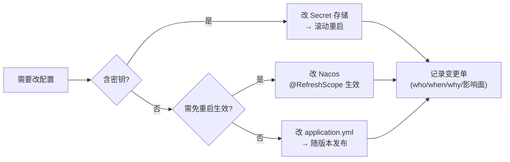

# 02 · 数据与配置规范

> 本文由《03-配置规范》与《04-数据与缓存规范》合并而成（2026-10-14）。两者同属「服务端数据与配置」关注点。
> 上游：[`README.md`](./README.md)

## 第一部分 · 配置规范


> 文档版本：v1.0.0 ｜ 日期：2026-10-14 ｜ 状态：**待评审**
> 上游：[`README.md`](./README.md)、[`../architecture/SpringCloud微服务重构方案.md`](../architecture/SpringCloud微服务重构方案.md) §10
> 解决的问题：问题总账 **B-01「真实凭据硬编码入仓」**、**B-11「`.env.example` 与解析逻辑不符」**、**B-13「生产 SQL 与 debug 日志全开」**

---

### 1. 配置分层与优先级

```
① 环境变量（最高）        密钥、环境相关端点（DB/Redis/MQ 地址）
② Nacos 配置（中）        业务可调参数、路由、限流阈值、开关
③ application.yml（低）   非敏感的公共默认值（仅 synpharm-common）
④ 代码内 @Value 默认值     兜底常量（${X:default}）
```

> **同键冲突时高优先级覆盖低优先级**。禁止在 ③ 中放置任何密钥或环境相关端点。

#### 1.1 三类配置的判定标准

| 判定 | 归属 |
|---|---|
| 是密钥/凭据？ | → **环境变量**（总则 G10） |
| 随环境变化（地址、端口、实例名）？ | → **环境变量** |
| 随业务变化且需**免重启生效**？ | → **Nacos** |
| 纯技术默认值且永不变化？ | → **`synpharm-common` 的 application.yml** |
| 只影响本服务、无需动态调整？ | → **本服务 `application.yml`** |

---

### 2. 命名规范

#### 2.1 键名

| 类型 | 规范 | 示例 |
|---|---|---|
| 环境变量 | `SCREAMING_SNAKE_CASE`，不加统一前缀（沿用现状） | `DB_HOST`、`JWT_SECRET`、`FASTAPI_API_KEY` |
| Spring 配置键 | `kebab-case` | `fastapi.base-url`、`health-breaker-threshold` |
| 自定义配置根 | 服务领域名，**不用** `app.*` 兜底 | `fastapi.*`、`prediction.resolver.*`、`design.*` |
| 环境变量与配置键映射 | 通过 `${KEY:default}` 显式声明 | `base-url: ${FASTAPI_URL:http://localhost:8000}` |

> **禁止**：`app.foo.bar` 这类无领域含义的兜底命名（现状 `app.name` 是历史遗留，新配置不得仿效）。

#### 2.2 布尔值与数值

| 项 | 规定 |
|---|---|
| 布尔 | 环境变量用 `true`/`false`（小写字符串）；**禁止** `1`/`0`/`yes` |
| 时长 | 带单位后缀（`timeout: 30s`、`open-ms: 30000`）；**禁止**裸数字表达时长 |
| 容量 | 带单位（`max-file-size: 100MB`） |
| 列表 | **逗号分隔**，禁止 JSON 数组字符串（问题总账 B-11 的根因：`["k1","k2"]` 被当成两个带引号的 key） |

> **B-11 强制修复**：`FASTAPI_API_KEYS` 必须写成 `key1,key2`；解析端按逗号切分并 `trim()`；**同时**兼容"误写成 JSON 数组"的历史值（解析后剥离引号与方括号）并打 `WARN` 日志。

---

### 3. Nacos 组织

| 项 | 规定 |
|---|---|
| 命名空间 | `synpharm-{dev\|test\|prod}`（**必须**按环境隔离，禁止共用 public） |
| Group | `DEFAULT_GROUP`（不自定义 group，避免心智负担） |
| dataId | `synpharm-{service}.yaml`，如 `synpharm-gateway.yaml` |
| 共享配置 | `synpharm-common.yaml`（`shared-configs`，`refresh: true`） |
| 格式 | `YAML` |
| 认证 | `NACOS_USERNAME` / `NACOS_PASSWORD`（环境变量注入） |

#### 3.1 共享配置 `synpharm-common.yaml`

只放**跨服务一致的纯技术配置**：

| 内容 | 说明 |
|---|---|
| `mybatis-plus.*` | 驼峰映射、逻辑删除字段/值、`id-type` |
| `jackson.*` | 时间格式、时区、`NON_NULL` |
| `server.servlet.encoding` | UTF-8 强制 |
| `management.endpoints` | 健康检查暴露项 |
| `logging.pattern.*` / `logging.level.root` | 日志格式基线（见 07 §5） |
| `feign.*` / `sentinel.*` | 调用侧公共超时与熔断基线 |

> **禁止**放入：任何密钥、数据库地址、路由表、业务阈值。

#### 3.2 配置模板（每服务）

```yaml
## synpharm-design.yaml（示意，密钥一律不出现）
spring:
  datasource:
    url: jdbc:mysql://${DB_HOST}:${DB_PORT}/${DB_NAME}?useUnicode=true&characterEncoding=utf8&serverTimezone=Asia/Shanghai&rewriteBatchedStatements=true
    username: ${DB_USERNAME}
    password: ${DB_PASSWORD}
  rabbitmq:
    host: ${RABBITMQ_HOST}
    port: ${RABBITMQ_PORT:5672}
    username: ${RABBITMQ_USERNAME}
    password: ${RABBITMQ_PASSWORD}
    listener:
      simple:
        acknowledge-mode: manual          # 手动 ack（见 05 §5）
        retry:
          enabled: true
          max-attempts: 3
          initial-interval: 1s
          multiplier: 2.0                 # 指数退避
        default-requeue-rejected: false   # 重试耗尽 → 死信

design:
  rate-limit:
    generate-per-minute: 5
    evaluate-per-minute: 10
    read-per-minute: 300
  capability:
    probe-fixed-delay: 10m
    cache-ttl: 5m
```

---

### 4. Profile 策略

| profile | 用途 | 关键差异 |
|---|---|---|
| `dev` | 本地开发 | 直连 `localhost`；SQL/DEBUG 日志；Knife4j 开；`CAPTCHA_DEV_MODE=true` |
| `docker` | 容器编排（dev/测试环境） | 服务名寻址（`mysql`/`redis`/`rabbitmq`/`fastapi`）；Knife4j 开；日志 `INFO` |
| `prod` | 生产 | Knife4j **关**；日志 `INFO`/`WARN`；`CAPTCHA_DEV_MODE=false`；SQL 日志**关**；Actuator 仅暴露 `health` |

**禁止事项（B-13 整改）**

| 禁止 | 原因 |
|---|---|
| `mybatis-plus.configuration.log-impl: StdOutImpl` 进生产 | 全量 SQL + 参数落日志 |
| `logging.level.com.synpharm: debug` 进生产 | 性能与敏感信息泄露 |
| `knife4j.enable: true` 进生产 | 接口文档对外暴露 |
| `management.endpoints.web.exposure.include: "*"` 进生产 | 信息泄露 |
| `CAPTCHA_DEV_MODE=true` 进生产 | 验证码回显 = 认证绕过 |

---

### 5. fail-fast 清单（缺失即启动失败）

> 参照 [`application.yml`](../../../synpharm-backend/src/main/resources/application.yml) 中 `jwt.secret: ${JWT_SECRET:}` 的既有做法（留空则启动失败）。

| 配置项 | 服务 | 校验 |
|---|---|---|
| `JWT_SECRET` | auth、gateway | 非空 **且长度 ≥ 32 字节** |
| `DB_PASSWORD` | 全部 | 非空 |
| `DB_USERNAME` / `DB_NAME` | 全部 | 非空 |
| `RABBITMQ_PASSWORD` | predict、design | 非空 |
| `FASTAPI_API_KEY` | predict、design、platform | 非空（引擎侧已启用鉴权时） |
| `INTERNAL_TOKEN` | 全部 | 非空 **且长度 ≥ 32 字节** |
| `S3_SECRET_KEY` | asset（`STORAGE_TYPE=s3` 时） | 非空 |
| `NACOS_SERVER_ADDR` | 全部 | 非空 |

**实现方式**：`@ConfigurationProperties` + `@Validated` + `@NotBlank`/`@Size`，或用 `EnvironmentPostProcessor` 在启动早期校验。

**反向要求**：**不得**为"方便启动"给密钥配置提供默认值（现状 `application.yml` 中 `QQ_EMAIL_AUTH_CODE` 有硬编码默认值 —— 属 B-01，**必须删除**）。

---

### 6. 密钥管理

| 项 | 规定 |
|---|---|
| 存储 | `.env`（本地，**已在 `.gitignore`**）→ CI/CD Secret → K8s Secret / Vault |
| 入仓 | **禁止**任何真实密钥进仓（含 `application*.yml`、`docker-compose*.yml`、测试代码、文档） |
| `.env.example` | **只放占位符**，且占位符**必须能被解析逻辑正确处理**（B-11） |
| Git 历史 | 已泄露的密钥必须**轮换**，仅删除文件不算修复 |
| 传输 | 仅经环境变量；**禁止**通过命令行参数传递（会进 `ps`） |
| 打印 | 启动日志中密钥一律脱敏为 `****`；**禁止**打印完整配置对象 |
| 轮换周期 | `JWT_SECRET`、`INTERNAL_TOKEN` 建议 90 天；支持**双密钥并行期**（旧密钥验签、新密钥签发） |

> 现状问题：`.env` 中已存在真实 `MYSQL_ROOT_PASSWORD`、`JWT_SECRET`、`RABBITMQ_PASSWORD`、`FASTAPI_API_KEY`。该文件**不得进仓**，且这些值在拆分上线前**必须全部轮换**。

---

### 7. 配置项清单

#### 7.1 通用（全部服务）

| 环境变量 | 必填 | 说明 |
|---|---|---|
| `SPRING_PROFILES_ACTIVE` | ✅ | `dev`/`docker`/`prod` |
| `SERVER_PORT` | ❌ | 容器内端口（默认按服务表） |
| `NACOS_SERVER_ADDR` | ✅ | `nacos:8848` |
| `NACOS_NAMESPACE` | ✅ | `synpharm-{env}` |
| `NACOS_USERNAME` / `NACOS_PASSWORD` | ✅ | |
| `DB_HOST` / `DB_PORT` / `DB_NAME` | ✅ | **`DB_NAME` 各服务不同**（见 7.2） |
| `DB_USERNAME` / `DB_PASSWORD` | ✅ | 各服务独立账号 |
| `REDIS_HOST` / `REDIS_PORT` / `REDIS_PASSWORD` / `REDIS_DATABASE` | ✅ | `REDIS_DATABASE` 按服务分配（见 04 §6.2） |
| `INTERNAL_TOKEN` | ✅ | 服务间调用令牌 |
| `JAVA_OPTS` | ❌ | JVM 参数 |
| `TRACING_SAMPLE_RATE` / `ZIPKIN_ENDPOINT` | ❌ | 生产建议 `0.1` |

#### 7.2 服务专属

| 服务 | 专属配置 |
|---|---|
| **gateway** | `JWT_SECRET`、`JWT_EXPIRATION`、路由表（Nacos）、`GATEWAY_CORS_ALLOWED_ORIGINS` |
| **auth** | `DB_NAME=synpharm_auth`、`JWT_SECRET`、`JWT_EXPIRATION`、`JWT_REFRESH_EXPIRATION`、`CAPTCHA_DEV_MODE`、`QQ_EMAIL`、`QQ_EMAIL_AUTH_CODE`、`LOGIN_MAX_ATTEMPTS`、`LOGIN_LOCK_MINUTES` |
| **predict** | `DB_NAME=synpharm_predict`、`RABBITMQ_*`、`FASTAPI_URL`、`FASTAPI_API_KEY`、`FASTAPI_TIMEOUT_SINGLE`、`FASTAPI_TIMEOUT_BATCH`、`FASTAPI_HEALTH_*`、`UNIPROT_BASE_URL`、`RCSB_BASE_URL`、`RESOLVER_*` |
| **design** | `DB_NAME=synpharm_design`、`RABBITMQ_*`、`FASTAPI_URL`、`FASTAPI_API_KEY`、`DESIGN_RATE_LIMIT_*`、`DESIGN_PROBE_*`、`DESIGN_SSE_HEARTBEAT` |
| **asset** | `DB_NAME=synpharm_asset`、`STORAGE_TYPE`、`S3_ENDPOINT`/`S3_BUCKET`/`S3_ACCESS_KEY`/`S3_SECRET_KEY`/`S3_REGION`、`FILE_MAX_SIZE`、`FILE_ALLOWED_TYPES` |
| **platform** | `DB_NAME=synpharm_platform`、`FASTAPI_URL`、`FASTAPI_API_KEY`、`PROBE_FIXED_DELAY` |
| **fastapi** | `API_KEYS`（**逗号分隔**）、`MODEL_DIR`、`DEVICE`、`BATCH_SIZE`、`LOG_LEVEL` |

> **`DB_NAME` 必须逐服务不同** —— 这是决策 B（每服务独立 schema）的配置体现。

---

### 8. 配置变更流程



| 规则 | 说明 |
|---|---|
| `@RefreshScope` | 仅加在**真正需要热更新**的 Bean 上（路由、阈值、开关）；**禁止**加在有状态的单例上 |
| 敏感变更 | `JWT_SECRET`/`INTERNAL_TOKEN` 轮换期间需**双值并行**（新旧同时可验），窗口期 ≥ 1 个 Token 有效期 |
| 变更留痕 | Nacos 有历史版本，但仍需变更记录（生产环境） |
| 回滚 | Nacos 一键回滚历史版本；环境变量变更需重新发布 |

---

### 9. 禁止事项汇总

| # | 禁止 | 对应问题 |
|---|---|---|
| 1 | 真实密钥进仓 | B-01 |
| 2 | 为密钥提供代码默认值 | B-01 |
| 3 | `.env.example` 占位符与解析逻辑不符 | B-11 |
| 4 | 列表配置写成 JSON 数组字符串 | B-11 |
| 5 | 生产开 SQL 全量日志 / DEBUG | B-13 |
| 6 | 生产开 Knife4j / 全量 Actuator | B-13 |
| 7 | `CAPTCHA_DEV_MODE=true` 进生产 | — |
| 8 | 用 `app.*` 兜底命名承载新配置 | — |
| 9 | 跨环境共用 Nacos namespace | — |
| 10 | 把环境相关端点写进 `application.yml` 默认值 | — |

---

### 10. 修订记录

| 版本 | 日期 | 说明 |
|---|---|---|
| v1.0.0 | 2026-10-14 | 首版：四层配置与判定标准、命名规范、Nacos 组织与模板、profile 差异与生产禁令、fail-fast 清单、密钥管理、逐服务配置项清单、变更流程 |

## 第二部分 · 数据与缓存规范


> 文档版本：v1.0.0 ｜ 日期：2026-10-14 ｜ 状态：**待评审**
> 上游：[`README.md`](./README.md)、[`../architecture/SpringCloud微服务重构方案.md`](../architecture/SpringCloud微服务重构方案.md) §7/§8
> 契约依据：[`../design/detailed/01-数据层详细设计.md`](../design/detailed/01-数据层详细设计.md)
> 落地约束：**决策 B** —— 单 MySQL 实例 + 每服务独立 schema + 禁止跨服务外键/JOIN

---

### 1. Schema 与账号

#### 1.1 划分

| schema | 归属服务 | 账号 | 端口 |
|---|---|---|---|
| `synpharm_auth` | auth | `synpharm_auth` | 3306（内网） |
| `synpharm_predict` | predict | `synpharm_predict` | 同上 |
| `synpharm_design` | design | `synpharm_design` | 同上 |
| `synpharm_asset` | asset | `synpharm_asset` | 同上 |
| `synpharm_platform` | platform | `synpharm_platform` | 同上 |
| `synpharm_agent` | agent（二期） | `synpharm_agent` | 同上 |

#### 1.2 授权规范

```sql
-- 00_create_databases.sql（重写现有 00_create_database.sql）
CREATE DATABASE IF NOT EXISTS synpharm_auth     CHARACTER SET utf8mb4 COLLATE utf8mb4_0900_ai_ci;
-- ... 其余 schema 同理

CREATE USER IF NOT EXISTS 'synpharm_auth'@'%' IDENTIFIED BY '<由环境变量注入，脚本内用占位符>';
GRANT SELECT, INSERT, UPDATE, DELETE, EXECUTE, SHOW VIEW ON synpharm_auth.* TO 'synpharm_auth'@'%';
-- 不给 DROP/ALTER/CREATE：DDL 由迁移脚本用管理员账号执行
FLUSH PRIVILEGES;
```

| 规则 | 说明 |
|---|---|
| 最小权限 | 应用账号仅 `SELECT/INSERT/UPDATE/DELETE`；**不给** `CREATE/ALTER/DROP` |
| 禁止跨库授权 | `synpharm_auth` 账号**不得**有任何其他 schema 的权限 |
| 密码 | 从环境变量注入，脚本中只留占位符 |
| `root` | 仅用于迁移与运维，应用**不得**使用 |

---

### 2. 表命名

| 规则 | 示例 |
|---|---|
| 小写 + 下划线，**单数**名词 | `sys_user`、`design_project`、`candidate_molecule` |
| 平台/系统表前缀 `sys_` | `sys_user`、`sys_login_log` |
| 领域表按领域前缀（新增可选） | `design_*`、`predict_*`，**不强制**改动既有表名 |
| 关联表 = 两侧单数用 `_` 连接 | `project_target`、`batch_task_item` |
| 日志/明细表后缀 | `_log`（追加日志）、`_item`（明细）、`_result`（结果） |
| 字典表后缀 | `_definition`（如 `metric_definition`） |

> **禁止**：表名带服务前缀（`design_svc_project`）；表名带环境后缀；复数表名。

---

### 3. 列命名与类型

#### 3.1 通用列名

| 语义 | 列名 | 类型 |
|---|---|---|
| 主键 | `id` | `BIGINT UNSIGNED AUTO_INCREMENT` |
| 业务编号 | `{entity}_no` | `VARCHAR(32)` |
| 外键列 | `{referenced_table_singular}_id` | `BIGINT UNSIGNED`（**无物理外键**，见 §7） |
| 归属用户 | `user_id` | `BIGINT UNSIGNED`（跨 schema，普通列） |
| 状态 | `status` | `VARCHAR(24)`（**大写下划线枚举**） |
| 布尔 | `is_xxx` / `xxx_flag` | `TINYINT(1)` |
| 计数 | `xxx_count` | `INT UNSIGNED` |
| 进度 | `progress` | `DECIMAL(5,4)`（0.0000~1.0000） |
| 分数 | `xxx_score` | `DECIMAL(8,4)`（0~1 归一化） |
| 结构化参数 | `xxx_json` | `JSON` |
| 摘要/摘要键 | `xxx_digest` | `CHAR(64)`（SHA256 hex） |

#### 3.2 类型规范

| 项 | 规定 | 禁止 |
|---|---|---|
| 主键 | `BIGINT UNSIGNED` + 自增 | `INT`（溢出风险）、UUID 主键 |
| 字符串 | 按需 `VARCHAR(n)`；超长用 `TEXT` | 一律 `VARCHAR(255)` |
| 枚举 | `VARCHAR(24)` | `TINYINT` 裸数字 |
| 时间 | `DATETIME`（秒级）；需毫秒用 `DATETIME(3)` | `TIMESTAMP`（2038 + 时区隐式转换）、`BIGINT` 存毫秒 |
| 金额/比例 | `DECIMAL(_, _)` | `FLOAT`/`DOUBLE`（精度丢失） |
| 布尔 | `TINYINT(1)` | `CHAR(1)` 'Y'/'N' |
| JSON | `JSON` 类型（MySQL 8 原生） | `TEXT` 存 JSON |
| 二进制/大文件 | **不入库**，走 `file_asset` | `BLOB`/`LONGBLOB` |
| 序列/SMILES | `VARCHAR(2000)` / `VARCHAR(4000)` | `TEXT`（无法建前缀索引） |

> **聚合列（生成列）**：需要"唯一不变式"时用 `VIRTUAL` 生成列 + 唯一索引（如 `primary_project_id`、`selected_structure_id`）。

---

### 4. 审计列

**所有业务表必须包含**（MyBatis-Plus 自动填充）：

| 列 | 类型 | 说明 |
|---|---|---|
| `created_at` | `DATETIME NOT NULL` | 创建时间（`MetaObjectHandler` 填充） |
| `updated_at` | `DATETIME NOT NULL` | 更新时间（`ON UPDATE` 或 `MetaObjectHandler`） |
| `deleted` | `TINYINT(1) NOT NULL DEFAULT 0` | 逻辑删除 |
| `version` | `INT UNSIGNED NOT NULL DEFAULT 1` | 乐观锁（**仅需并发编辑的表**；追加型表可省） |

| 规则 | 说明 |
|---|---|
| 追加型表（`*_log`、`evaluation_result`） | 只需 `created_at`，**不需要** `updated_at`/`version` |
| 时间填充 | 统一用 `MyBatisPlusMetaObjectHandler`（`common` 提供），**禁止**在 SQL 里写 `NOW()` 于应用路径 |
| 删除 | 逻辑删除；`deleted=1` 时**不参与任何唯一键**（唯一键**不得**包含 `deleted`，见 §6.2） |
| 禁止 | 应用层 `UPDATE ... SET deleted=1` 时忘记同时清理唯一约束 → 见 §6.2 |

---

### 5. 主键与业务编号

| 项 | 规范 |
|---|---|
| 主键 | 代理键，自增；**不承载业务含义** |
| 业务编号 | `{PREFIX}{yyMMddHHmmss}{4位随机}`，如 `P260101120001A7F3`、`J260101120001A7F3` |
| 编号前缀 | `P`=项目、`R`=轮次、`J`=任务、`G`=生成、`E`=评估、`T`=靶点、`C`=约束集、`RP`=报告、`W`=湿实验、`A`=智能体会话 |
| 唯一性 | `uk_{entity}_no` |
| 接口接受 | 接受 ID **或** `no` 的端点必须在文档中注明（如 `GET /jobs/{jobId}`） |

---

### 6. 唯一键与去重键

#### 6.1 命名与原则

| 项 | 规范 |
|---|---|
| 命名 | `uk_{语义}`，如 `uk_project_inchikey`、`uk_idempotent_key`、`uk_primary_target` |
| 原则 | 唯一键是**业务不变式的最后防线**，不是查询优化手段（那是索引的职责） |
| 冲突处理 | 应用层**必须先查后插**（降概率）**且**捕获 1062（兜并发窗口），二者缺一不可（见 05 §4） |

#### 6.2 双轨去重键（既有设计，必须遵守）

| 分子类型 | 唯一键 | 列 |
|---|---|---|
| 小分子 | `uk_project_inchikey` | `(project_id, inchikey)` |
| 大分子 | `uk_project_sequence` | `(project_id, sequence_hash)` |

> 两套键**互不干扰**；`deleted` **不参与**唯一键 —— 逻辑删除后同分子仍视为重复（避免"删了再建"绕过去重）。

#### 6.3 关键唯一键清单（设计域）

| 唯一键 | 表 | 语义 |
|---|---|---|
| `uk_project_inchikey` | `candidate_molecule` | 小分子去重 |
| `uk_project_sequence` | `candidate_molecule` | 大分子去重 |
| `uk_project_target` | `project_target` | 同项目同靶点不重复绑定 |
| `uk_primary_target` | `project_target` | 每项目**恰好 1 个**主靶点（生成列） |
| `uk_structure_selected` | `binding_pocket` | 每结构**恰好 1 个**选定口袋（生成列） |
| `uk_run_mol_metric` | `evaluation_result` | 评估结果 upsert 幂等 |
| `uk_idempotent_key` | `design_job` | 业务幂等键 |
| `uk_sha256` | `file_asset` | 内容寻址去重 |
| `uk_category_code` | `design_library_item` | 同分类 code 唯一 |
| `uk_tool_code` | `design_tool` | 工具码唯一 |

---

### 7. 外键规范（**跨 schema 一律禁止**）

#### 7.1 裁决规则

| 情形 | 裁决 |
|---|---|
| 同 schema 内的外键 | ✅ **允许且推荐**（如 `design_project → constraint_set`） |
| 跨 schema 的外键 | ❌ **永久禁止**，改为普通列 + 应用层校验 |

#### 7.2 必须为普通列的跨域引用（清单）

| 列 | 源表 → 目标表 | 目标 schema |
|---|---|---|
| `user_id` | `design_project` / `constraint_set` / `design_tool` / `agent_session` → `sys_user` | auth |
| `file_asset_id` | `target_structure` → `file_asset` | asset |
| `structure_asset_id` | `candidate_molecule` → `file_asset` | asset |
| `data_asset_id` | `wet_experiment` → `file_asset` | asset |
| `source_tool_id` | `evaluation_result` → `design_tool` | platform |
| `agent_session_id` | `design_report` → `agent_session` | agent |

> **勘误 C-06**：`fk_er_tool` **永久不建** —— `evaluation_result` 对 `realness`/`source_tool_id` 是**快照**语义，本就不需要引用完整性。

#### 7.3 `36_design_domain_revision.sql` 的逐条裁决

| 外键 | 跨 schema | 裁决 |
|---|---|---|
| `fk_dp_constraint_set` | 否 | ✅ 保留 |
| `fk_pt_target` | 否 | ✅ 保留 |
| `fk_gen_job` | 否 | ✅ 保留 |
| `fk_ev_job` | 否 | ✅ 保留 |
| `fk_struct_asset` | **是** | ❌ 删（改普通列） |
| `fk_cand_structure` | **是** | ❌ 删（改普通列） |
| `fk_er_tool` | **是** | ❌ 删（且**永不建**，见 C-06） |

---

### 8. 索引规范

#### 8.1 命名

| 类型 | 前缀 | 示例 |
|---|---|---|
| 主键 | `PRIMARY` | — |
| 唯一键 | `uk_` | `uk_project_inchikey` |
| 普通索引 | `idx_` | `idx_project_status_created` |
| 外键索引 | `idx_fk_` | `idx_fk_project_id` |
| 全文 | `ft_` | `ft_name` |

#### 8.2 规则

| 规则 | 说明 |
|---|---|
| 命中 WHERE/ORDER BY | 索引必须服务**实际**查询模式 |
| 最左前缀 | 复合索引列序按"等值 → 范围 → 排序"排列 |
| 覆盖索引 | 排行榜等热点查询考虑覆盖索引（`INCLUDE` 等价于把列加入索引） |
| 单表索引数 | ≤ 6（写放大）；超出说明查询模式需重构 |
| 避免冗余 | `(a)` 与 `(a,b)` 并存时删去 `(a)` |
| 排序稳定性 | 索引列序需匹配 `ORDER BY col DESC, id ASC` 的稳定排序需求 |
| 新增流程 | 必须给出**预期 QPS + 数据量 + `EXPLAIN` 结果**，随迁移脚本提交 |
| 禁止 | 在低基数列单独建索引（如 `status` 只有 5 个值）除非配合高基数列 |

---

### 9. 字符集、排序规则与时区

| 项 | 规定 |
|---|---|
| 字符集 | `utf8mb4`（**必须**，`utf8` 不支持 emoji/部分中文） |
| 排序规则 | `utf8mb4_0900_ai_ci`（MySQL 8 默认，大小写不敏感） |
| 时区 | 连接参数 `serverTimezone=Asia/Shanghai`；MySQL 容器 `TZ=Asia/Shanghai` |
| `sql_mode` | 保留 MySQL 8 默认（含 `STRICT_TRANS_TABLES`、`ONLY_FULL_GROUP_BY`） |
| 禁止 | `utf8mb3`、`utf8mb4_general_ci`（新表） |

---

### 10. 迁移脚本规范

#### 10.1 编号与命名

```
{序号}_{领域}_{描述}.sql
```

| 段 | 规范 |
|---|---|
| 序号 | **两位数字**，全局递增，不重排（`00`~`38` 已占用，新增从 `39_` 起） |
| 领域 | `auth` / `predict` / `design` / `asset` / `platform` / `agent` / `all` |
| 描述 | 小写下划线，动词开头（`create_`、`alter_`、`seed_`、`index_`、`revision_`） |

**现有 38 个脚本的重新编组**见 [`../architecture/SpringCloud微服务重构方案.md`](../architecture/SpringCloud微服务重构方案.md) §8.1；重命名后**必须**同步更新 `docker-compose` 的挂载与文档引用。

#### 10.2 强制规则

| # | 规则 | 理由 |
|---|---|---|
| 1 | **幂等**：`CREATE TABLE IF NOT EXISTS`、`INSERT ... ON DUPLICATE KEY UPDATE`、`ALTER` 前先判定 | 允许重复执行（现验收标准是"幂等 28/28"） |
| 2 | 已发布脚本**禁止修改** | 环境间不一致 |
| 3 | 每个脚本首行注明：**目的 / 影响 schema / 是否幂等 / 回滚方式** | 运维可读 |
| 4 | DDL 与 DML **分离**（`create_*` 与 `seed_*` 不同文件） | 种子数据可单独跳过 |
| 5 | 大表 `ALTER` 必须评估锁表时长；> 5s 需用 `pt-online-schema-change` 或分步执行 | 生产可用性 |
| 6 | 索引变更单独成文件（`index_*`） | 便于回滚 |
| 7 | 脚本**不得**包含真实凭据（用户/密码用占位符） | B-01 |
| 8 | 每个脚本**必须**在空库 + 有库两种场景实测通过 | 见 07 §6 |

#### 10.3 新增服务初始化顺序

```
00_create_databases.sql        → 建 6 个 schema + 6 个账号 + 授权
01_auth_sys_user.sql           → 按 schema 归属重命名后的既有脚本
...
11_design_*.sql ~ 38_design_*.sql
39_asset_*.sql / 40_platform_*.sql（新增）
```

---

### 11. MyBatis-Plus 约定

| 项 | 规定 |
|---|---|
| 驼峰映射 | `map-underscore-to-camel-case: true`（共享配置） |
| 逻辑删除 | 全局配置 `logic-delete-field: deleted` / `logic-delete-value: 1` / `logic-not-delete-value: 0` |
| 主键策略 | `id-type: auto`（自增） |
| 审计填充 | `MetaObjectHandler` 实现 `insertFill`/`updateFill`（`common` 提供） |
| 乐观锁 | `@Version` 注解 + `OptimisticLockerInnerInterceptor` |
| 分页 | `PaginationInnerInterceptor`（`DbType.MYSQL`）+ 上限 200 校验 |
| 防全表更新 | `BlockAttackInnerInterceptor`（禁止无 WHERE 的 update/delete） |
| SQL 位置 | 单表用 `BaseMapper`；多表/复杂查询写 XML（放 `resources/mapper/{schema}/`） |
| 禁止 | `SELECT *`（显式列）；在 `domain` 层出现 Mapper；跨 schema JOIN |

---

### 12. 大表与归档

| 表 | 预估规模 | 策略 |
|---|---|---|
| `evaluation_result` | 千万级 | 偏页 > 1000 走键集分页；达到阈值改用**归档表**（上游决策 A-2：**不用分区**，MySQL 分区与唯一键有硬冲突） |
| `molecule_edit_log` / `tool_invocation_log` / `agent_step` | 百万级 | 按月归档到 `*_archive` 表 |
| `sys_login_log` | 百万级 | 保留 180 天，历史归档 |

**归档触发阈值**：单表 > 500 万行 或 > 20GB，**必须**先建归档表并切流，再清理。

**归档表命名**：`{table}_archive_yyyymm`，结构与主表一致，**无唯一键**（避免历史冲突）。

---

### 13. 缓存规范（Redis）

#### 13.1 DB index 分配

| index | 归属 | 说明 |
|---|---|---|
| `0` | **保留** | 不投入使用（避免与历史遗留 key 混淆） |
| `1` | auth | 验证码、登录锁定、Token 黑名单（**`token:blacklist:*` 需网关可读，见 §13.3**） |
| `2` | predict | 外部调用缓存（UniProt/PDB）、批量进度 |
| `3` | design | 进度、能力、限流、SSE |
| `4` | asset | 预签名 URL 缓存 |
| `5` | platform | 能力矩阵缓存 |
| `6` | gateway | 限流计数 |
| `7` | 保留 | — |

> **注意**：Redis 的 `SELECT` 是**连接级**的；若网关需读 auth 的 `token:blacklist:*`，则该 key 必须落在**双方都能访问的 index**。**推荐做法**：`token:blacklist:*` 统一放 **index 1**，网关与 auth 都连 index 1；其余 key 各归各的 index。

#### 13.2 Key 命名

```
{service}:{domain}:{identifier}[:{qualifier}]
```

| 示例 | 说明 | TTL |
|---|---|---|
| `auth:captcha:{email}:{type}` | 验证码 | 5 min |
| `auth:login:lock:{account}` | 登录锁定 | 15 min |
| `token:blacklist:{jti}` | Token 黑名单 | 剩余有效期 |
| `predict:resolve:uniprot:{acc}` | UniProt 缓存 | 24 h |
| `predict:resolve:uniprot:{acc}:neg` | 负缓存 | 10 min |
| `predict:progress:{batchId}` | 批量进度 | 24 h |
| `design:progress:{jobNo}` | 任务进度 | 24 h |
| `design:capabilities` | 引擎能力矩阵 | 5 min |
| `design:tool:{toolCode}` | 工具元数据 | 5 min |
| `design:cmd:{projectId}` | 命令注册表 | 60 s |
| `design:ratelimit:{userId}:{api}:{projectId}` | 限流计数 | 1 min |
| `design:sse:{jobNo}` | SSE 事件流 | 24 h |
| `asset:presign:{assetId}` | 预签名 URL | 10 min |

#### 13.3 强制规则

| # | 规则 |
|---|---|
| 1 | **DB 为权威**：Redis 只是投影，丢失后**必须**能从 DB 重建（红线 R6） |
| 2 | **所有 key 必须设 TTL**（禁止无过期 key，黑名单 key 的 TTL = Token 剩余有效期） |
| 3 | **必须**统一 key 前缀（防多服务冲突） |
| 4 | 禁止缓存**大对象**（> 100KB 走 `file_asset`） |
| 5 | 序列化统一 `String + JSON`（Jackson），**禁止** JDK 序列化（跨语言不可读、有反序列化风险） |
| 6 | 缓存穿透：空结果也缓存（短 TTL 负缓存） |
| 7 | 缓存雪崩：同批 key 的 TTL 加 **±10% 随机抖动** |
| 8 | 缓存击穿：热点 key 用逻辑过期或分布式锁（仅 `design:capabilities` 等少数场景需要） |
| 9 | 禁止用 Redis 做**消息队列**（本项目用 RabbitMQ）；`design:sse:*` 用 Pub/Sub 是**例外**（允许丢失） |
| 10 | 敏感数据（Token、验证码）**不得**明文落 Redis 日志 |

---

### 14. 修订记录

| 版本 | 日期 | 说明 |
|---|---|---|
| v1.0.0 | 2026-10-14 | 首版：schema 与最小权限、表/列/类型/审计列、主键与业务编号、唯一键与双轨去重、跨 schema 禁外键与 `36_` 逐条裁决、索引与迁移脚本规范、MyBatis-Plus 约定、大表归档、Redis DB index 与 key 规范 |
