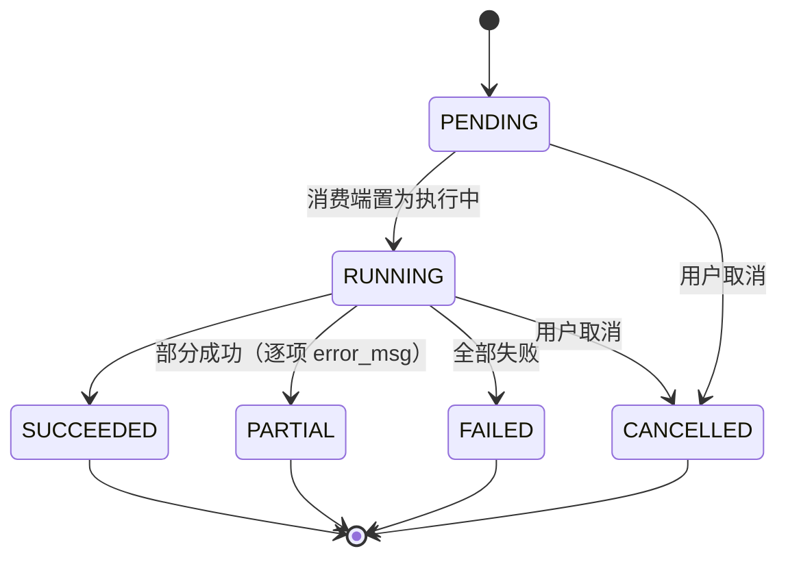
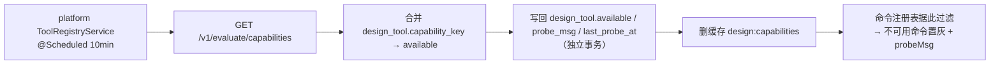

# 03 · 事务、消息与安全规范

> 本文由《05-事务幂等与消息规范》与《06-服务间调用与安全规范》合并而成（2026-10-14）。两者同属「服务端运行时约束」。
> 上游：[`README.md`](./README.md)

## 第一部分 · 事务、幂等与消息


> 文档版本：v1.0.0 ｜ 日期：2026-10-14 ｜ 状态：**待评审**
> 上游：[`README.md`](./README.md)（红线 R5/R6/R7/R8）、[`../design/detailed/03-实现级详细设计.md`](../design/detailed/03-实现级详细设计.md) §3~§7
> 解决的问题：问题总账 **D-05「事务内做 30~60s 外部 HTTP」**、**C-06「失败状态被回滚」**、**A-01「MQ 监听未启用」**、**C-03「静默产出假结果」**

---

### 1. 事务边界铁律（红线 R5）

| # | 铁律 |
|---|---|
| T1 | **事务内只做本地写**（本服务自己的 schema） |
| T2 | **MQ 投递一律 `afterCommit`**（`TransactionSynchronizationManager.registerSynchronization` 或 `@TransactionalEventListener(AFTER_COMMIT)`） |
| T3 | **跨服务 HTTP 不进事务**（禁止复现 D-05） |
| T4 | **批量写入按批独立事务**（每批 200 条以内），禁止一个长事务跑完整批 |
| T5 | **`@Transactional` 只出现在 `application` 层**，且**只**标注 `AppService` 的公开方法 |
| T6 | **进度/SSE 推送在事务外**（Redis 写入不参与回滚） |
| T7 | **事务内禁止**：`Thread.sleep`、`CountDownLatch.await`、读大文件、循环查 DB（N+1） |
| T8 | 事务方法**必须**设为 `public`，且**不得**同类内部自调用（Spring AOP 失效） |

```java
// ✅ 正确：事务内只本地写，投递在 afterCommit
@Transactional
public JobAccepted submitGeneration(Long projectId, GenerationRequest req, Long userId) {
    DesignJob job = jobRepo.insertPending(...);
    GenerationRun run = runRepo.insertPending(...);
    afterCommit(() -> producer.send(DESIGN_GENERATE, buildMsg(job, run)));  // T2
    return new JobAccepted(job.getId(), job.getJobNo(), job.getStatus());
}

// ❌ 错误：事务内做外部 HTTP（D-05 的复现）
@Transactional
public void bad(...) {
    Result r = fastApiClient.generate(...);   // 30~60s 持锁
    repo.save(r);
}
```

---

### 2. 事务边界总表

#### 2.1 design（设计域）

| 用例 | 事务内（本地写） | 事务外 |
|---|---|---|
| 创建项目 | `design_project` + `project_target`×N +（可选）`constraint_set` + `constraint_rule` | — |
| 激活约束集 | `design_project.active_constraint_set_id` + `constraint_set.status/version` | — |
| 开启轮次 | `design_round` 插入 + `design_project.current_round_id` | — |
| **提交生成** | `design_job(PENDING)` + `generation_run(PENDING)` | MQ 投递 |
| **执行编辑** | `candidate_molecule(EDITED)` + `molecule_edit_log` | 同步快评写 `evaluation_result`（**另一短事务**） |
| 编辑预览 | —（不落库） | 调 `/v1/molecules/edit`（无事务） |
| **批量评估** | `evaluation_run(PENDING)` + `design_job` | MQ 投递 |
| 生成/评估消费 | **每批** `candidate_molecule`/`evaluation_result` 独立事务 + 更新 `*_run` 统计 | 进度推 Redis / SSE |
| **报告生成** | `design_report(PENDING)` + `design_job` | MQ 投递 |
| **报告审批** | `design_report.decision*` +（REVISE）插入修订版占位 +（APPROVED）预写 `wet_experiment(PLANNED)` | 送样通知 |
| 录入湿实验 | `wet_experiment`（含服务端算出的 `error_delta`/`is_hit`） | — |
| 回灌校准 | `design_job` + 更新 `wet_experiment.feedback_*` | MQ 投递 → 登记 `file_asset` → 回写 `calibration_id` |
| 文件上传去重 | `file_asset`（命中则 `ref_count+1`）+ 引用方更新 | 未命中时**先上传对象存储再开事务** |

#### 2.2 predict / auth / asset

| 用例 | 事务内 | 事务外 |
|---|---|---|
| 单条预测 | `predict_task` + `predict_result`（**短事务，< 100ms**） | 调 FastAPI（**事务外**，这是 C-05/C-06 的整改要求） |
| 批量上传 | `batch_task(PENDING)` | MQ 投递 |
| 批量消费 | 每批 `batch_task_item` 独立事务 + 更新 `batch_task` 统计 | 写结果文件、推进度 |
| 登录 | `sys_login_log` 插入 +（新用户）`sys_user` 插入 | 写 Redis 黑名单、发邮件 |
| 注册 | `sys_user` 插入 | 发欢迎邮件 |
| 文件上传 | `file_asset` 登记 | 上传对象存储（先传后登记，避免长事务） |

> **C-06 整改**：批量任务失败时，`batch_task.status` 的更新**必须在独立事务**中提交，不得因外层回滚而丢失失败状态。历史 bug 是"失败被上报为成功 / 失败状态被回滚"。

---

### 3. 三层幂等（红线 R7）

| 层 | 手段 | 覆盖 | 失败行为 |
|---|---|---|---|
| **L1 业务幂等键** | 请求头 `Idempotency-Key`（或服务端推导键）→ `design_job.uk_idempotent_key` | 重复点击"提交生成/评估/报告"、网络重试 | 命中且未终态 → **返回既有 job**（HTTP 200，`data.reused=true`） |
| **L2 业务唯一键** | 数据库 `uk_*`（见 04 §6） | 并发重复产出同一分子/结果/文件；多主靶点；多选定口袋 | 1062 → 归一化为业务错误码（见 §4） |
| **L3 乐观锁** | `version` / `If-Match`（见 02 §5.2） | 并发编辑（项目、约束集、报告审批、视图状态） | `409 STALE_OBJECT` |

#### 3.1 幂等键规范

| 项 | 规定 |
|---|---|
| 客户端显式 | `Idempotency-Key: <UUID v4>`；服务端按 `(user_id, key)` 唯一 |
| 服务端推导 | 无请求头时按业务推导，如 `prj{projectId}-round{roundId}-{strategies 排序后}` |
| 存储位置 | `design_job.idempotent_key` + `uk_idempotent_key` |
| 有效期 | 终态后可重复提交（新请求即新任务）；**未终态**期间一律复用 |
| 响应 | 复用返回 HTTP **200**（区别于新建的 202）+ `data.reused=true` |

---

### 4. 唯一键冲突（1062）归一化

> 数据库唯一键抛 `SQLIntegrityConstraintViolationException`（`ERROR 1062`），**禁止直接透给前端**。

| 唯一键 | 归一化错误码 | 附带数据 |
|---|---|---|
| `uk_project_inchikey` / `uk_project_sequence` | `CANDIDATE_DUPLICATED` | `details.existingId`（**先查一次拿 id**） |
| `uk_project_target` | `DESIGN_TARGET_DUPLICATED` | — |
| `uk_primary_target` | `DESIGN_PRIMARY_TARGET_EXISTS` | — |
| `uk_structure_selected` | 提示"请先取消原选定口袋" | `details.currentPocketId` |
| `uk_run_mol_metric` | **不报错**：改为 upsert（幂等成功路径） | — |
| `uk_idempotent_key` | **不报错**：查既有 job 返回 | `data.reused=true` |
| `uk_sha256`（file_asset） | **不报错**：`ref_count+1` 并返回既有 asset | `data.reused=true` |
| `uk_category_code` | `LIBRARY_CODE_DUPLICATED` | — |
| `uk_tool_code` | `TOOL_CODE_DUPLICATED` | — |

**实现要点（缺一不可）**：

1. **先查后插** —— 降低冲突概率（99% 的重复请求在此被拦下，不必抛异常）；
2. **捕获 1062** —— 兜住并发窗口（两个请求同时通过 `SELECT` 检查）。

```java
// ✅ 统一在 application 层归一化
try {
    repo.insert(candidate);
} catch (DuplicateKeyException e) {
    throw mapConstraintViolation(e);   // 按约束名 → ErrorCode
}
```

> **约束名提取**：从 `e.getMostSpecificCause().getMessage()` 中解析 `Duplicate entry ... for key 'uk_xxx'`；解析失败则退化为 `BUSINESS_CONFLICT` 并记 `WARN`（**不得**直接透出原始消息，它含值内容）。

---

### 5. 消息与队列规范

#### 5.1 命名

| 类型 | 规范 | 示例 |
|---|---|---|
| Exchange | `synpharm.{domain}`，类型 `topic` | `synpharm.design`、`synpharm.predict` |
| Queue | `{service}.{action}.queue` | `predict.batch.queue`、`design.generation.queue`、`design.evaluation.queue`、`design.report.queue`、`design.feedback.queue`、`design.pocket.queue` |
| Routing Key | `{domain}.{action}` | `design.generate`、`design.evaluate`、`design.pocket`、`design.report`、`design.feedback` |
| 死信 Exchange | `synpharm.dlx` | — |
| 死信 Queue | `{service}.{action}.dlq` | `design.generation.dlq` |

#### 5.2 消息体（强制包装）

```jsonc
{
  "messageId":  "0f8c1e2a-...",          // UUID，消费端去重依据
  "type":       "design.generate",       // = routing key
  "version":    1,                       // 消息结构版本，只增不改
  "occurredAt": "2026-10-14T10:00:01+08:00",
  "traceId":    "b7c1...",               // 全链路追踪
  "jobId":      8891,                    // 业务任务 ID（消费端先校验未终态）
  "jobNo":      "J260101120001A7F3",
  "payload":    { /* 业务字段 */ }
}
```

| 规则 | 说明 |
|---|---|
| 必带 `jobId` | 消费端**先校验 job 未终态**，防重复消费（红线 R7） |
| 必带 `messageId` | 消费端可用其做二次去重（Redis `SETNX`，TTL > 重试窗口） |
| 必带 `traceId` | 跨进程链路串联（见 07 §5） |
| 版本演进 | 只增字段、不改语义、不删字段；破坏性变更 → 新 routing key |
| 载荷精简 | 消息里放 **ID 与少量参数**，不放全量数据（避免大消息）；消费端回 DB 取权威数据 |

#### 5.3 发布端

| 规则 | 说明 |
|---|---|
| 投递时机 | **一律 `afterCommit`**（T2）；事务回滚则不投递 |
| 确认 | 开启 `publisher-confirm-type: correlated` + `publisher-returns` |
| 失败处理 | 投递失败 → 记 `ERROR` 日志 + 落 `design_job.error_msg`（**不得**静默吞掉，问题总账 A-01 的教训） |
| 禁止 | 在循环里逐条投递（用批量）；在事务内投递 |

#### 5.4 消费端

| 规则 | 说明 |
|---|---|
| `acknowledge-mode` | **`manual`**（手动 ack）；处理成功才 `basicAck` |
| 幂等 | 先校验 job 未终态 + `uk_*` upsert（见 §3） |
| 事务 | **每批一个独立事务**（T4），禁止整批长事务 |
| 失败重试 | `max-attempts: 3`，指数退避 `1s → 2s → 4s` |
| 重试耗尽 | `basicNack(requeue=false)` → 死信队列；**同时**更新 job 为 `FAILED`（独立事务，防 C-06） |
| 部分成功 | `run.status = PARTIAL` + **逐项 `error_msg`**（红线 R1）；**禁止**把 PARTIAL 上报为 SUCCEEDED（问题总账 A-06） |
| 并发 | `concurrency: 3~8`，按队列隔离（生成/评估/报告/回灌各自线程池，避免互相挤占） |
| 禁止 | 消费端做无限重试（会阻塞队列）；消费端调用"非幂等的外部写" |

#### 5.5 队列隔离与死信

```yaml
## 每个业务队列独立配置（避免单队列阻塞全部）
spring.rabbitmq.listener.simple:
  acknowledge-mode: manual
  retry: { enabled: true, max-attempts: 3, initial-interval: 1s, multiplier: 2.0 }
  default-requeue-rejected: false
```

| 队列 | TTL | 最大长度 | 死信 |
|---|---|---|---|
| `design.generation.queue` | 24h | 10 000 | `design.generation.dlq` |
| `design.evaluation.queue` | 24h | 10 000 | `design.evaluation.dlq` |
| `design.report.queue` | 24h | 2 000 | `design.report.dlq` |
| `design.pocket.queue` | 1h | 2 000 | `design.pocket.dlq` |
| `design.feedback.queue` | 24h | 1 000 | `design.feedback.dlq` |
| `predict.batch.queue` | 24h | 1 000 | `predict.batch.dlq` |

**死信运维要求**：DLQ 有消息必须**告警**（不得静默堆积）；提供管理端查询与重放（重放前必须确认业务侧幂等）。

---

### 6. 跨服务事件规范

> **与队列的区别**：队列是**命令**（谁去做，有明确 owner）；事件是**广播的既成事实**（发生了，谁关心谁消费）。

| 事件 | 发布方 | 消费方 | 载荷要点 |
|---|---|---|---|
| `auth.user.deleted` | auth | 全部（清理孤儿数据） | `{userId, deletedAt}` |
| `auth.user.disabled` | auth | 全部（拒绝已发 Token 的后续请求由网关处理） | `{userId}` |
| `asset.file.created` | asset | design、predict（可回填引用） | `{assetId, sha256, size, contentType}` |
| `design.report.approved` | design | report（二期）、agent（二期） | `{reportId, projectId, roundId}` |
| `report.calibration.written` | design（二期） | agent（二期） | `{calibrationId, batchNo}` |

#### 6.1 规则

| # | 规则 |
|---|---|
| 1 | 事件**只增不删**；语义变更 → 新事件名 + `version` |
| 2 | 事件**必须可重放**（消费端幂等） |
| 3 | 事件的投递同样是 `afterCommit` |
| 4 | **禁止**用事件做同步请求-响应（那用 Feign） |
| 5 | 事件消费失败**不得**影响发布方事务 |
| 6 | 事件命名用**过去时**（`user.deleted` 而非 `delete.user`） |

#### 6.2 Saga / 补偿

> 本项目**不引入分布式事务框架**（Seata）。跨服务一致性靠 **Saga + 幂等 + 补偿**。

| 场景 | 补偿策略 |
|---|---|
| `design_report.approved` 后预写 `wet_experiment` 失败 | 重试；仍失败 → 报告状态置 `APPROVED_WITH_WARNING` + `warnings[]` 提示 |
| 回灌登记 `file_asset` 失败 | 重试；仍失败 → `wet_experiment.feedback_status = PENDING`，由定时任务补偿 |
| 用户注销后各服务清理失败 | 定时对账任务按 `auth.user.deleted` 事件重放补偿 |
| 跨服务写（如 design 让 asset 加引用计数）失败 | **本地事务已提交**，用 Outbox 表 + 定时投递补发 |

**Outbox 模式（轻量实现）**：需要"本地事务提交后**必定**发出事件"的场景，在**本地 schema** 建 `outbox_event` 表，与业务写同事务插入；由定时任务（每 5s）扫描未发送记录投递 MQ 并标记。**适用**：`auth.user.deleted`、`design.report.approved`。

---

### 7. 长任务状态机与进度（红线 R6）

#### 7.1 统一状态机



| 状态 | 语义 | 进度 |
|---|---|---|
| `PENDING` | 已受理未开始 | `0` |
| `RUNNING` | 执行中 | 有意义 |
| `SUCCEEDED` | 全部成功 | `1` |
| `PARTIAL` | 部分成功 → **必须**逐项 `error_msg` | 有意义 |
| `FAILED` | 全部失败 | — |
| `CANCELLED` | 用户取消 | — |

| 规则 | 说明 |
|---|---|
| 终态不可逆 | `SUCCEEDED`/`PARTIAL`/`FAILED`/`CANCELLED` 为终态 |
| 取消 | 幂等；终态 → `409 JOB_NOT_CANCELLABLE`；`PENDING` 可直接取消，`RUNNING` 置取消标记由消费端检查 |
| 权威 | **DB 为权威**，Redis 为投影（红线 R6）；进度可从 `design_job` 重建 |
| 超时 | 每个 job 有 `deadlineAt`；超时由定时任务置 `FAILED` + `UPSTREAM_TIMEOUT` |
| 重启恢复 | 服务重启后，定时任务扫描 `RUNNING` 且超过 `deadlineAt` 的 job，置 `FAILED`；`PENDING` 且无对应队列消息的重新投递 |

#### 7.2 进度写入

| 项 | 规定 |
|---|---|
| Key | `{service}:progress:{jobNo}`，TTL 24h |
| 内容 | `{status, progress, doneCount, totalCount, updatedAt}` |
| 频率 | **节流**：每批次结束或每 ≥ 500ms 写一次，禁止逐条写（防 Redis 打爆） |
| 终态 | 终态后保留 TTL 期内，便于前端补查 |
| SSE | 事件流由 Redis Pub/Sub 转发；**允许丢失**（前端可回退轮询） |

#### 7.3 「静默兜底」识别（红线 R8 / 问题总账 C-03）

> 引擎可能"看似正常但无意义"地返回。**必须**识别并记 `success=0`，禁止把兜底值当真实结果入库。

| 症状 | 判定 |
|---|---|
| 置信度恒为 `0.5` / 亲和力恒为 `0` / `interactions` 恒空 | `success=0` + `TOOL_DEGRADED` 警示 |
| `algo_type` 与请求不符的回包 | `success=0` + `error_msg` |
| 响应缺必填 metric 字段 | `success=0` |
| 数值为 `NaN`/`Infinity`/越界（如置信度 > 1） | **清洗为 `null`** + `success=0` |
| 同一批次内多个候选返回**完全相同**的分数 | 记 `WARN` 并标记待人工确认 |

**强制**：`evaluation_result.success = 0` 的记录**不得**参与综合得分分母，并按比例重分配权重（红线 R1），且必须出现在 `warnings[]` 中。

---

### 8. 修订记录

| 版本 | 日期 | 说明 |
|---|---|---|
| v1.0.0 | 2026-10-14 | 首版：事务八条铁律与总表、三层幂等、1062 归一化、MQ 命名/包装/发布消费/隔离死信、跨服务事件与 Saga/Outbox、长任务状态机与进度、静默兜底识别 |

## 第二部分 · 服务间调用与安全


> 文档版本：v1.0.0 ｜ 日期：2026-10-14 ｜ 状态：**待评审**
> 上游：[`README.md`](./README.md)（红线 R2/R3/R4）、[`../architecture/SpringCloud微服务重构方案.md`](../architecture/SpringCloud微服务重构方案.md) §9
> 解决的问题：问题总账 **B-04「JWT 只验签不验人」**、**B-07「CORS 任意源 + 携带凭证」**、**B-10「FastAPI 生产默认无认证」**、**B-12「fail-open 归属校验」**、**B-19「API Key 非常量时间比较」**

---

### 1. 服务发现与调用方式

| 项 | 规定 |
|---|---|
| 注册中心 | Nacos（`spring-cloud-starter-alibaba-nacos-discovery`） |
| 服务名 | `synpharm-{service}`（小写短横线），**与 Maven artifactId 一致** |
| 调用方式 | **OpenFeign**（声明式）；禁止裸 `WebClient`/`RestTemplate` 调业务服务 |
| 负载均衡 | Spring Cloud LoadBalancer（`lb://synpharm-xxx`） |
| 地址形式 | **只用服务名**（`lb://`），禁止硬编码 IP/端口/hostname |
| 健康检查 | 注册前需 `/actuator/health` 就绪；`spring.cloud.nacos.discovery.health-indicator` 开启 |

#### 1.1 调用矩阵（谁调谁）

| 调用方 | 被调方 | 用途 |
|---|---|---|
| gateway | auth | Token 校验/内省（或本地验签 + Redis 黑名单） |
| design | platform | 能力矩阵（命令过滤） |
| design / predict | asset | 文件读写、引用计数 |
| 全部 | auth | 用户信息补全（**优先用透传头，减少调用**） |
| predict / design / platform | fastapi | 算法计算（`/v1/**`） |

> **禁止**：`asset`/`auth`/`platform` 反向调用业务服务；**禁止**环形依赖。

---

### 2. Feign 规范

#### 2.1 超时与重试

| 场景 | connectTimeout | readTimeout | 重试 |
|---|---|---|---|
| 轻量元数据（auth 用户、platform 能力、asset 元信息） | 1s | 3s | **1 次**（仅 `GET`） |
| design → asset 文件上传（预签名/小文件） | 1s | 10s | **0 次** |
| 计算层 `predict` 单条 | 1s | **30s** | **0 次** |
| 计算层 `batch` | 1s | **60s** | **0 次** |
| 计算层 `generate` / `evaluate` / `pocket` | 1s | **300s** | **0 次** |

```yaml
feign:
  client:
    config:
      default:
        connectTimeout: 1000
        readTimeout: 3000
        loggerLevel: basic
      synpharm-fastapi:          # 计算层单独覆盖
        connectTimeout: 1000
        readTimeout: 30000
```

#### 2.2 重试铁律

| # | 规则 |
|---|---|
| 1 | **只有幂等的 `GET` 才允许自动重试**；`POST`/`PATCH`/`DELETE` **禁止**自动重试 |
| 2 | 重试次数 ≤ 1（不含首次）；禁止指数级无限重试 |
| 3 | 重试必须发生在**熔断器之外**（先重试后熔断统计），或直接关闭重试只做熔断 |
| 4 | **事务内禁止任何 Feign 调用**（红线 R5 / T3） |
| 5 | 计算层调用**一律不重试**（计算代价高、非幂等）；由业务层决定是否重新提交 job |

#### 2.3 熔断与降级

| 项 | 规定 |
|---|---|
| 实现 | **Sentinel**（与 Spring Cloud Alibaba 同源，替换手写 `SimpleCircuitBreaker`） |
| 熔断粒度 | 按 **Feign client（下游服务）** 维度 |
| 触发 | 慢调用比例 > 50%（RT > 1s）或异常比例 > 50%，统计窗口 10s，最小请求数 20 |
| 熔断时长 | 30s（半开探测） |
| 降级返回 | **必须**是明确的失败信号（`503 DEPENDENCY_UNAVAILABLE` 或 `warnings[]` 降级），**禁止**返回伪造的空/默认数据 |
| 例外 | 能力矩阵查询可降级为**缓存副本**并标 `warnings: TOOL_DEGRADED` |

> **禁止"静默兜底"**：下游不可用时返回 `data: []` 或默认值会让上游误判为真实结果（红线 R8 的服务间版本）。

#### 2.4 Feign 契约与错误解码

| 项 | 规定 |
|---|---|
| 契约 | 接口定义在 `synpharm-api` 模块（共享 jar），DTO 与之同源 |
| 服务名 | `@FeignClient(name = "synpharm-asset", path = "/internal/files")` |
| 解码 | **统一 `ErrorDecoder`**：把下游信封 `{code, errorCode, message}` 还原为 `BusinessException(ErrorCode)` 抛出，**禁止**把下游错误当成功解析 |
| 传递 | Feign 拦截器自动透传 `X-Trace-Id`、`X-Request-Id`、`X-Internal-Token`；**不透传** `X-User-Id`（内部接口不做归属校验） |
| 日志 | `loggerLevel: basic`（仅方法/URL/状态/耗时）；`full` **仅本地调试** |

---

### 3. 内部上下文透传

| 头 | 来源 | 下游行为 |
|---|---|---|
| `X-User-Id` / `X-User-Role` / `X-User-Email` | 网关从 JWT 解析后写入 | 业务服务直接信任（**前提**：来源是网关，见 §3.1） |
| `X-Trace-Id` / `X-Request-Id` | 网关生成或客户端传入 | 写入 MDC，透传给下游与 MQ |
| `X-Internal-Token` | 调用方（Feign 拦截器） | `/internal/**` 校验 |

#### 3.1 防止伪造（**强制**）

```java
// InternalHeaderFilter：服务入口第一道
// 1) 非内网来源 → 剥离全部 X-User-* / X-Internal-Token
// 2) /internal/** 请求 → 校验 X-Internal-Token（常量时间比较）
// 3) /api/** 请求（经网关）→ 保留 X-User-*
```

| # | 规则 |
|---|---|
| 1 | 下游**必须**先剥离客户端可伪造的头，再按来源重新决定是否信任 |
| 2 | `X-User-Id` 只允许来自**网关**（内网 IP 段 + 网关签名的 `X-Gateway-Signature` 更佳） |
| 3 | 内部 Token 比较**必须**用常量时间算法（问题总账 B-19） |
| 4 | 服务端口**不得**映射到宿主公网（见 07 §8 端口表） |

---

### 4. 内部接口认证（`/internal/**`）

| 项 | 规定 |
|---|---|
| 暴露 | 网关**不路由** `/internal/**`（显式 404） |
| 认证 | `X-Internal-Token`（环境变量 `INTERNAL_TOKEN`，≥32 字节随机） |
| 比较 | **常量时间**（`MessageDigest.isEqual` 或 `SecureComparator`） |
| 时机 | 在过滤器链**最前**；失败返回 `401 UNAUTHORIZED` |
| 网络 | 仅容器内网；生产建议叠加 mTLS（待决策 G） |
| 禁用 | 禁止 `/internal/**` 承载归属校验（调用方已校验）；禁止对外暴露 |

---

### 5. 计算层（FastAPI）调用规范

#### 5.1 铁律（红线 R3）

| # | 铁律 |
|---|---|
| 1 | FastAPI **只提供 `/v1/**`**，**不提供任何对外接口** |
| 2 | FastAPI **不访问数据库**（无状态计算节点） |
| 3 | **一切计算**（化学、模型、描述符、指纹、MCS、对接、口袋）只在 FastAPI；SpringBoot 侧**禁止**出现计算代码 |
| 4 | 浏览器侧**禁止**做计算（前端只允许调 `POST /api/design/compare/candidates` 等服务端接口） |
| 5 | FastAPI **进网格**：通过 Nacos 解析地址 + Feign/WebClient；**不注册为 Spring Cloud 服务** |

#### 5.2 认证（B-10 整改）

| 项 | 规定 |
|---|---|
| 头 | `X-API-Key: <key>` |
| 配置 | FastAPI `API_KEYS`（**逗号分隔**，见 03 §2.2）；生产**必须**非空 |
| 校验范围 | **全部** `/v1/**` 路由；`/`、`/docs`、`/redoc`、`/openapi.json` 在生产**必须关闭** |
| 比较 | 常量时间 |
| 失败 | `401`，响应体为 FastAPI 风格 `{status, code, algo_type, detail}`（既有约定，见问题总账 §6.3） |
| 缺省 | `API_KEYS` 为空时**仅限内网**，且启动时打 `WARN`；生产环境缺失则**启动失败** |

#### 5.3 端点与能力

| 端点 | 用途 | 阶段 |
|---|---|---|
| `GET /v1/evaluate/capabilities` | **能力矩阵**（能力权威的唯一来源） | P0 |
| `POST /v1/evaluate/properties` | RDKit 性质评估 | P1 |
| `POST /v1/molecules/edit` | 分子编辑 | |
| `POST /v1/molecules/standardize` | 规范化 | |
| `POST /v1/generate` | 分子生成 | |
| `POST /v1/pockets/detect` | 口袋检测 | |
| `POST /v1/predict/single` / `batch` | 三模型推理（既有） | ✅ |
| `GET /v1/ddi/drugs` | DDI 支持药物白名单 | ✅ |

#### 5.4 能力探测（红线 R2）



| 判定 | `available` | `probe_msg` |
|---|---|---|
| 引擎能力矩阵对应键为 `true` 且 `enabled=1` | `1` | `null` |
| 引擎能力为 `false` | `0` | `引擎 X 未部署` |
| 探测请求失败（超时/连不上） | `0` | `引擎不可达：<原因>` |
| 从未探测过 | `0`（建表默认） | `尚未探测` |

| # | 规则 |
|---|---|
| 1 | `available` **只能**由探测回写；`POST /tools` 与 `PATCH /tools/{id}` **忽略**该字段（否则等于允许伪造能力） |
| 2 | 探测失败时**保留**上一次的 `available` 还是置 `0`？→ **置 `0`**（fail-closed，宁可多置灰不可假可用） |
| 3 | 探测结果变更时**必须**清缓存并推送 `TOOL_DEGRADED` 警示 |
| 4 | 前端**必须**在点击前置灰（红线 R1），禁止"点了才失败" |

---

### 6. 认证与授权

#### 6.1 JWT 规范（B-04 整改）

| 项 | 规定 |
|---|---|
| 算法 | `HS256`；**禁止** `none`；**必须**显式校验算法（防算法混淆攻击） |
| 密钥 | `JWT_SECRET` ≥ 32 字节强随机（`openssl rand -hex 32`）；fail-fast（见 03 §5） |
| Claims | `sub`(userId) / `uid` / `role` / `email` / `jti` / `iss`(`synpharm`) / `aud`(`synpharm-api`) / `iat` / `exp` |
| 有效期 | 访问令牌 **24h**（`JWT_EXPIRATION=86400000`）；如需刷新令牌，见待决策 |
| **验人（B-04）** | 除验签外**必须**校验：`iss`、`aud`、`exp`、`nbf`、**`jti` 不在黑名单** |
| 黑名单 | `token:blacklist:{jti}`（Redis，TTL = Token 剩余有效期）；**登出必须写入**（修复 B-05 静默成功） |
| 密钥轮换 | 支持双密钥并行（旧密钥验签、新密钥签发）；`kid` 头标识 |
| 泄露应对 | 轮换 `JWT_SECRET` → 全部 Token 失效（强制重登） |

#### 6.2 校验位置（网关统一）

| 项 | 规定 |
|---|---|
| 校验点 | **网关**（统一）；下游服务**不再解析 JWT**（只读透传头） |
| 公开接口 | `/api/auth/login`、`/api/auth/register`、`/api/auth/captcha/send`、`/api/auth/password/reset`（**白名单显式枚举**，禁止通配符 `/**`） |
| 失败 | `401 UNAUTHORIZED`（信封见 01 §8.4） |
| 透传 | 解析成功后写入 `X-User-Id`/`X-User-Role`/`X-User-Email` |

> **B-04 的教训**：此前"只验签不验人"——Token 签名合法即放行，导致已禁用/已删除用户的存量 Token 继续可用。现在**必须**叠加黑名单 + 用户状态。

#### 6.3 归属校验（红线 R4 / B-12）

```java
// common 提供，fail-closed
public <T> T require(T entity, Long ownerId, ErrorCode notFound) {
    if (entity == null || ownerId == null || !ownerId.equals(ownerOf(entity))) {
        throw new BusinessException(notFound);   // 404（不是 403）
    }
    return entity;
}
```

| # | 规则 |
|---|---|
| 1 | 归属不符 → **404**（防资源探测）；`403` **仅**用于非归属类（管理员接口） |
| 2 | `ownerId == null` **必须拒绝**（**禁止**沿用历史 fail-open 写法：`if (ownerId != null && !eq) throw`） |
| 3 | 必查清单：项目、轮次、靶点、结构、口袋、约束集、生成任务、候选、编辑产物、评估任务、job、报告、实验、文件、工作台状态 |
| 4 | 越权访问**必须**记审计日志（`WARN` + `userId` + `resourceType` + `resourceId`） |
| 5 | 归属校验在 `api` 层或 `application` 层入口处；**禁止**只在 DAO 查询条件里带 `user_id` 而不做显式校验（易漏）|

#### 6.4 CORS（B-07 整改）

| 项 | 规定 |
|---|---|
| 位置 | **只在网关**配置；下游服务**禁用** CORS |
| 允许源 | **显式白名单**（`GATEWAY_CORS_ALLOWED_ORIGINS`，逗号分隔）；**禁止** `*` 与 `allowCredentials=true` 组合 |
| 允许方法 | `GET,POST,PUT,PATCH,DELETE,OPTIONS` |
| 允许头 | `Authorization,Content-Type,Idempotency-Key,If-Match,X-Request-Id` |
| 暴露头 | `X-Trace-Id,Retry-After,ETag,Content-Disposition` |
| 凭证 | `allowCredentials: true`（**前提**：源是白名单） |
| 预检缓存 | `maxAge: 3600` |
| 生产 | `*` 一律拒绝（**包含 dev 默认值**不得带入生产） |

#### 6.5 限流

见 [`02-接口设计规范.md`](01-接口与错误码规范.md) §9。安全相关补充：

| 项 | 规定 |
|---|---|
| 登录 | 账户维度 10/min；连续失败 5 次锁定（`ACCOUNT_LOCKED`，可配置） |
| 验证码 | 邮箱维度 5/h + **60s 冷却**（B-15）；key **必须**归一化邮箱（小写 + trim，B-16） |
| 验证码回显 | `CAPTCHA_DEV_MODE` **生产必须 false** |
| 游客登录 | 单 IP 单日上限（B-09） |

#### 6.6 密码与账户

| 项 | 规定 |
|---|---|
| 存储 | BCrypt（strength ≥ 10） |
| 强度 | 长度 ≥ 8 且包含字母+数字（B-17）；**必须**服务端校验，不得只在前端 |
| 传输 | **禁止**走 URL query（B-06）；一律请求体 |
| 重置 | 一次性 token（短 TTL）+ 用后失效 |
| 注销 | 逻辑删除 + 写 Token 黑名单 + 发 `auth.user.deleted` 事件 |
| 枚举防护 | 登录失败消息统一为"邮箱或密码错误"（不区分用户是否存在） |

---

### 7. 审计与脱敏

#### 7.1 审计日志

| 事件 | 必记字段 |
|---|---|
| 登录成功/失败 | `userId?`, `account`, `loginType`, `ip`, `userAgent`, `success`, `errorMsg` |
| Token 失效/黑名单命中 | `userId`, `jti`, `reason` |
| 越权访问尝试 | `userId`, `resourceType`, `resourceId`, `path` |
| 审批决策 | `reportId`, `decision`, `decisionBy`, `note` |
| 能力开关变更 | `toolCode`, `enabled`, `operator` |
| 密钥/配置变更 | `key`, `operator`, `at`（**不记值**） |

**审计保留**：`sys_login_log` 180 天；审计类事件 ≥ 1 年。

#### 7.2 脱敏（日志与响应）

| 数据 | 处理 |
|---|---|
| 密码 / 验证码 / Token / API Key / 内部 Token | **一律不记**（日志中替换为 `****`） |
| 邮箱 | 日志中部分掩码（`a***@qq.com`） |
| 手机号 | 中四位掩码 |
| 用户序列 / SMILES | 可记（业务数据），但**不得**记入 ERROR 堆栈的 message |
| 请求体 | 默认不记；开启需显式白名单字段 |
| 响应堆栈 | 对外**禁止**（`INTERNAL_ERROR`） |

#### 7.3 上传安全

| 项 | 规定 |
|---|---|
| 大小 | 单文件 ≤ 100MB（网关 + 服务双重限制） |
| 类型 | 白名单（`csv`、`sdf`、`mol`、`pdb`、`cif`、`png`、`pdf`）；**必须**服务端嗅探（不信任扩展名/MIME） |
| 文件名 | **不落盘原名**；用 `assetId` 或 SHA256；原名只作展示（防路径穿越） |
| 存储 | 对象存储，**禁止**本地卷（多副本失效） |
| 病毒扫描 | 生产建议接入（待决策） |
| nginx 限制 | `client_max_body_size` **必须**与后端限制一致（问题总账 A-07：nginx 1MB 拦批量上传） |

---

### 8. 修订记录

| 版本 | 日期 | 说明 |
|---|---|---|
| v1.0.0 | 2026-10-14 | 首版：服务发现与调用矩阵、Feign 超时/重试/熔断/错误解码、内部上下文透传与防伪造、`/internal/**` 认证、计算层契约与能力探测、JWT 规范与网关校验、归属校验、CORS、限流、密码与账户、审计与脱敏、上传安全 |
