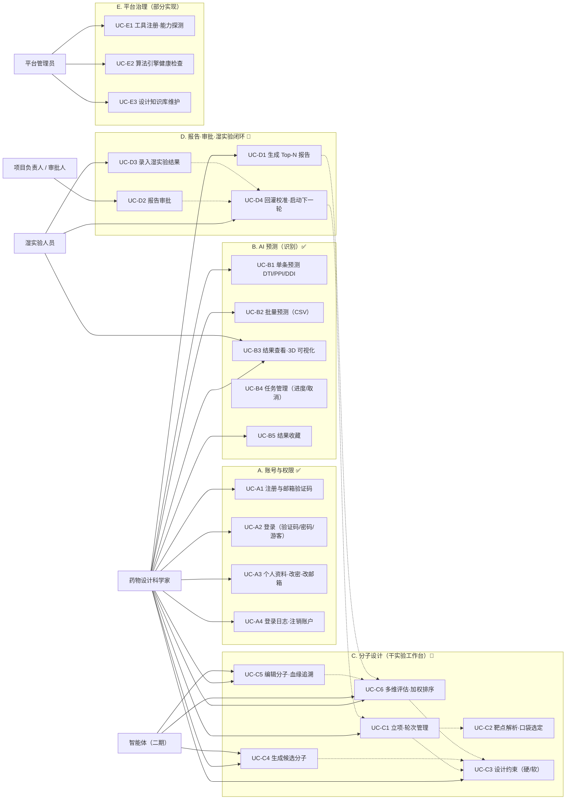
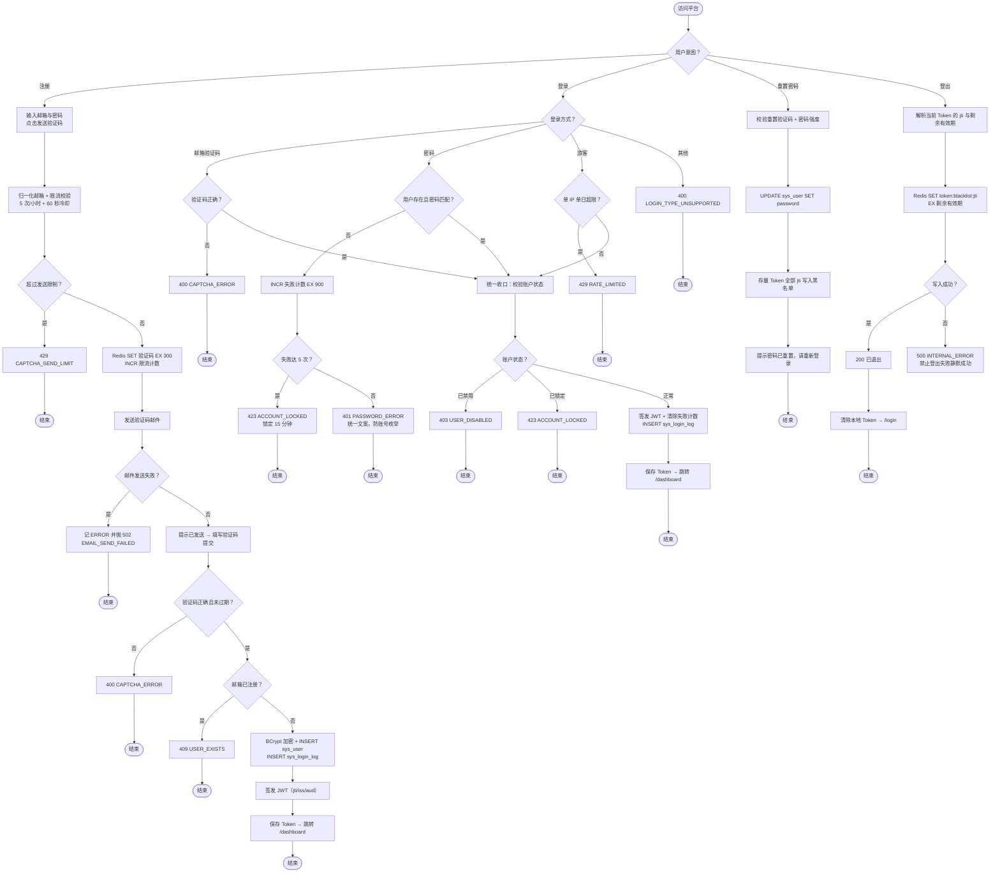
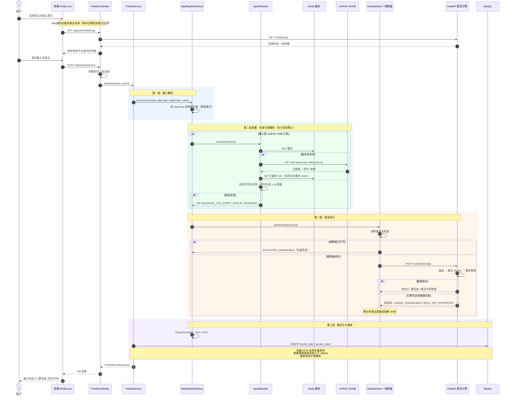
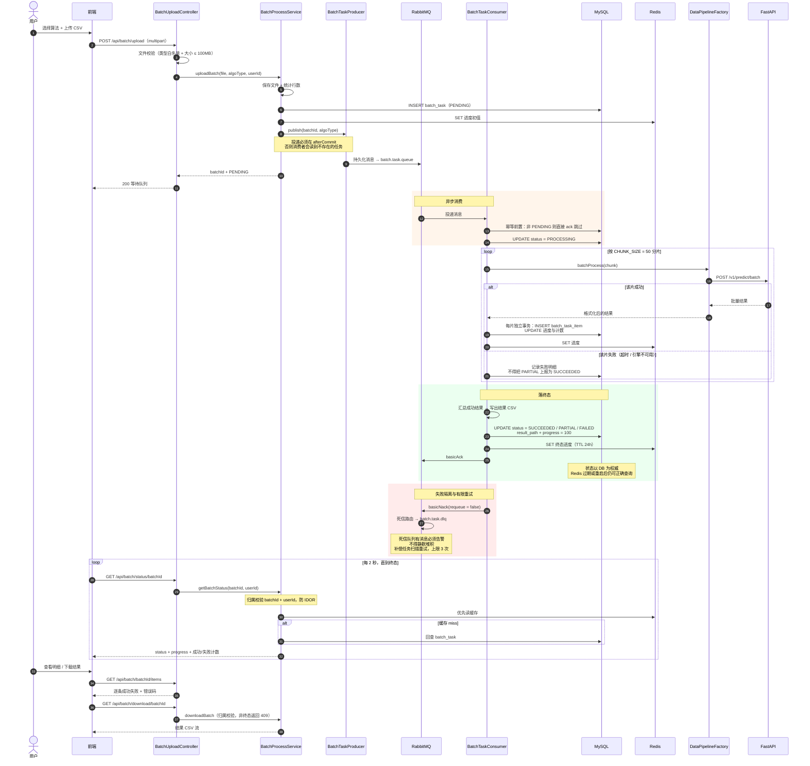
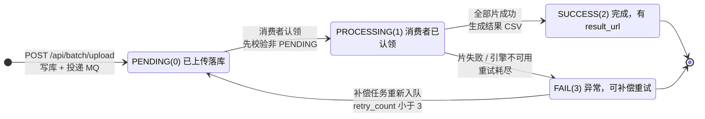
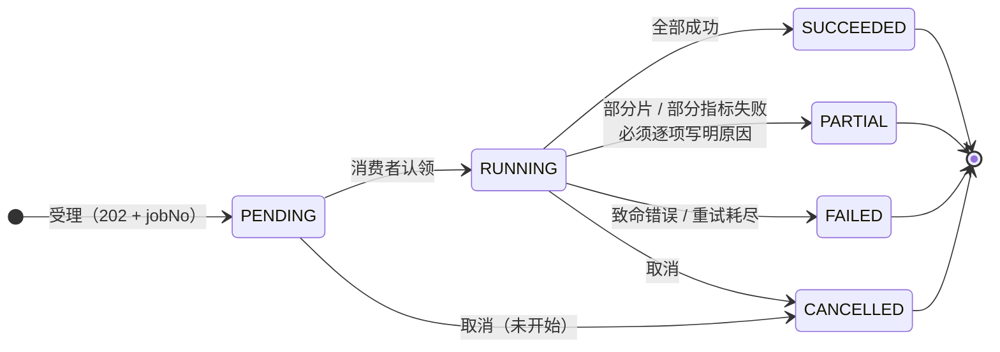
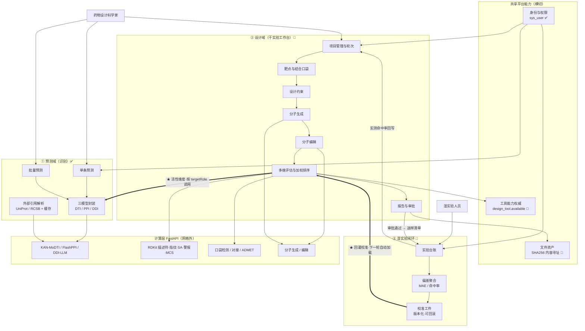
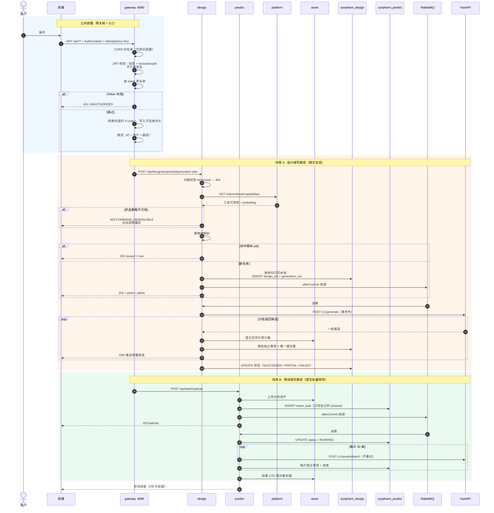

# SynPharm 业务流程 UML（内嵌图，可直接查看）

> 版本：v2.0.0 ｜ 日期：2026-10-14
> **本文件全部使用 Mermaid 内嵌**：在 GitHub、VS Code（内置支持）、Typora 中**直接渲染，无需任何插件**。
> 原 PlantUML 版本已于 2026-10-14 删除（备份见 [`../README.md`](../README.md) §4.2），本文件是唯一维护源。
> 设计域 UML（13 张）见 [`./设计域.md`](./设计域.md)；写作与校验说明见 [`./README.md`](./README.md)。

## 图例

| 标记 | 含义 |
|---|---|
| ✅ | 代码已落地 |
| 📄 | 仅有 DDL / 契约，未实现 |
| 全景 | 跨实现状态 |

---

## 1. 业务全景用例图

覆盖 6 大业务域、28 个用例、5 类角色。**已实现的是「识别」域（账号 + 预测），「设计」域尚未实现。**

**两条要点**

| 要点 | 说明 |
|---|---|
| **一份定义，两处执行** | 约束（C3）同时被**生成**（引导）与**评估**（筛选）复用，避免"生成按一套标准、筛选按另一套" |
| **能力可见性** | 未安装的引擎（Vina / ADMET）必须**点击前置灰并给出原因**，不得"点了才失败" |

---

## 2. 账号与认证业务流程 ✅

四个互斥分支：注册 / 登录（三种方式）/ 重置密码 / 登出。

---

## 3. 单条预测业务流程 ✅

DTI / PPI / DDI 三算法，含**三段管道**（解析器 → 执行器 → 格式化器）、外部引用解析与熔断降级。

---

## 4. 批量预测业务流程 ✅

CSV 上传 → 202 受理 → RabbitMQ → 分片消费 → 进度 → 下载，含失败重试 / 死信 / 重启自愈。

---

## 5. 批量任务状态机

### 5.1 当前实现（`batch_task.status` TINYINT 0~3）

**现状 5 个缺陷**（源自 [`../modules/predict/批量处理技术设计文档.md`](../modules/predict/批量处理技术设计文档.md) §2.2）

| # | 缺陷 | 影响 |
|---|---|---|
| P1 | 表缺 `deleted` 列但 Mapper 有 `AND deleted=0` | `status`/`download` 在 Redis 过期后必报 SQL 错 |
| P2 | 表缺 `algo_type` 列 | 只能依赖 Redis 才知道算法类型 |
| P3 | 状态与进度以 Redis 为准 | 服务重启即丢 |
| P4 | `status`/`download` 不校验归属 | IDOR |
| P5 | 线程池任务重启即丢 | 无持久化 |
| **另** | **缺 `PARTIAL` 态** | 部分片失败时会把"部分成功"上报为成功 |

### 5.2 目标统一字典（与设计域 `design_job` 合并为全域唯一）

**迁移映射**

| 现状 `batch_task` | 目标统一字典 | 说明 |
|---|---|---|
| `PENDING(0)` | `PENDING` | 语义不变 |
| `PROCESSING(1)` | `RUNNING` | 更名，与 `design_job` 一致 |
| `SUCCESS(2)` | `SUCCEEDED` | 更名（**注意不是 `SUCCESS`**） |
| `FAIL(3)` | `FAILED` | 更名 |
| 无 | `PARTIAL` | **新增**：部分成功必须可见 |
| 无 | `CANCELLED` | **新增**：支持取消 |

> DB 由 `TINYINT` 改为 `VARCHAR(24)`，一次性 UPDATE 映射旧值；`batch_task` 与 `design_job` 共用 `synpharm-common` 中的同一套状态常量。

---

## 6. 预测域与设计域的协同关系

**最关键的结论：预测域不是被设计域取代，而是成为设计域的「一个评估器」。**

| 咬合点 | 说明 |
|---|---|
| **★ 活性维度** | 设计域的「活性」指标**不重写模型**，而是复用预测域的三模型，按 `targetRole` 分别调用以支持选择性指数 |
| **★ 回灌校准** | 校准**不直接改模型权重文件**，而是产出**版本化校准工件**（残差 / Isotonic），可回滚、可审计 |
| 拆分视角 | 目标态：AUTH → `synpharm-auth`、ASSET → `synpharm-asset`、TOOL → `synpharm-platform`；设计域应通过 `synpharm-predict` 的接口调用三模型，**而非直连 FastAPI** |

---

## 7. 目标态微服务业务流转

拆分后的两条主写路径，以及网关的统一职责。

**目标态四条关键约束**

| # | 约束 |
|---|---|
| 1 | 网关是**唯一**对外入口，也是**唯一** CORS 与 JWT 校验点 |
| 2 | 服务端口不映射宿主；`/internal/**` 网关不路由（需 `X-Internal-Token`） |
| 3 | 服务各写自己的 schema；跨服务**只读走 Feign、写走事件或 owner 接口** |
| 4 | 计算层在网格外，仅 `/v1/**` + `X-API-Key` |

---

## 8. 贯穿全部流程的 8 条红线

| 红线 | 内容 |
|---|---|
| R1 | **能力与真实性可见**：未部署引擎点击前置灰；部分失败逐项说明 |
| R2 | **能力事实单一权威**：`design_tool.available` 只由探测回写 |
| R3 | **一切计算在 FastAPI**，且 FastAPI 不碰数据库 |
| R4 | **归属校验 fail-closed**，归属不符一律 404 |
| R5 | **事务边界**：事务内只本地写、MQ `afterCommit`、批量独立事务 |
| R6 | **长任务可取消、可观测、可恢复**（DB 为权威，Redis 只是投影） |
| R7 | **幂等**：写操作可重放不产生副作用 |
| R8 | **禁止静默兜底**：看似正常但无意义的算法结果必须记 `success = 0` |

---

## 9. 修订记录

| 版本 | 日期 | 说明 |
|---|---|---|
| v1.0.0 | 2026-10-14 | 首版：7 张 PlantUML 图（已归档） |
| v2.0.0 | 2026-10-14 | **改写为 Mermaid 内嵌**，无需插件即可查看；合并原 `architecture/uml/README.md` 的渲染说明 |
