# SynPharm 设计域 UML（内嵌图，可直接查看）

> 版本：v1.0.0 ｜ 日期：2026-10-14
> **本文件全部使用 Mermaid 内嵌**：GitHub / VS Code / Typora 直接渲染，**无需任何插件**。
> 原 PlantUML 版本（13 张）已由本文件取代并删除，备份见 [`../README.md`](../README.md) §4.2。
> 上游依据：[`../design/detailed/README.md`](../design/detailed/README.md) ｜ 配套：[`./业务流程.md`](./业务流程.md)（全平台业务流程 7 张）

## 目录

| # | 图 | 类型 | 来源 |
|---|---|---|---|
| 1 | [设计域用例图](#1-设计域用例图) | flowchart | `detailed/uml/01-usecase` |
| 2 | [设计域组件与依赖](#2-设计域组件与依赖) | flowchart | `detailed/uml/02-component` |
| 3 | [设计域类模型](#3-设计域类模型) | classDiagram | `detailed/uml/03-class` |
| 4 | [主链路时序](#4-主链路时序立项--生成--编辑--评估--报告--审批) | sequenceDiagram | `detailed/uml/04-sequence-main` |
| 5 | [湿实验反馈闭环时序](#5-湿实验反馈闭环时序) | sequenceDiagram | `detailed/uml/05-sequence-feedback` |
| 6 | [五个状态机](#6-五个状态机) | stateDiagram-v2 ×5 | `detailed/uml/06-state` |
| 7 | [端到端活动图](#7-端到端活动图) | flowchart | `detailed/uml/07-activity` |
| 8 | [数据模型（33 张表）](#8-数据模型33-张表) | erDiagram | `detailed/uml/08-数据模型` |
| 9 | [实现分层与依赖方向](#9-实现分层与依赖方向) | flowchart | `detailed/uml/09-实现分层` |
| 10 | [编辑快车道时序](#10-编辑快车道时序保存即编译) | sequenceDiagram | `detailed/uml/10-编辑快车道时序` |
| 11 | [能力与真实性机制](#11-能力与真实性机制红线-r1--r2) | flowchart | `detailed/uml/11-能力真实性机制` |
| 12 | [校准工件状态机](#12-校准工件状态机) | stateDiagram-v2 | `detailed/uml/12-校准工件状态机` |
| 13 | [校准回灌时序](#13-校准回灌时序) | sequenceDiagram | `detailed/uml/13-校准回灌时序` |

---

## 1. 设计域用例图

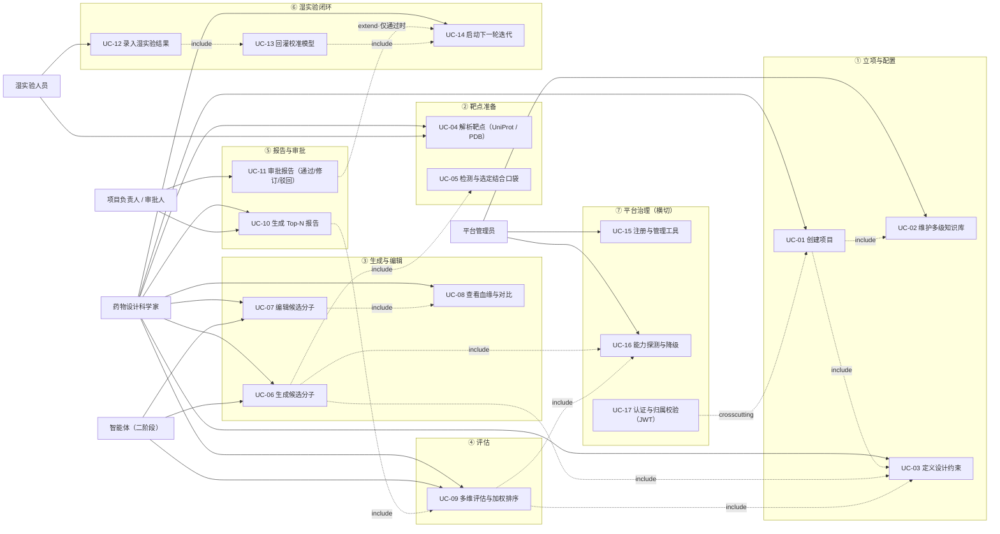

> **能力可见性红线（UC-16）**：未安装的引擎（Vina / ADMET）必须在 UI **置灰并给出原因**，不得"点了才失败"。

---

## 2. 设计域组件与依赖

```mermaid
flowchart TB
  subgraph FE["前端 Vue3"]
    FE_WS["工作台 Shell"]
    FE_LIB["知识库管理"]
    FE_TG["靶点与口袋面板"]
    FE_CS["约束编辑器"]
    FE_GN["生成器面板"]
    FE_ED["分子编辑器 + 2D 画布"]
    FE_EV["评估与排行榜"]
    FE_RP["报告与审批"]
    FE_LB["湿实验台账"]
    FE_CM["命令面板（Ctrl+K）"]
    FE_SSE["SSE 客户端（增量推送）"]
  end

  subgraph BE["业务层 SpringBoot（synpharm-backend）"]
    subgraph API["API 层"]
      C_PRJ["ProjectController"]
      C_LIB["LibraryController"]
      C_TGT["TargetController"]
      C_CST["ConstraintController"]
      C_GEN["GenerationController"]
      C_EDT["MoleculeEditController"]
      C_EVA["EvaluationController"]
      C_JOB["JobController"]
      C_RPT["ReportController"]
      C_EXP["ExperimentController"]
      C_TOL["ToolController"]
      C_WKS["WorkspaceController"]
      C_CMD["CommandController"]
      C_FIL["FileController"]
    end
    subgraph SVC["Service 层（编排 + 事务边界）"]
      S_PRJ["ProjectService"]
      S_RND["RoundService"]
      S_LIB["LibraryService"]
      S_TGT["TargetService"]
      S_CST["ConstraintService"]
      S_GEN["GenerationService"]
      S_EDT["MoleculeEditService"]
      S_EVA["EvaluationService"]
      S_SCR["ScoringService"]
      S_JOB["JobService"]
      S_RPT["ReportService"]
      S_EXP["ExperimentService"]
      S_TOL["ToolRegistry"]
      S_FIL["FileAssetService"]
      S_CMD["CommandRegistry（唯一写入口）"]
    end
    R_REPO["Repository 层（MyBatis-Plus）"]
    subgraph XC["横切"]
      X_JWT["JwtAuthenticationFilter"]
      X_ERR["GlobalExceptionHandler"]
      X_OWN["assertOwnership（fail-closed）"]
      X_AUD["MetaObjectHandler"]
    end
    subgraph MSG["消息与任务"]
      MQ_P["TaskProducer"]
      MQ_C["DesignTaskConsumer"]
    end
  end

  subgraph FA["计算层 FastAPI（synpharm-fastapi）"]
    FA_R["Router /v1/**"]
    FA_KEY["X-API-Key 服务间鉴权"]
    FA_RD["RDKit 引擎"]
    FA_GEN["分子生成引擎"]
    FA_PKT["结构与口袋引擎"]
    FA_DOC["对接引擎（Vina / smina）"]
    FA_ADM["ADMET 引擎"]
    FA_DTI["KAN-MoDTI"]
    FA_PPI["FlashPPI"]
    FA_DDI["DDI-LLM"]
    FA_CAP["Capabilities 能力矩阵"]
    FA_AGT["Agent 运行时（二阶段）"]
  end

  subgraph INF["数据与基础设施"]
    DB[("MySQL 8")]
    REDIS[("Redis")]
    MQ[("RabbitMQ")]
    S3["对象存储（S3 兼容）"]
  end

  subgraph EXT["外部数据源"]
    EXT_UP["UniProt REST"]
    EXT_PDB["RCSB PDB"]
    EXT_AF["AlphaFold DB"]
    EXT_PM["PubMed"]
  end

  FE_WS --> C_PRJ & C_WKS
  FE_LIB --> C_LIB
  FE_TG --> C_TGT
  FE_CS --> C_CST
  FE_GN --> C_GEN
  FE_ED --> C_EDT
  FE_EV --> C_EVA
  FE_RP --> C_RPT
  FE_LB --> C_EXP
  FE_CM --> C_CMD
  FE_SSE --> C_WKS

  C_PRJ --> S_PRJ & S_RND
  C_LIB --> S_LIB
  C_TGT --> S_TGT
  C_CST --> S_CST
  C_GEN --> S_GEN
  C_EDT --> S_EDT
  C_EVA --> S_EVA
  C_JOB --> S_JOB
  C_RPT --> S_RPT
  C_EXP --> S_EXP
  C_TOL --> S_TOL
  C_FIL --> S_FIL
  C_WKS --> S_CMD
  C_CMD --> S_CMD

  S_PRJ --> S_RND
  S_SCR --> S_EVA
  S_RPT --> S_EVA
  S_RPT --> S_EXP
  S_CMD --> S_GEN & S_EDT & S_EVA & S_RPT
  S_CMD --> S_TOL
  S_GEN --> S_JOB
  S_GEN --> S_CST
  S_EVA --> S_JOB
  S_EVA --> S_SCR
  S_RPT --> S_JOB

  S_PRJ & S_LIB & S_TGT & S_CST & S_GEN & S_EDT & S_EVA & S_JOB & S_RPT & S_EXP & S_TOL & S_FIL --> R_REPO
  R_REPO --> DB
  S_JOB --> REDIS
  S_GEN --> MQ_P
  S_EVA --> MQ_P
  S_RPT --> MQ_P
  MQ_P --> MQ
  MQ --> MQ_C
  MQ_C --> S_GEN & S_EVA & S_RPT
  S_FIL --> S3
  S_TGT --> S3

  S_GEN --> FA_KEY
  S_EDT --> FA_KEY
  S_EVA --> FA_KEY
  S_TGT --> FA_KEY
  S_TOL --> FA_CAP
  FA_KEY --> FA_R
  FA_R --> FA_RD & FA_GEN & FA_PKT & FA_DOC & FA_ADM & FA_DTI & FA_PPI & FA_DDI
  FA_AGT --> FA_R

  S_TGT --> EXT_UP & EXT_PDB & EXT_AF
  FA_PKT --> EXT_AF
  FA_AGT --> EXT_PM
  X_JWT -.-> C_PRJ
  X_OWN -.-> S_PRJ
  X_AUD -.-> R_REPO
```

> **架构铁律**：对外 REST 全部在 SpringBoot（`/api/**`）；FastAPI 只提供 `/v1/**` 服务间接口。
> **一切计算**（含 Diff 用的 MCS、描述符）不得落在浏览器。

---

## 3. 设计域类模型

```mermaid
classDiagram
  direction LR

  class DesignProject {
    <<聚合根>>
    +Long id
    +String projectNo
    +Long userId
    +String name
    +String goalText
    +Long diseaseId
    +Long modalityId
    +ProjectStatus status
    +Long activeConstraintSetId
    +Long currentRoundId
    +Date startedAt
    +Date closedAt
    +canTransferTo(ProjectStatus) boolean
  }
  class DesignLibraryItem {
    +Long id
    +LibraryCategory category
    +String code
    +String name
    +Long parentId
    +int levelNo
    +String path
    +boolean enabled
    +boolean builtin
    +subtree() List~DesignLibraryItem~
  }
  class DesignRound {
    +Long id
    +Long projectId
    +int roundNo
    +String strategyNote
    +RoundStatus status
    +String conclusionText
    +Date openedAt
    +Date closedAt
  }
  class ProjectTarget {
    +Long id
    +Long projectId
    +Long targetId
    +boolean isPrimary
    +TargetRole role
    +int sortNo
  }
  class ConstraintSet {
    <<聚合根>>
    +Long id
    +String setNo
    +Long userId
    +String name
    +ConstraintSetStatus status
    +int version
    +Long parentId
    +snapshot() JsonNode
  }
  class ConstraintRule {
    +Long id
    +Long setId
    +String groupKey
    +String ruleType
    +Severity severity
    +String dimension
    +String operator
    +BigDecimal thresholdNum
    +BigDecimal thresholdMax
    +int weight
    +String humanReadable
  }
  class Target {
    <<聚合根>>
    +Long id
    +String uniprotId
    +String name
    +String geneName
    +String sequence
    +int sequenceLength
    +String status
  }
  class TargetStructure {
    +Long id
    +Long targetId
    +String pdbId
    +String source
    +String chainId
    +Long fileAssetId
    +boolean isPreferred
  }
  class BindingPocket {
    +Long id
    +Long structureId
    +int pocketNo
    +String method
    +BigDecimal druggability
    +BigDecimal centerX
    +BigDecimal centerY
    +BigDecimal centerZ
    +boolean isSelected
  }
  class GenerationRun {
    +Long id
    +String runNo
    +Long projectId
    +Long roundId
    +Long jobId
    +String strategies
    +int targetCount
    +int finalCount
    +String status
    +BigDecimal progress
  }
  class CandidateMolecule {
    <<聚合根>>
    +Long id
    +Long projectId
    +Long roundId
    +Long originRunId
    +String modalityCode
    +String smiles
    +String inchikey
    +String sequence
    +String sequenceHash
    +OriginType originType
    +Long parentMolId
    +ReviewStatus reviewStatus
    +BigDecimal totalScore
    +lineageUp() List~CandidateMolecule~
    +lineageDown() List~CandidateMolecule~
    +root() CandidateMolecule
  }
  class MoleculeEditLog {
    <<追加日志>>
    +Long id
    +Long projectId
    +Long roundId
    +Long parentMolId
    +Long childMolId
    +String strategyCode
    +String editType
    +String targetRegion
    +String parentSmiles
    +String childSmiles
    +OperatorType operatorType
    +Long operatorId
  }
  class MetricDefinition {
    <<字典>>
    +Long id
    +String metricCode
    +String dimension
    +String category
    +ValueType valueType
    +String unit
    +Better better
    +BigDecimal minValue
    +BigDecimal maxValue
    +BigDecimal weight
    +boolean enabled
  }
  class EvaluationRun {
    <<聚合根>>
    +Long id
    +String runNo
    +Long projectId
    +Long roundId
    +Long jobId
    +String scope
    +JsonNode metricWeights
    +String status
    +BigDecimal progress
  }
  class EvaluationResult {
    <<追加明细>>
    +Long id
    +Long runId
    +Long projectId
    +Long moleculeId
    +String metricCode
    +BigDecimal valueNum
    +String valueText
    +Boolean passed
    +BigDecimal normalized
    +String grade
    +RiskLevel riskLevel
    +Realness realness
    +Long sourceToolId
    +boolean success
    +String errorMsg
  }
  class ScoringService {
    <<service>>
    +score(EvaluationRun) Map~Long,BigDecimal~
    -normalize(EvaluationResult) BigDecimal
    -redistributeWeights(Set~String~) Map~String,BigDecimal~
    +rank(Long, String) List~CandidateScore~
  }
  class DesignJob {
    <<统一任务>>
    +Long id
    +String jobNo
    +JobType jobType
    +Long projectId
    +Long roundId
    +Long userId
    +Long toolId
    +Long bizId
    +JobStatus status
    +BigDecimal progress
    +int totalCount
    +int doneCount
    +String idempotentKey
    +String errorCode
    +String errorMsg
    +Date startedAt
    +Date completedAt
    +isTerminal() boolean
  }
  class DesignReport {
    <<报告审批>>
    +Long id
    +String reportNo
    +Long projectId
    +Long roundId
    +Long evaluationRunId
    +int topN
    +String bodyMd
    +Decision decision
    +Long decisionBy
    +Date decisionAt
    +String decisionNote
    +Long revisionOf
    +int versionNo
    +approve(Long, String) void
    +requestRevision(Long, String) void
    +reject(Long, String) void
  }
  class WetExperiment {
    <<湿实验>>
    +Long id
    +String experimentNo
    +Long projectId
    +Long roundId
    +Long candidateId
    +Long reportId
    +String assayType
    +String targetRole
    +ExperimentStatus resultStatus
    +BigDecimal resultNum
    +String unit
    +Boolean isHit
    +BigDecimal predictedValue
    +BigDecimal errorDelta
    +boolean feedbackToModel
    +String feedbackBatch
    +computeDelta() BigDecimal
  }
  class DesignTool {
    <<能力权威>>
    +Long id
    +String toolCode
    +String name
    +ToolCategory category
    +String type
    +String provider
    +String endpoint
    +boolean asyncExecution
    +String requiresEngine
    +String capabilityKey
    +boolean enabled
    +boolean available
    +Realness realness
    +boolean agentExposed
    +probe() boolean
  }
  class FileAsset {
    <<内容寻址>>
    +Long id
    +String sha256
    +String fileName
    +String contentType
    +long sizeBytes
    +String storageUri
    +int refCount
    +dedupe(byte[]) FileAsset
  }

  class ProjectStatus {
    <<enumeration>>
    DRAFT
    READY
    ACTIVE
    COMPLETED
    CANCELLED
    ARCHIVED
  }
  class RoundStatus {
    <<enumeration>>
    PLANNED
    GENERATING
    EDITING
    EVALUATING
    REVIEWING
    CLOSED
  }
  class JobStatus {
    <<enumeration>>
    PENDING
    RUNNING
    SUCCEEDED
    PARTIAL
    FAILED
    CANCELLED
  }
  class ReviewStatus {
    <<enumeration>>
    NEW
    QUALIFIED
    REJECTED
    TOP
    SELECTED
  }
  class Decision {
    <<enumeration>>
    PENDING
    APPROVED
    REVISE
    REJECTED
  }
  class EditStrategy {
    <<enumeration>>
    SIDE_CHAIN
    SCAFFOLD_HOP
    MUTATION
    LINKER
    INTERFACE_REDESIGN
    HUMANIZATION
    GLYCO_OPT
  }
  class EvalDimension {
    <<enumeration>>
    AFFINITY
    STABILITY
    EXPRESSION
    ADMET
    SYNTHESIZABILITY
    DEVELOPABILITY
    SELECTIVITY
    IMMUNOGENICITY
  }
  class Realness {
    <<enumeration>>
    REAL
    SEMI_REAL
    HEURISTIC
    SIMULATED
  }
  class RiskLevel {
    <<enumeration>>
    LOW
    MEDIUM
    HIGH
    CRITICAL
  }

  class ProjectService
  class RoundService
  class ConstraintService
  class GenerationService
  class MoleculeEditService
  class EvaluationService
  class JobService
  class ReportService
  class ExperimentService
  class ToolRegistryService
  class CommandRegistry

  DesignProject "1" *-- "0..*" DesignRound : 含轮次
  DesignProject "1" *-- "0..*" ProjectTarget : 绑定靶点
  DesignProject --> DesignLibraryItem : diseaseId
  DesignProject --> DesignLibraryItem : modalityId
  DesignProject "0..1" o-- "0..1" ConstraintSet : activeConstraintSetId
  ConstraintSet "1" *-- "0..*" ConstraintRule : 含规则
  ConstraintSet "0..1" --> "0..1" ConstraintSet : parentId版本
  ProjectTarget --> Target
  Target "1" *-- "0..*" TargetStructure
  TargetStructure "1" *-- "0..*" BindingPocket
  TargetStructure --> FileAsset : fileAssetId
  DesignRound "1" *-- "0..*" GenerationRun
  ConstraintSet "1" --> "0..*" GenerationRun : 约束来源
  GenerationRun "0..1" --> "0..*" CandidateMolecule : 产出
  DesignRound "1" *-- "0..*" EvaluationRun
  EvaluationRun "1" *-- "0..*" EvaluationResult
  MetricDefinition "1" --> "0..*" EvaluationResult : 定义指标
  CandidateMolecule "0..1" --> "0..*" CandidateMolecule : parentMolId版本链
  CandidateMolecule "1" --> "0..*" MoleculeEditLog : 被编辑父
  CandidateMolecule "1" --> "0..*" MoleculeEditLog : 产物子
  CandidateMolecule --> DesignLibraryItem : modalityCode
  DesignProject --> ProjectStatus
  DesignRound --> RoundStatus
  DesignJob --> JobStatus
  CandidateMolecule --> ReviewStatus
  DesignReport --> Decision
  DesignReport "1" --> "0..*" WetExperiment : report_id
```

---

## 4. 主链路时序（立项 → 生成 → 编辑 → 评估 → 报告 → 审批）

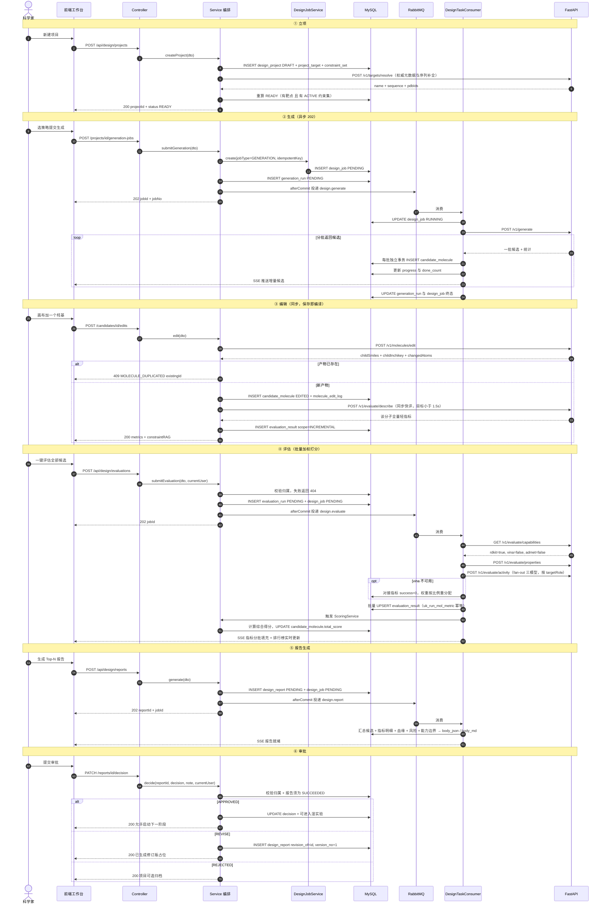

---

## 5. 湿实验反馈闭环时序

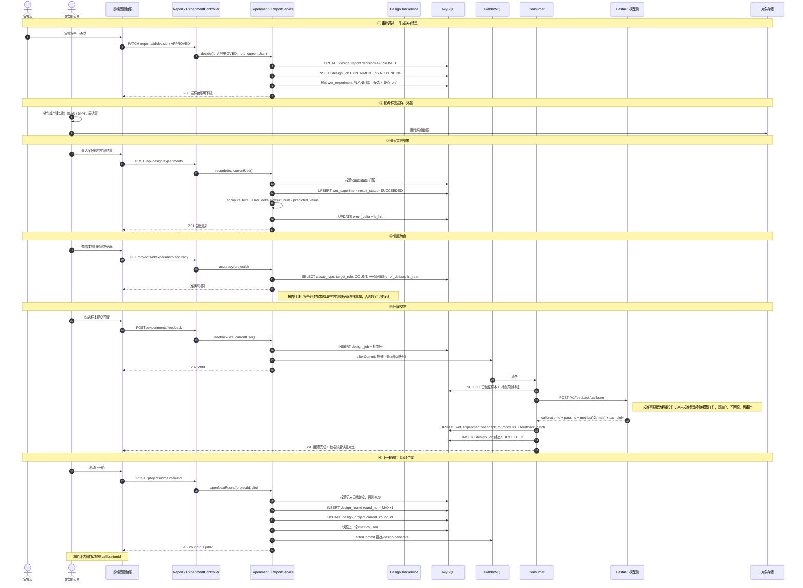

---

## 6. 五个状态机

### 6.1 项目 `design_project`

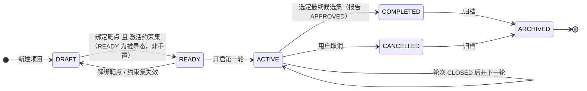

### 6.2 轮次 `design_round`

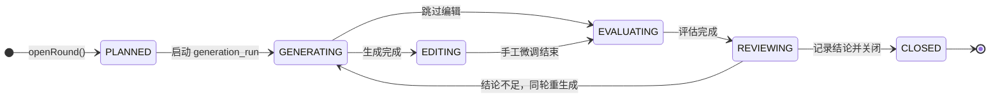

### 6.3 统一任务 `design_job`

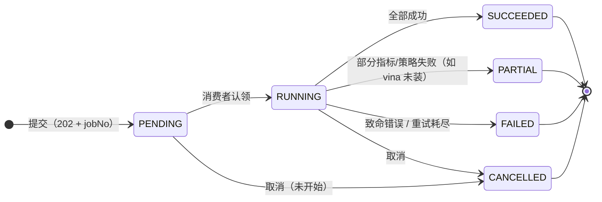

> **枚举映射**：需求 `jobs.status` 为 `pending/running/succeeded/failed/cancelled`；本设计为 **6 态**，在上表基础上**新增 `PARTIAL`** —— 生成/评估存在"部分成功"（多指标、多策略），强行归入 `SUCCEEDED` 会掩盖能力缺口。同时把既有 `generation_run` / `evaluation_run` 的 `SUCCESS` 统一更名为 `SUCCEEDED`，全域共用一个字典。

### 6.4 候选评审 `candidate_molecule.review_status`

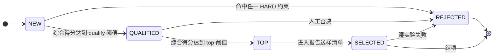

### 6.5 报告审批 `design_report.decision`

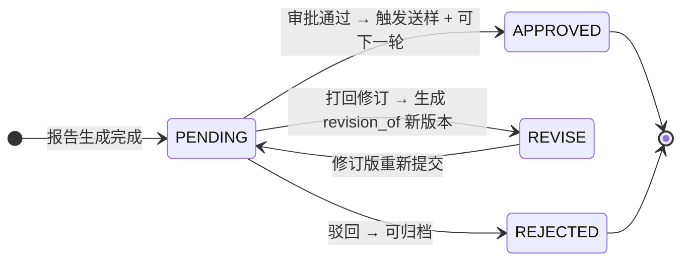

---

## 7. 端到端活动图

> Mermaid 无原生泳道，此处用 `subgraph` 按角色分区表达等价语义。

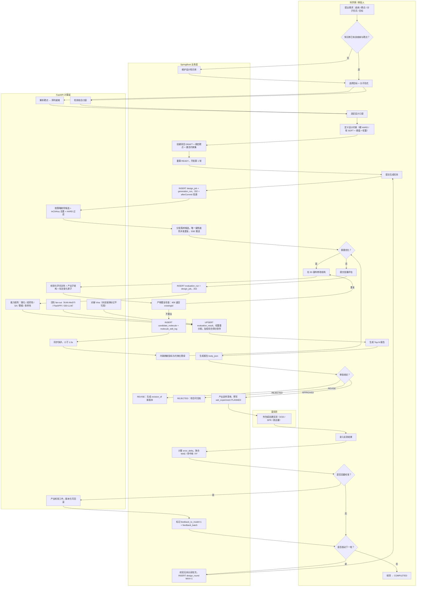

---

## 8. 数据模型（33 张表）

```mermaid
erDiagram
  sys_user ||--o{ design_project : "拥有"
  sys_user ||--o{ constraint_set : "创建"
  sys_user ||--o{ design_tool : "注册"
  sys_user ||--o{ agent_session : "发起"

  design_project ||--o{ project_target : "绑定靶点"
  design_project ||--o{ design_round : "含轮次"
  design_project ||--o{ generation_run : "发起生成"
  design_project ||--o{ candidate_molecule : "拥有候选"
  design_project ||--o{ evaluation_run : "发起评估"
  design_project |o--o| workspace_state : "视图状态"

  target ||--o{ project_target : "被引用"
  target ||--o{ target_structure : "有结构"
  target_structure ||--o{ binding_pocket : "检测出口袋"

  constraint_set ||--o{ constraint_rule : "含规则"
  constraint_set |o--o| design_project : "active_constraint_set_id"

  design_round ||--o{ generation_run : "含生成任务"
  design_round ||--o{ evaluation_run : "含评估任务"
  constraint_set ||--o{ generation_run : "约束来源"
  generation_run |o--o{ candidate_molecule : "origin_run_id"

  candidate_molecule |o--o{ candidate_molecule : "parent_mol_id"
  candidate_molecule ||--o{ molecule_edit_log : "父（被编辑）"
  candidate_molecule ||--o{ molecule_edit_log : "子（产物）"
  candidate_molecule ||--o{ evaluation_result : "被评估"

  metric_definition ||--o{ evaluation_result : "定义指标"
  evaluation_run ||--o{ evaluation_result : "含结果"

  design_job ||--o{ generation_run : "job_id"
  design_job ||--o{ evaluation_run : "job_id"
  design_job ||--o{ design_report : "job_id"
  design_tool ||--o{ evaluation_result : "source_tool_id 快照"
  design_tool ||--o{ design_job : "tool_id"
  file_asset ||--o{ target_structure : "file_asset_id"
  file_asset ||--o{ candidate_molecule : "structure_asset_id"
  file_asset ||--o{ wet_experiment : "data_asset_id"
  design_library_item ||--o{ design_library_item : "parent_id"
  design_library_item |o--o{ design_project : "disease/modality_id"
  design_report ||--o{ wet_experiment : "report_id"
  agent_session ||--o{ design_report : "agent_session_id"

  sys_user {
    bigint id
    varchar email
    varchar nickname
  }
  sys_login_log {
    bigint id
    bigint user_id
    varchar login_type
    tinyint success
  }
  predict_task {
    bigint id
    bigint user_id
    varchar algo_type
    tinyint status
  }
  predict_result {
    bigint id
    bigint task_id
    varchar algo_type
  }
  user_favorite {
    bigint id
    bigint user_id
    bigint task_id
  }
  batch_task {
    varchar batch_id
    bigint user_id
    tinyint status
  }
  batch_task_item {
    bigint id
    varchar batch_id
    tinyint status
  }
  ddi_supported_drug {
    bigint id
    varchar drug_key
  }

  design_project {
    bigint id
    varchar project_no
    bigint user_id
    varchar status
    bigint active_constraint_set_id
    bigint disease_id
    bigint modality_id
    bigint current_round_id
  }
  project_target {
    bigint project_id
    bigint target_id
    tinyint is_primary
    varchar role
    bigint primary_project_id
  }
  design_round {
    bigint project_id
    int round_no
    varchar status
  }
  target {
    varchar uniprot_id
    text sequence
    varchar status
  }
  target_structure {
    bigint target_id
    varchar source
    varchar source_key
    bigint file_asset_id
  }
  binding_pocket {
    bigint structure_id
    int pocket_no
    tinyint is_selected
    bigint selected_structure_id
  }
  constraint_set {
    varchar set_no
    bigint user_id
    varchar status
    int version
    bigint parent_id
  }
  constraint_rule {
    bigint set_id
    varchar rule_type
    varchar severity
    json params_json
    varchar dimension
    varchar operator
  }
  generation_run {
    bigint project_id
    bigint round_id
    varchar strategies
    varchar status
    bigint job_id
  }
  candidate_molecule {
    bigint project_id
    varchar smiles
    varchar inchikey
    varchar sequence_hash
    varchar modality_code
    bigint parent_mol_id
    decimal total_score
  }
  molecule_edit_log {
    bigint parent_mol_id
    bigint child_mol_id
    varchar strategy_code
    varchar operator_type
  }
  metric_definition {
    varchar metric_code
    varchar dimension
    decimal weight
    json applies_to
  }
  evaluation_run {
    bigint project_id
    bigint round_id
    json metric_weights
    varchar status
    bigint job_id
  }
  evaluation_result {
    bigint run_id
    bigint molecule_id
    varchar metric_code
    tinyint success
    varchar realness
    bigint source_tool_id
  }
  workspace_state {
    bigint user_id
    bigint project_id
    json panel_layout_json
  }
  agent_session {
    bigint user_id
    varchar status
  }
  agent_step {
    bigint session_id
    int seq_no
  }
  agent_report {
    bigint session_id
    text body_md
  }
  tool_invocation_log {
    bigint session_id
    bigint step_id
    varchar tool_code
  }
  design_library_item {
    varchar category
    varchar code
    varchar path
    json meta_json
  }
  file_asset {
    char sha256
    varchar object_key
    varchar storage_uri
    int ref_count
  }
  design_tool {
    varchar tool_code
    varchar endpoint
    varchar realness
    tinyint available
    varchar probe_msg
  }
  design_job {
    varchar job_no
    varchar job_type
    varchar status
    varchar idempotent_key
    varchar biz_type
    bigint biz_id
  }
  design_report {
    varchar report_no
    json body_json
    text capability_note
    varchar decision
    bigint revision_of
  }
  wet_experiment {
    varchar experiment_no
    varchar assay_type
    decimal error_delta
    varchar calibration_id
  }
```

**DDD 角色**

| 角色 | 表 |
|---|---|
| 聚合根 | `design_project`、`target`、`constraint_set`、`generation_run`、`candidate_molecule`、`evaluation_run`、`design_job`、`agent_session` |
| 聚合内 | `project_target`、`design_round`、`target_structure`、`binding_pocket`、`constraint_rule` |
| 追加日志 / 明细 | `molecule_edit_log`、`evaluation_result`、`agent_step`、`tool_invocation_log` |
| 字典 | `metric_definition`、`design_library_item`（自引用树） |
| 基础设施型 | `file_asset`（内容寻址）、`design_tool`（能力权威）、`workspace_state` |
| 业务单据 | `design_report`（报告审批）、`wet_experiment`（湿实验） |
**分组与编号**

| 分组 | 数量 | 表 | DDL 编号 |
|---|---|---|---|
| 平台复用（既有） | 8 | `sys_user`、`sys_login_log`、`predict_task`、`predict_result`、`user_favorite`、`batch_task`、`batch_task_item`、`ddi_supported_drug` | `01_`~`10_` |
| 设计域 | 15 | `design_project`、`project_target`、`design_round`、`target`、`target_structure`、`binding_pocket`、`constraint_set`、`constraint_rule`、`generation_run`、`candidate_molecule`、`molecule_edit_log`、`metric_definition`、`evaluation_run`、`evaluation_result`、`workspace_state` | `11_`~`25_` |
| 智能体（二阶段） | 4 | `agent_session`、`agent_step`、`agent_report`、`tool_invocation_log` | `26_`~`29_` |
| 本次新增 | 6 | `design_library_item`、`file_asset`、`design_tool`、`design_job`、`design_report`、`wet_experiment` | `30_`~`35_` |

**关键约束**

| 约束 | 说明 |
|---|---|
| **双轨去重键** | `uk_project_inchikey(project_id, inchikey)` 管小分子；`uk_project_sequence(project_id, sequence_hash)` 管大分子。两套键互不干扰 |
| **能力权威** | `design_tool.available` 只能由 probe 回写（红线 R1/R2）；`realness` 四层：`REAL`/`SEMI_REAL`/`HEURISTIC`/`SIMULATED` |
| **延迟外键** | `36_design_domain_revision.sql` 中补建。**拆分后**：同 schema 保留 4 条（`fk_dp_constraint_set`、`fk_pt_target`、`fk_gen_job`、`fk_ev_job`）；跨 schema 的 3 条（`fk_struct_asset`、`fk_cand_structure`、`fk_er_tool`）**永久不建**，改普通列 + 应用层校验 |

---

## 9. 实现分层与依赖方向

```mermaid
flowchart TB
  subgraph API["① api（接口层）"]
    PC["ProjectController"]
    RC["RoundController"]
    TC["TargetController"]
    CC["ConstraintController"]
    GC["GenerationController"]
    CandC["CandidateController"]
    EC["EditController"]
    EvC["EvaluationController"]
    JC["JobController（含 SSE）"]
    RepC["ReportController"]
    ExpC["ExperimentController"]
    ToolC["ToolController"]
    WC["WorkspaceController"]
    FC["FileController"]
  end
  subgraph SUP["support（横切）"]
    DEC["DesignErrorCode"]
    OG["OwnershipGuard（fail-closed → 404）"]
    IDEM["IdempotencyService"]
    ASM["DesignAssembler"]
  end
  subgraph APP["② application（应用层 · 事务边界只在这里）"]
    PAS["ProjectAppService"]
    RAS["RoundAppService"]
    TAS["TargetAppService"]
    CAS["ConstraintAppService"]
    GAS["GenerationAppService"]
    CandAS["CandidateAppService"]
    EAS["EditAppService"]
    EAS2["EvaluationAppService"]
    RepAS["ReportAppService"]
    ExpAS["ExperimentAppService"]
    JAS["JobAppService"]
    WAS["WorkspaceAppService"]
    FAS["FileAppService"]
  end
  subgraph DOM["③ domain（领域层 · 纯逻辑，无 IO）"]
    DM["model 实体与值对象"]
    DREPO["repo 仓储接口"]
    DCONS["constraint 约束求值"]
    DSCORE["scoring 得分与权重重分配"]
    DLINE["lineage 血缘与成环检测"]
    DCAP["capability 能力与真实性规则"]
  end
  subgraph INF["④ infrastructure（基础设施）"]
    IPERS["persistence Mapper + XML"]
    ICLI["client FastApiDesignClient + ToolAdapter"]
    IMQ2["mq Producer + Consumer"]
    ICACHE["cache Redis"]
    ISTORE["storage ObjectStorage（S3 / LOCAL）"]
    IPROBE["probe ToolRegistryService"]
  end
  FE2["前端 /design"]
  FA2["FastAPI 算法引擎"]
  DB2[("MySQL 8")]
  MQ3[("RabbitMQ")]
  RD3[("Redis")]
  S32["对象存储"]

  FE2 --> PC
  FE2 --> JC
  PC --> PAS
  RC --> RAS
  TC --> TAS
  CC --> CAS
  GC --> GAS
  CandC --> CandAS
  EC --> EAS
  EvC --> EAS2
  RepC --> RepAS
  ExpC --> ExpAS
  JC --> JAS
  ToolC --> IPROBE
  WC --> WAS
  FC --> FAS
  PC -.-> OG

  PAS --> DM
  PAS --> DREPO
  EAS --> DCONS
  EAS2 --> DSCORE
  CandAS --> DLINE
  EAS2 --> DCAP
  GAS --> DREPO
  RepAS --> DCAP

  IPERS -.->|实现| DREPO
  IPERS --> DB2
  ICLI --> FA2
  IMQ2 --> MQ3
  ICACHE --> RD3
  ISTORE --> S32
  IPROBE --> ICLI
  IPROBE --> IPERS
  GAS --> IMQ2
  EAS2 --> IMQ2
  RepAS --> IMQ2
  ExpAS --> IMQ2
  FAS --> ISTORE
```

**依赖方向铁律**：`api → application → domain ← infrastructure`

**禁止事项**

| # | 禁止 |
|---|---|
| 1 | `api` 层写业务判断 / 开事务 / 调 Mapper |
| 2 | `domain` 层做任何 IO |
| 3 | 在事务内做跨服务 HTTP（历史问题 D-05） |
| 4 | MQ 投递不在 `afterCommit`（红线 R5） |

---

## 10. 编辑快车道时序（保存即编译）

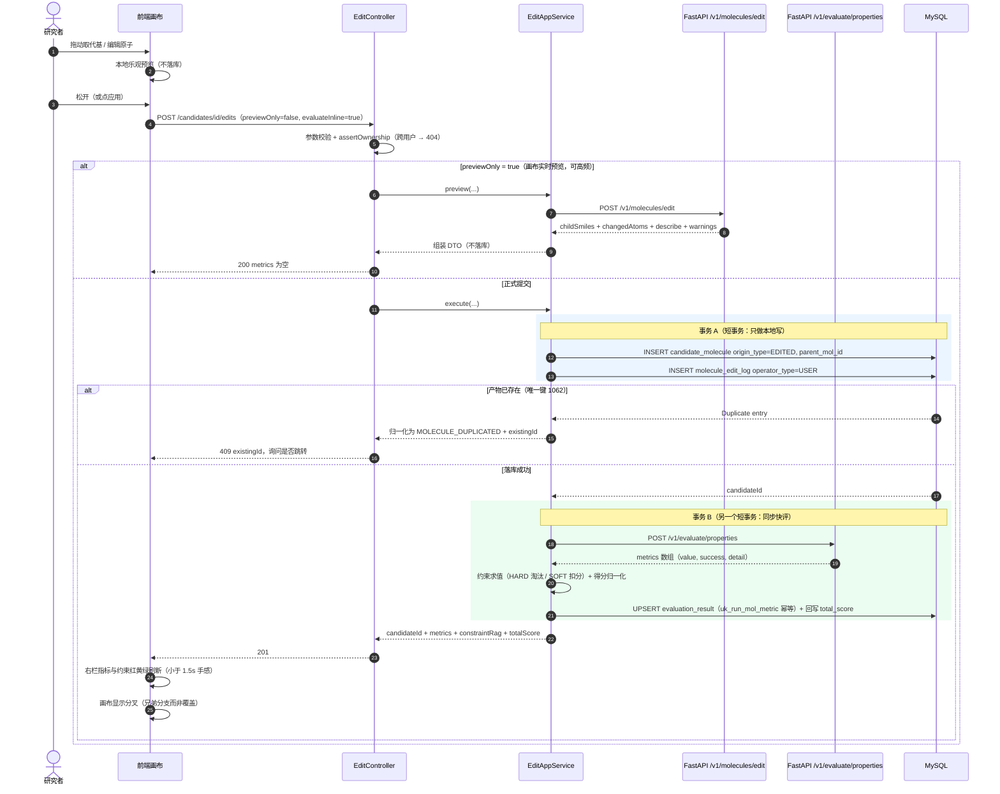

> **为什么拆两个事务**：事务 A 只写本地（毫秒级、锁范围小）；事务 B 含一次外部 HTTP（快评），若与 A 同事务，会在 HTTP 期间持有行锁（历史问题 D-05 的反模式）。
> **静默兜底识别（红线 R2）**：引擎返回"看似正常但无意义"的值（如置信度恒 0.5）必须记 `success=0`，不计入排序。
> 若 `evaluateInline=false`：事务 B 改投 MQ（牺牲手感换稳定性）。

---

## 11. 能力与真实性机制（红线 R1 / R2）

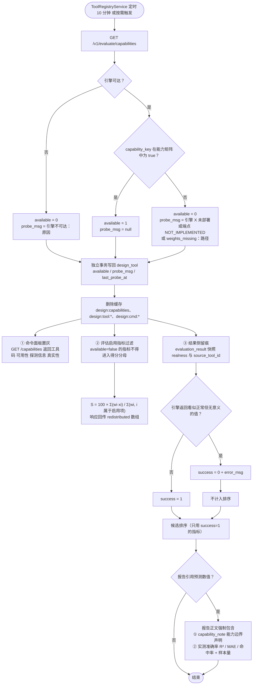

> **`available` 不可伪造**：禁止把 `available` 暴露为可写 API 字段，`POST /tools` 与 `PATCH /tools/{id}` 均**忽略**该字段。
> **静默兜底判定**（历史 C-03：模型崩溃时返回 `[0],[0],[0.5]`）：置信度恒 0.5 / 亲和力恒 0 / `interactions` 恒空 / `algo_type` 与请求不符 / 响应缺必填 metric。
> **报告红线**：样本量为 0 → 写"未验证"；样本量 < 30 → 提示统计置信度有限。

---

## 12. 校准工件状态机

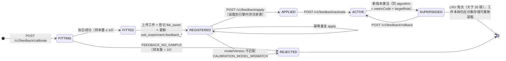

> **工件形态**：manifest（≤ 256 KB，可内联）+ 可选大参数文件（isotonic 断点等）。两者都以 sha256 内容寻址 → 天然去重、防篡改。`calibrationId` 是业务标识（可读、可回滚），`sha256` 是内容标识（去重、校验）。
> **应用索引**：`(algorithm, metricCode, targetRole)`；`targetRole = null` 作为"默认校准"，被具体角色校准覆盖。
> **失败保护**：样本量 < 10 拒绝拟合；无校准时引擎**不加任何修正**，并回传 `calibrationId: null`（不得静默套用旧校准）。

---

## 13. 校准回灌时序

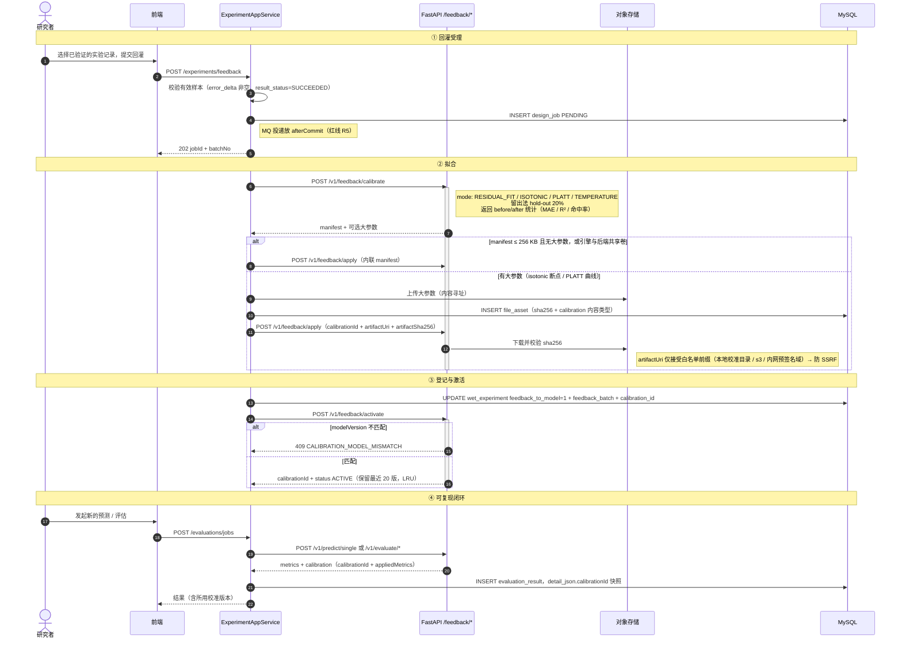

> **三条保证**
> - **可复现**：同一 `(SMILES, target, modelVersion, calibrationId)` → 同一输出
> - **可审计**：报告引用某数值 → 可追到 `(evaluation_run, calibrationId, 引擎版本)`
> - **可回滚**：实测偏差变大 → `POST /v1/feedback/rollback`
>
> **不做的事**：不修改模型权重文件（2.7 GB 二进制、不可审计、不可回滚）。

---

## 14. 修订记录

| 版本 | 日期 | 说明 |
|---|---|---|
| v1.0.0 | 2026-10-14 | 首版：13 张设计域 UML 由 PlantUML 改写为 Mermaid 内嵌，无需插件即可查看 |
